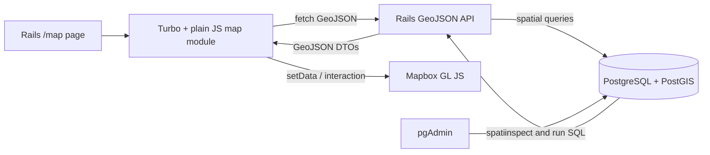

# Rails + PostGIS + Mapbox GL JS Demo Guide

This guide is organized as two progressively richer demonstrations built on the same Rails/PostGIS development environment.

- **Part 1 — Tiny Spatial Demo:** learn Point, LineString, and Polygon fundamentals; spatial querying and GeoJSON boundaries; a Rails + Turbo/plain-JavaScript Mapbox page built with npm, esbuild, Tailwind, and package-managed Mapbox GL JS; pgAdmin; scenario-driven PostGIS exercises; an advanced create/style-on-map task; and a measured performance-tuning lab.
- **Part 2 — Lisbon Wastewater Network:** branch from Part 1, import real Câmara Municipal de Lisboa GIS data through Rails seeds, model points/lines/polygons and directed network topology, visualize domain layers in Mapbox, and trace every upstream collector feeding a selected manhole.

The guide targets:

```text
Ruby 4.0.3
Rails 8.1.4
Active Record 8.1.x
PostgreSQL 18 + PostGIS 3.6
Node.js 24.21.0 LTS + npm
Turbo Rails JS 8.0.23
esbuild 0.28.2
Tailwind CSS 4.3.3
Mapbox GL JS 3.32.0
```

Run terminal commands from the Rails project root unless a section explicitly says otherwise. Because `.docker/docker-compose.yml` interpolates the root `.env` when generating pgAdmin configs, every host-side Compose command in this guide explicitly includes `--env-file .env`.

The development environment has two supported entry points that share the same Rails development Dockerfile. **Docker Compose** defines the complete standalone stack (`web`, `db`, and `pgadmin`), while the **Dev Container** builds the Rails workspace directly from the same `.docker/Dockerfile.dev` and uses Compose only to start the supporting `db` and `pgadmin` services.

The project uses one project-root `.env` file for development configuration. The same file supplies container runtime variables and the values that Docker Compose interpolates into pgAdmin's generated `servers.json` and pgpass configs. Docker Compose service definitions stay under `.docker/`; Dev Containers does not duplicate them or wrap the Compose `web` build. Instead, it joins the stable Compose network created for `db` and `pgadmin`. This avoids coupling the editor workspace to Compose's image-build implementation while keeping one canonical Rails toolchain.

---

# Part 1 — Tiny Spatial Demo

This guide builds a deliberately small spatial application so that the **PostGIS concepts remain visible** instead of being hidden behind application architecture.

You will build the application as a sequence of complete vertical slices. Start with a single `Sensor` Point and finish it end to end: persistence, PostGIS queries, GeoJSON serialization, Rails API, Rails page, Turbo-aware plain-JavaScript/Mapbox rendering, read interactions, and finally create/style interactions. Only after that Point workflow works do you introduce a LineString entity, finish its API and map behavior, then introduce a Polygon entity and its interactions.

The final UI is a normal Rails page using **Turbo Drive plus plain JavaScript map modules**. The tutorial deliberately keeps the older import-map/Stimulus baseline only through Step 34 so you can see the migration boundary, then moves to npm, esbuild, Tailwind, and `mapbox-gl` from `node_modules`. Mapbox only **renders spatial results**. PostGIS decides authoritative spatial relationships; Rails owns the application/API boundary; Turbo owns page navigation lifecycle; the plain JavaScript map module owns Mapbox lifecycle and interaction.

The Part 1 progression is:

```text
Sensor Point end to end
    -> Sensor create/style task
    -> WalkingRoute LineString end to end
    -> ParkArea Polygon end to end
    -> cross-geometry interactions
    -> scenario-driven exercises
    -> measured performance tuning
```

---

### 1. What you are building



The final development stack is:

| Component | Purpose | Host access |
| --- | --- | --- |
| Rails | Server-rendered map page + GeoJSON API | `http://localhost:3000/map` |
| PostgreSQL + PostGIS | Spatial storage and querying | `127.0.0.1:55432` |
| pgAdmin | Database inspection and manual SQL | `http://localhost:5050` |
| Mapbox GL JS | Browser map renderer | Installed from npm and bundled with esbuild |

PostgreSQL deliberately **does not use host port `5432`**. Inside the Docker network it still listens on `5432`; Compose publishes it on host port `55432`.

This guide targets the application/toolchain versions established during setup:

```text
Ruby 4.0.3
Rails 8.1.4
Active Record 8.1.x
Node.js 24.21.0 LTS
Turbo Rails JS 8.0.23
esbuild 0.28.2
Tailwind CSS 4.3.3
Mapbox GL JS 3.32.0
```

Run every terminal command from the Rails project root — the directory containing `Gemfile`.

> The values in `.env` are development defaults for this demo. Keep `.env` out of version control and use a proper secret-management strategy outside local development.

---

## Part 1.1 — Build the development environment with Dev Containers and Docker Compose

The development environment has one architecture and two ways to use it:

```text
                         project source
                              |
                    .docker/Dockerfile.dev
                       /                \
                      /                  \
                     v                    v
          Dev Container build       Compose web build
                     |                    |
                     |                    v
                     |             Compose-only Rails
                     |
                     +--------+-----------+
                              |
                              v
                  tiny_postgis_default network
                       /              \
                      v                v
                PostGIS db          pgAdmin
                (Compose)           (Compose)
```

The **Dev Container workflow is the primary path in this tutorial**. It builds a standalone Rails development container from `.docker/Dockerfile.dev`, mounts the project at `/rails`, loads the root `.env`, and joins the Compose network used by PostgreSQL and pgAdmin.

The **Compose-only workflow** builds its `web` service from that exact same Dockerfile. Both workflows therefore share the Ruby/native-package definition, source tree, runtime `.env`, PostgreSQL data, and pgAdmin service without requiring the Dev Container itself to be a Compose service.

#### Host prerequisites for the Dev Container workflow

Install these on the host before opening the repository in a Dev Container:

- Docker with Docker Compose v2 support.
- Visual Studio Code.
- The **Dev Containers** extension (`ms-vscode-remote.remote-containers`).
- Git.

The Dev Containers extension stays on the host because it is responsible for creating and attaching to the development container. The language, database, frontend, and GIS extensions used while editing the project are declared later in `.devcontainer/devcontainer.json`, so they are installed automatically in the remote development environment.

The official Docker tooling extension is also most useful on the host because that is where the Docker daemon runs. Installing Docker tooling inside the development container is optional and is deliberately not required by this tutorial; exposing the host Docker socket inside the application container would grant that container powerful host-level Docker access and is unnecessary for this demo.

### 2. Add the Rails/PostGIS dependency

PostGIS itself runs in PostgreSQL. Rails needs an adapter so Active Record understands PostGIS spatial column types.

In `Gemfile`, ensure the framework baseline and these dependencies are present:

```ruby
gem "rails", "8.1.4"
gem "activerecord-postgis-adapter", "~> 11.1.0"
gem "rgeo-geojson", "~> 2.2"
gem "importmap-rails"
gem "stimulus-rails"
```

The `11.1.x` adapter series supports Active Record 8.1 and Ruby 3.2+. `rgeo-geojson` is the small RGeo extension used later to encode loaded Point, LineString, and Polygon objects as GeoJSON without duplicating coordinate traversal in controllers. The `importmap-rails` and `stimulus-rails` declarations are the **temporary pre-migration frontend baseline** retained through Step 34. Step 35 removes both and replaces them with Turbo, `jsbundling-rails`, `cssbundling-rails`, npm, esbuild, Tailwind, and the package-installed Mapbox runtime. A normal full-stack Rails 8 application may already contain these baseline gems; do not duplicate declarations.

Rails 8.1.4 includes Active Support compatibility with JSON 3.x, so this revision does **not** pin `json` below version 3. If an older copy of the demo contains:

```ruby
gem "json", "< 3"
```

remove that compatibility pin when upgrading to Rails 8.1.4. Keep the existing `pg` declaration. This project deliberately does not add a `ruby "4.0.3"` directive to the Gemfile: Ruby is already pinned by `.ruby-version` for developer tooling and by the Docker base image for the reproducible runtime. Add a Gemfile `ruby` directive only if you explicitly want Bundler to reject any other Ruby version.

#### Why an adapter is needed

Without the PostGIS adapter, PostgreSQL can still perform spatial SQL, but Active Record will not have the same convenient migration types and RGeo object mapping.

The adapter gives Rails three useful capabilities:

- spatial migration types such as `st_point`,
- spatial indexes through normal Rails migrations,
- conversion of spatial database values into RGeo Ruby objects.

Reference: <https://github.com/rgeo/activerecord-postgis-adapter>

---

### 3. Create the development directories and `.env`

Create the Docker and Dev Container directories:

```bash
mkdir -p .docker .devcontainer
```

> **Replace any earlier demo `.env` contents rather than keeping both naming schemes.** This revision uses `POSTGRES_*` variables consistently and does not use `DB_USERNAME`, `DB_PASSWORD`, or `RUBY_VERSION` from `.env`.

Create a project-root `.env` file:

```dotenv
POSTGRES_HOST=db
POSTGRES_PORT=5432
POSTGRES_USER=postgres
POSTGRES_PASSWORD=postgres
POSTGRES_DB=postgres

PGADMIN_DEFAULT_EMAIL=dev@example.com
PGADMIN_DEFAULT_PASSWORD=dev

MAPBOX_PUBLIC_TOKEN=pk.replace-with-a-public-mapbox-token
```

This is the project's **single development environment file**. It serves two roles: service-level `env_file` entries inject values into containers, while Compose CLI interpolation uses the same values to generate pgAdmin's declarative connection files. Keep Docker/Buildx client switches out of it. The project setup below does not require developers to export host-side Bake compatibility variables before opening the Dev Container.

Create `.env.example` with safe placeholders:

```dotenv
POSTGRES_HOST=db
POSTGRES_PORT=5432
POSTGRES_USER=postgres
POSTGRES_PASSWORD=change-me
POSTGRES_DB=postgres

PGADMIN_DEFAULT_EMAIL=dev@example.com
PGADMIN_DEFAULT_PASSWORD=change-me

MAPBOX_PUBLIC_TOKEN=pk.replace-me
```

Ensure the real `.env` is ignored by Git:

```gitignore
.env
.env.*
!.env.example
```

The environment variable names are deliberately shared between Rails and the PostgreSQL image where possible:

```text
POSTGRES_USER      -> PostgreSQL initialization + Rails database username
POSTGRES_PASSWORD  -> PostgreSQL initialization + Rails database password
POSTGRES_DB        -> PostgreSQL maintenance database
POSTGRES_HOST      -> Rails connection host
POSTGRES_PORT      -> Rails connection port
```

This avoids maintaining duplicate aliases for the same database credential, such as separate Rails-only and PostgreSQL-only password variables.

#### Why Ruby is not configured through `.env`

Ruby is part of the **build-time toolchain**, while the values above are **runtime development configuration**. This guide pins Ruby in `.ruby-version` and `Dockerfile.dev` instead of requiring Compose interpolation before the Dev Container can even be created.

Use this `.ruby-version`:

```text
4.0.3
```

Ruby is intentionally pinned in two places that serve different consumers:

```text
.ruby-version
    -> editor/version-manager/tooling selection

Dockerfile FROM ruby:4.0.3-slim-bookworm
    -> reproducible container runtime
```

Keep those values aligned whenever Ruby changes. A Gemfile `ruby` directive is optional and is not used in this demo because the project already had a two-pin runtime convention.

The relevant project structure becomes:

```text
.
├── .devcontainer/
│   └── devcontainer.json
├── .docker/
│   ├── docker-compose.yml
│   └── Dockerfile.dev
├── app/
├── config/
├── db/
├── public/
├── .env
├── .env.example
├── .dockerignore
├── .ruby-version
├── Gemfile
└── Gemfile.lock
```

#### Bootstrap `Gemfile.lock` before building the application image

For a Rails application, commit `Gemfile.lock` and make image builds depend on it. The development Dockerfile intentionally copies both `Gemfile` and `Gemfile.lock` so normal builds cannot silently resolve a different dependency graph.

If this is a fresh checkout and `Gemfile.lock` does not exist yet, do **not** try to generate it with the Compose `web` service: Compose must build `web` first, while that image itself requires the lockfile. That creates a bootstrap cycle.

Generate the first lockfile with the pinned Ruby base image directly:

```bash
docker run --rm \
  --mount type=bind,source="$PWD",target=/rails \
  --workdir /rails \
  ruby:4.0.3-slim-bookworm \
  bundle lock
```

This writes `Gemfile.lock` into the bind-mounted project directory on the host without requiring the application image to exist first.

Verify it exists:

```bash
test -f Gemfile.lock && echo "Gemfile.lock created"
```

Then build the real development image from the locked dependency graph:

```bash
docker compose \
  --env-file .env \
  -f .docker/docker-compose.yml \
  build web
```

If `Gemfile.lock` was already tracked and was deleted accidentally, restore it from Git instead of generating a new dependency graph:

```bash
git restore Gemfile.lock
```

After deliberate dependency upgrades, update the existing lockfile with Bundler rather than deleting it as a routine step.

---

### 4. Create the shared Rails development Dockerfile

Create `.docker/Dockerfile.dev`:

```dockerfile
FROM node:24.21.0-bookworm-slim AS node_runtime

FROM ruby:4.0.3-slim-bookworm

RUN apt-get update -qq \
    && apt-get install --no-install-recommends -y \
      build-essential \
      ca-certificates \
      curl \
      git \
      libgeos-dev \
      libpq-dev \
      libyaml-dev \
      less \
      pkg-config \
      postgresql-client \
    && rm -rf /var/lib/apt/lists/*

COPY --from=node_runtime /usr/local/bin/node /usr/local/bin/node
COPY --from=node_runtime /usr/local/lib/node_modules /usr/local/lib/node_modules

RUN ln -s /usr/local/lib/node_modules/npm/bin/npm-cli.js /usr/local/bin/npm \
    && ln -s /usr/local/lib/node_modules/npm/bin/npx-cli.js /usr/local/bin/npx

WORKDIR /rails

ENV RAILS_ENV=development \
    BUNDLE_PATH=/usr/local/bundle \
    BUNDLE_APP_CONFIG=/usr/local/bundle

COPY Gemfile Gemfile.lock .ruby-version ./
RUN bundle install

COPY . .

EXPOSE 3000

CMD ["sh", "-c", "rm -f /tmp/rails-server.pid && if [ -f package-lock.json ] && [ -x bin/dev ]; then exec bin/dev; else exec bin/rails server -b 0.0.0.0 -p 3000 -P /tmp/rails-server.pid; fi"]
```

The same Dockerfile is used by both development workflows. Each workflow may produce its own local image, but the Ruby version, Node/npm runtime, native packages, Bundler setup, working directory, and default application command come from one definition. The `CMD` deliberately supports both tutorial phases: before Step 35 there is no `package-lock.json`, so Compose starts Rails directly; after the migration, `package-lock.json` and executable `bin/dev` exist, so Compose starts Rails, esbuild, and Tailwind together through `bin/dev`.

Node is installed **before** the tutorial creates `package.json` because the frontend migration does not happen until Step 35. This avoids a circular setup problem: the development environment already has npm when you reach the migration, but no JavaScript dependency graph is created prematurely.

The Node stage is pinned to the current Node 24 LTS line used by this guide. npm comes from that official Node image. The tutorial intentionally does not install or enable another JavaScript package manager.

`postgresql-client` is installed because the Dev Container should be able to run tools such as `psql` and `pg_isready` directly. `curl` is useful for exercising the Rails API from the development shell. `less` is installed because Git and other CLI tools commonly use it as their pager; without it, commands such as `git branch` can fail with `less: not found` inside the slim image.

Installed gems live under:

```text
/usr/local/bundle
```

Application source lives under:

```text
/rails
```

After Step 35, JavaScript packages live under `/rails/node_modules`, which the development workflows mount on a named Docker volume so Linux-native packages such as esbuild do not have to live in the host bind-mounted source tree.

The separation matters because the project directory will be bind-mounted onto `/rails` while installed gems remain available outside that mount and `node_modules` is isolated on its own nested volume.

---

### 5. Add the root Docker build ignore file

Both development workflows use the **repository root as the Docker build context**:

```text
Compose web build:
  context: ..

Dev Container build:
  context: ..
```

Use a root `.dockerignore` so the same exclusions apply regardless of whether Docker is invoked by Compose or by Dev Containers.

If an older revision of this demo contains:

```text
.docker/Dockerfile.dev.dockerignore
```

remove it after creating the root file. Dockerfile-specific ignore files take precedence over the root `.dockerignore`, so keeping two copies would create unnecessary configuration drift.

Create `.dockerignore` at the repository root:

```text
.git
.bundle
.env
.env.*
log/*
tmp/*
storage/*
vendor/bundle
node_modules
app/assets/builds/*
!app/assets/builds/.keep
coverage
config/master.key
config/credentials/*.key
.DS_Store
```

The root `.env` is intentionally excluded from every image build. Runtime development configuration is supplied when containers start; it is never baked into an image layer.

A root `.dockerignore` is particularly important for the Dockerfile-based Dev Container because Dev Container tooling may use an intermediate Dockerfile during the build. Docker always applies the `.dockerignore` at the build-context root, so secrets and local artifacts remain excluded even when the effective Dockerfile path changes.

---

### 6. Create the canonical Docker Compose stack

Keep the complete standalone service definitions under `.docker/`. This file is the single source of truth for Compose-only development and for the supporting `db`/`pgadmin` services that the Dev Container starts. The Dev Container builds the Rails workspace directly from the same `.docker/Dockerfile.dev`.

> **Replace `.docker/docker-compose.yml` completely with the file below. Do not merge this block into an older Compose file.** Earlier revisions used obsolete `${DB_USERNAME}`, `${DB_PASSWORD}`, `${RUBY_VERSION}`, and `${PGADMIN_*}` names. This revision intentionally uses `${POSTGRES_*}` interpolation only for the generated pgAdmin connection configs.

Create `.docker/docker-compose.yml`:

```yaml
name: tiny_postgis

services:
  web:
    build:
      context: ..
      dockerfile: .docker/Dockerfile.dev

    image: tiny-postgis-web:development

    env_file:
      - ../.env

    ports:
      - "127.0.0.1:3000:3000"

    volumes:
      - ..:/rails
      - node_modules:/rails/node_modules

    depends_on:
      db:
        condition: service_healthy

    stdin_open: true
    tty: true

  db:
    image: postgis/postgis:18-3.6
    platform: linux/amd64

    env_file:
      - ../.env

    ports:
      - "127.0.0.1:55432:5432"

    volumes:
      - postgis_data:/var/lib/postgresql

    healthcheck:
      test:
        - CMD-SHELL
        - pg_isready -h 127.0.0.1 -U $${POSTGRES_USER} -d $${POSTGRES_DB}
      interval: 2s
      timeout: 5s
      retries: 30
      start_period: 10s

  pgadmin:
    image: dpage/pgadmin4:9.18

    env_file:
      - ../.env

    environment:
      PGADMIN_REPLACE_SERVERS_ON_STARTUP: "True"

    ports:
      - "127.0.0.1:5050:80"

    volumes:
      - pgadmin_data:/var/lib/pgadmin

    configs:
      - source: pgadmin_pgpass
        target: /config/pgpass
        uid: "5050"
        gid: "5050"
        mode: 0400
      - source: pgadmin_servers
        target: /pgadmin4/servers.json
        mode: 0444

    depends_on:
      db:
        condition: service_healthy

configs:
  pgadmin_servers:
    content: |
      {
        "Servers": {
          "1": {
            "Name": "Tiny PostGIS",
            "Group": "Development",
            "Host": "${POSTGRES_HOST:?Set POSTGRES_HOST in .env}",
            "Port": ${POSTGRES_PORT:?Set POSTGRES_PORT in .env},
            "MaintenanceDB": "${POSTGRES_DB:?Set POSTGRES_DB in .env}",
            "Username": "${POSTGRES_USER:?Set POSTGRES_USER in .env}",
            "PassFile": "/config/pgpass",
            "SSLMode": "prefer"
          }
        }
      }

  pgadmin_pgpass:
    content: |
      ${POSTGRES_HOST:?Set POSTGRES_HOST in .env}:${POSTGRES_PORT:?Set POSTGRES_PORT in .env}:*:${POSTGRES_USER:?Set POSTGRES_USER in .env}:${POSTGRES_PASSWORD:?Set POSTGRES_PASSWORD in .env}

volumes:
  postgis_data:
  pgadmin_data:
  node_modules:
    name: tiny_postgis_node_modules
```

Before continuing, verify that the service file contains no legacy host-side interpolation:

```bash
grep -nE '\$\{(DB_|RUBY_VERSION|PGADMIN_)' .docker/docker-compose.yml
```

Expected result: **no output**.

Validate the canonical Compose project using the root `.env` for interpolation:

```bash
docker compose \
  --env-file .env \
  -f .docker/docker-compose.yml \
  config --quiet
```

The `node_modules` volume is declared now even though `package.json` is not created until Step 35. It gives both development workflows one container-native dependency location once npm is introduced, while remaining harmless before then.

#### Why both `env_file` and `--env-file` are used

The service declaration:

```yaml
env_file:
  - ../.env
```

passes the root `.env` values into the containers themselves. That supplies Rails, PostgreSQL, and pgAdmin runtime variables.

The Compose file also contains `${POSTGRES_*}` expressions inside `configs.*.content`. Those are resolved by the **host-side Compose CLI before containers start**. Because the Compose file lives under `.docker/` while `.env` lives at the repository root, Compose commands in this tutorial explicitly use:

```bash
--env-file .env
```

The two flows are therefore:

```text
root .env
   |
   +--> service env_file: ../.env
   |      +--> web runtime environment
   |      +--> db runtime environment
   |      +--> pgAdmin runtime environment
   |
   +--> docker compose --env-file .env
          +--> pgadmin_servers config content
          +--> pgadmin_pgpass config content
```

`servers.json` itself does not interpolate environment variables. Compose performs the substitution while materializing the config. Required-value expressions such as `${POSTGRES_USER:?Set POSTGRES_USER in .env}` make Compose fail immediately if the root `.env` is missing or incomplete rather than generating a broken pgAdmin configuration.

The generated pgpass config is mounted as UID/GID `5050` with mode `0400`, matching Docker's pgAdmin auto-connect pattern and the password-file permission requirements. `PGADMIN_REPLACE_SERVERS_ON_STARTUP=True` makes the declared server definition authoritative even when the persistent `pgadmin_data` volume already exists.

#### Why the health check uses `$$`

This string:

```yaml
pg_isready -h 127.0.0.1 -U $${POSTGRES_USER} -d $${POSTGRES_DB}
```

uses `$$` so Compose emits a literal `$`. The shell inside the database container then expands `POSTGRES_USER` and `POSTGRES_DB` from that container's environment.

#### Declarative pgAdmin connection

The pgAdmin server definition is generated from the same root `.env`; no `servers.json` or pgpass file is committed separately. Compose's top-level `configs.content` supports interpolation, so changing the demo's PostgreSQL connection values in `.env` updates both PostgreSQL/Rails runtime configuration and pgAdmin's generated connection files on the next Compose reconciliation.

`servers.json` points pgAdmin to `/config/pgpass` through its `PassFile` field. The password file is mounted read-only with mode `0400`. This keeps the demo frictionless while making the plaintext-development-password tradeoff explicit: this pattern is appropriate for disposable local demo credentials, not production secrets.

#### Container networking versus host ports

Inside the Compose network:

```text
Rails     -> db:5432
pgAdmin   -> db:5432
```

From the host:

```text
Rails     -> http://localhost:3000
PostGIS   -> 127.0.0.1:55432
pgAdmin   -> http://localhost:5050
```

The host mapping does not change PostgreSQL's internal port.

#### PostGIS image architecture and PostgreSQL 18 storage

The selected `postgis/postgis:18-3.6` image currently publishes `amd64` images, so the service declares that platform explicitly. Environments that do not support that architecture or cross-architecture execution must select a compatible image.

For PostgreSQL 18 images, the persistent volume target is:

```text
/var/lib/postgresql
```

Reference: <https://github.com/postgis/docker-postgis>

---

### 7. Add the Dev Container layer

The Dev Container uses a **Dockerfile-based** configuration. It does not attach to the Compose `web` service and it does not ask Compose to build the editor workspace.

That separation is intentional:

```text
                         .docker/Dockerfile.dev
                           /              \
                          /                \
                         v                  v
              Dev Container build     Compose web build
                         |                  |
                         |                  |
                         +--------+---------+
                                  |
                         same Rails toolchain

Dev Container initializeCommand
             |
             v
Docker Compose starts db + pgadmin
             |
             v
   tiny_postgis_default network
             ^
             |
standalone Dev Container joins network
```

This keeps `build:` in `.docker/docker-compose.yml` for normal Compose development while avoiding the Compose/Bake path that can fail when Dev Containers generates a temporary Dockerfile outside the normal Compose build context.

#### 7.1 Create `devcontainer.json`

The `.devcontainer` directory now needs only one file:

```text
.devcontainer/
└── devcontainer.json
```

If an older revision of the demo contains:

```text
.devcontainer/docker-compose.devcontainer.yml
```

remove it. It is no longer part of the architecture.

Create `.devcontainer/devcontainer.json`:

```json
{
  "name": "Rails + PostGIS Demo",
  "build": {
    "dockerfile": "../.docker/Dockerfile.dev",
    "context": ".."
  },
  "initializeCommand": [
    "docker",
    "compose",
    "--env-file",
    "${localWorkspaceFolder}/.env",
    "-f",
    "${localWorkspaceFolder}/.docker/docker-compose.yml",
    "up",
    "-d",
    "--wait",
    "db",
    "pgadmin"
  ],
  "workspaceMount": "source=${localWorkspaceFolder},target=/rails,type=bind",
  "workspaceFolder": "/rails",
  "mounts": [
    "source=tiny_postgis_node_modules,target=/rails/node_modules,type=volume"
  ],
  "runArgs": [
    "--env-file",
    "${localWorkspaceFolder}/.env",
    "--network",
    "tiny_postgis_default"
  ],
  "overrideCommand": true,
  "shutdownAction": "stopContainer",
  "postCreateCommand": "(bundle check || bundle install) && if [ -f package-lock.json ]; then npm ci; fi",
  "forwardPorts": [3000],
  "portsAttributes": {
    "3000": {
      "label": "Rails"
    }
  },
  "customizations": {
    "vscode": {
      "extensions": [
        "Shopify.ruby-lsp",
        "aki77.html-erb",
        "esbenp.prettier-vscode",
        "dbaeumer.vscode-eslint",
        "redhat.vscode-yaml",
        "mikestead.dotenv",
        "EditorConfig.EditorConfig",
        "ms-ossdata.vscode-pgsql",
        "RandomFractalsInc.geo-data-viewer",
        "humao.rest-client",
        "eamodio.gitlens"
      ],
      "settings": {
        "editor.formatOnSave": false,
        "[javascript]": {
          "editor.defaultFormatter": "esbenp.prettier-vscode",
          "editor.formatOnSave": true
        },
        "[json]": {
          "editor.defaultFormatter": "esbenp.prettier-vscode",
          "editor.formatOnSave": true
        },
        "[jsonc]": {
          "editor.defaultFormatter": "esbenp.prettier-vscode",
          "editor.formatOnSave": true
        },
        "[css]": {
          "editor.defaultFormatter": "esbenp.prettier-vscode",
          "editor.formatOnSave": true
        },
        "[html]": {
          "editor.defaultFormatter": "esbenp.prettier-vscode",
          "editor.formatOnSave": true
        },
        "files.associations": {
          "*.geojson": "json"
        }
      }
    }
  }
}
```

The paths in `build` are relative to `.devcontainer/devcontainer.json`, so:

```text
context: ..
    -> repository root

dockerfile: ../.docker/Dockerfile.dev
    -> repository-root/.docker/Dockerfile.dev
```

The Dev Container specification defines Dockerfile and build-context paths this way. It also allows `${localWorkspaceFolder}` in `initializeCommand`, `runArgs`, and workspace properties.

#### 7.2 What `initializeCommand` does

`initializeCommand` runs on the **host** before the development container is created. This command:

```bash
docker compose \
  --env-file .env \
  -f .docker/docker-compose.yml \
  up -d --wait db pgadmin
```

starts only the supporting services:

```text
db
pgadmin
```

It deliberately does **not** start the Compose `web` service. The Rails workspace will be the separate Dev Container built directly from `.docker/Dockerfile.dev`.

The Compose file declares:

```yaml
name: tiny_postgis
```

so the default Compose network has the stable name:

```text
tiny_postgis_default
```

`initializeCommand` may run on creation and on later starts. `docker compose --env-file .env -f .docker/docker-compose.yml up -d --wait db pgadmin` is idempotent for this purpose: it creates or updates those services as needed, regenerates the declarative pgAdmin configs from the current root `.env`, and waits for the services to become ready.

#### 7.3 How the Dev Container reaches PostgreSQL

The development container is started with:

```json
"runArgs": [
  "--env-file",
  "${localWorkspaceFolder}/.env",
  "--network",
  "tiny_postgis_default"
]
```

These arguments do two different jobs:

```text
--env-file <root>/.env
    -> puts POSTGRES_*, PGADMIN_*, and MAPBOX_PUBLIC_TOKEN into the Dev Container

--network tiny_postgis_default
    -> joins the same user-defined Docker network as db and pgadmin
```

Docker's user-defined Compose network provides service-name DNS, so the Dev Container can reach PostgreSQL at:

```text
Host: db
Port: 5432
```

That is why `config/database.yml` can use the same `POSTGRES_HOST=db` value in both workflows.

#### 7.4 Why `overrideCommand` is enabled

`.docker/Dockerfile.dev` has a default `CMD` that starts Rails. That behavior is useful in the Compose-only workflow because `docker compose --env-file .env -f .docker/docker-compose.yml up web` should run the application.

For an editor workspace, the container must remain available even when Rails is stopped or restarted manually. Dockerfile-based Dev Containers default to overriding the image command; this guide makes that behavior explicit:

```json
"overrideCommand": true
```

Rails is then started from a Dev Container terminal when needed. Before the Step 35 frontend migration, use:

```bash
bin/rails server -b 0.0.0.0
```

After Step 35, use `bin/dev` so Rails, esbuild, and Tailwind run together.

#### 7.5 Source mounting and dependency persistence

The workspace is mounted explicitly:

```json
"workspaceMount": "source=${localWorkspaceFolder},target=/rails,type=bind",
"workspaceFolder": "/rails"
```

That matches the Compose-only `web` service:

```yaml
volumes:
  - ..:/rails
  - node_modules:/rails/node_modules
```

Both workflows therefore expose the same host source tree at `/rails`. The nested `node_modules` volume deliberately overrides that path inside the source bind mount. This keeps Linux-native JavaScript dependencies in Docker storage rather than writing them into the macOS host checkout.

Gems are installed in `/usr/local/bundle`, outside the bind-mounted source directory. The Docker image gets the locked gems during `docker build`. The Dev Container hook is:

```json
"postCreateCommand": "(bundle check || bundle install) && if [ -f package-lock.json ]; then npm ci; fi"
```

Before Step 35 there is no `package-lock.json`, so only Bundler runs. After the frontend migration, rebuilding/recreating the Dev Container also synchronizes the npm dependency volume from the committed lockfile.

#### 7.6 What the Dev Container extensions provide

| Area | Extension | Why it is included |
| --- | --- | --- |
| Ruby / Rails | `Shopify.ruby-lsp` | Ruby language intelligence, navigation, completion, diagnostics, test/debug integration, and Rails-aware editor features. |
| Rails views | `aki77.html-erb` | HTML IntelliSense inside `*.html.erb` templates. |
| Frontend formatting | `esbenp.prettier-vscode` | Formatting for JavaScript, JSON, CSS, HTML, Markdown, and related frontend files. |
| Frontend linting | `dbaeumer.vscode-eslint` | Editor integration when the project has ESLint installed/configured. Node/npm are already present in the development image; the application dependency graph is intentionally created later in Step 35. |
| Docker / Compose YAML | `redhat.vscode-yaml` | YAML schema validation, completion, and diagnostics for configuration files including Compose YAML. |
| Environment files | `mikestead.dotenv` | Syntax highlighting for `.env` and `.env.example`. |
| Shared formatting rules | `EditorConfig.EditorConfig` | Applies project `.editorconfig` conventions when one is present. |
| PostgreSQL | `ms-ossdata.vscode-pgsql` | PostgreSQL connections, object browsing, query execution, schema visualization, and query-plan tooling from within the editor. |
| GIS / PostGIS results | `RandomFractalsInc.geo-data-viewer` | Visual preview of GeoJSON and other common geospatial files while developing import/export and Mapbox flows. |
| API testing | `humao.rest-client` | Execute HTTP requests from `.http` files against Rails endpoints without leaving the editor. |
| Git workflow | `eamodio.gitlens` | Branch, blame, history, and commit context while working through the tutorial branches. |

VS Code already provides strong built-in HTML, CSS, JavaScript, JSON, and TypeScript language services, so the tutorial does not add redundant extension packs.

Ruby LSP runs in the same remote environment as the project files and gems. If the application later adopts RuboCop or another Ruby formatter, configure Ruby LSP to use the project-pinned formatter rather than installing an unrelated global formatter.

The PostgreSQL extension runs from the Dev Container, so its database connection uses:

```text
Host:     db
Port:     5432
Database: tiny_postgis_development
User:     postgres
Password: postgres
```

Use the actual values from `.env` when they differ from the tutorial defaults. Do not use host port `55432` from an extension running inside the Dev Container.

The Geo Data Viewer complements PostGIS rather than replacing it. PostGIS remains responsible for storage and spatial queries; the extension is useful for visually inspecting exported/imported GeoJSON during development.

#### 7.7 Why Docker tooling is not installed inside the Dev Container by default

The host already needs Docker to create the Dev Container and to run the supporting Compose services. Running Docker-management tooling from inside the Rails container would additionally require Docker CLI access and typically access to the host Docker daemon/socket. That is unnecessary for this demo and widens the development container's privileges.

Install Docker/Container Tools on the host if you want Dockerfile/Compose editing plus host-daemon management. Keep application-language, database, and GIS extensions inside the Dev Container where the project code and dependencies live.

#### 7.8 Preflight the Dev Container setup

Validate the standalone Compose definition first:

```bash
docker compose \
  --env-file .env \
  -f .docker/docker-compose.yml \
  config --quiet
```

Start the same supporting services that `initializeCommand` will start:

```bash
docker compose \
  --env-file .env \
  -f .docker/docker-compose.yml \
  up -d --wait db pgadmin
```

Verify that the network exists:

```bash
docker network inspect tiny_postgis_default >/dev/null
```

Optionally verify the Rails Dockerfile independently of Dev Containers:

```bash
docker build \
  -f .docker/Dockerfile.dev \
  -t tiny-postgis-devcontainer-check \
  .
```

Then remove only that temporary verification image if desired:

```bash
docker image rm tiny-postgis-devcontainer-check
```

At this point use **Dev Containers: Rebuild and Reopen in Container**.

The important properties are:

```text
build              -> build the Rails workspace directly from .docker/Dockerfile.dev
initializeCommand  -> start Compose db + pgadmin on the host before container creation
workspaceMount     -> bind the repository to /rails
runArgs            -> load root .env and join tiny_postgis_default
workspaceFolder    -> open /rails
shutdownAction     -> stop only the standalone Dev Container
postCreateCommand  -> verify/install gems after the source mount exists
customizations     -> install editor extensions/settings in the remote environment
```

References:

- <https://containers.dev/implementors/json_reference/>
- <https://github.com/devcontainers/spec/blob/main/docs/specs/devcontainerjson-reference.md>
- <https://code.visualstudio.com/docs/devcontainers/create-dev-container>
- <https://docs.docker.com/compose/how-tos/networking/>

---

### 8. Configure Rails database access and code reloading

Replace the development/test portion of `config/database.yml` with:

```yaml
default: &default
  adapter: postgis
  encoding: unicode
  host: <%= ENV.fetch("POSTGRES_HOST") %>
  port: <%= ENV.fetch("POSTGRES_PORT") %>
  username: <%= ENV.fetch("POSTGRES_USER") %>
  password: <%= ENV.fetch("POSTGRES_PASSWORD") %>
  pool: <%= ENV.fetch("RAILS_MAX_THREADS", 5) %>

development:
  <<: *default
  database: tiny_postgis_development

test:
  <<: *default
  database: tiny_postgis_test
```

Rails and the database container now share the same username/password variable names. Rails-specific connection location is supplied by `POSTGRES_HOST=db` and `POSTGRES_PORT=5432`.

This tutorial assumes Rails 8.1 framework defaults. In a project created directly with Rails 8.1.4, `config/application.rb` should contain:

```ruby
config.load_defaults 8.1
```

If you are upgrading an existing Rails 8.0 application, do not change that setting blindly. Run the Rails application update workflow, review the generated 8.1 framework-default changes, test them, and then adopt `config.load_defaults 8.1`.

Use the password directly:

```erb
<%= ENV.fetch("POSTGRES_PASSWORD") %>
```

Do not JSON-encode it.

Inside the existing `Rails.application.configure do ... end` block in `config/environments/development.rb`, ensure these settings exist:

```ruby
config.enable_reloading = true
config.eager_load = false
config.file_watcher = ActiveSupport::FileUpdateChecker
```

The responsibilities are separate:

```text
bind mount       -> source changes appear inside /rails
Rails reloader   -> changed application classes reload between requests
Dev Container    -> editor/shell runs inside web
```

---

### 9. Start the development environment

At this point choose one development interface. Both use the same Rails Dockerfile and the same PostgreSQL/pgAdmin services.

#### Recommended path: Dev Container

Open the repository in a Dev Container-capable editor and choose **Rebuild and Reopen in Container**.

The lifecycle is:

```text
1. read .devcontainer/devcontainer.json
2. initializeCommand starts Compose db + pgadmin
3. build the Dev Container from .docker/Dockerfile.dev
4. create the standalone development container
5. bind-mount the repository at /rails
6. load the root .env into that container
7. join tiny_postgis_default
8. run postCreateCommand
9. install the configured editor extensions
10. open /rails as the workspace
```

Once attached, verify the environment:

```bash
pwd
ruby --version
bundle --version
```

The working directory should be:

```text
/rails
```

Verify the runtime variables:

```bash
env | grep -E '^(POSTGRES_HOST|POSTGRES_PORT|POSTGRES_USER|POSTGRES_PASSWORD|POSTGRES_DB|MAPBOX_PUBLIC_TOKEN)='
```

Verify PostgreSQL service-name resolution and connectivity over the shared Docker network:

```bash
pg_isready \
  -h "$POSTGRES_HOST" \
  -p "$POSTGRES_PORT" \
  -U "$POSTGRES_USER" \
  -d "$POSTGRES_DB"
```

Expected status:

```text
accepting connections
```

The Rails server is intentionally **not** started automatically in the Dev Container. Start it when the tutorial reaches the HTTP API:

```bash
bin/rails server -b 0.0.0.0
```

Port `3000` is forwarded by the Dev Container configuration. pgAdmin is not forwarded through the Dev Container because the Compose service already publishes it directly on host port `5050`.

#### Alternative path: Docker Compose only

No Dev Container-capable editor is required. Edit the bind-mounted source on the host and run the complete development stack through `.docker/docker-compose.yml`.

Validate the stack:

```bash
docker compose \
  --env-file .env \
  -f .docker/docker-compose.yml \
  config --quiet
```

Build the application image:

```bash
docker compose \
  --env-file .env \
  -f .docker/docker-compose.yml \
  build web
```

Start PostgreSQL and pgAdmin:

```bash
docker compose \
  --env-file .env \
  -f .docker/docker-compose.yml \
  up -d --wait db pgadmin
```

Verify the Rails runtime variables in a disposable `web` container:

```bash
docker compose \
  --env-file .env \
  -f .docker/docker-compose.yml \
  run --rm --no-deps web \
  env | grep -E '^(POSTGRES_HOST|POSTGRES_PORT|POSTGRES_USER|POSTGRES_PASSWORD|POSTGRES_DB|MAPBOX_PUBLIC_TOKEN)='
```

For application commands, the general translation is:

| Task | Dev Container terminal | Compose-only host terminal |
| --- | --- | --- |
| Generate migration | `bin/rails generate migration NAME` | `docker compose --env-file .env -f .docker/docker-compose.yml run --rm --no-deps web bin/rails generate migration NAME` |
| Migrate | `bin/rails db:migrate` | `docker compose --env-file .env -f .docker/docker-compose.yml run --rm web bin/rails db:migrate` |
| Seed | `bin/rails db:seed` | `docker compose --env-file .env -f .docker/docker-compose.yml run --rm web bin/rails db:seed` |
| Rails console | `bin/rails console` | `docker compose --env-file .env -f .docker/docker-compose.yml run --rm web bin/rails console` |
| Rails runner | `bin/rails runner '...'` | `docker compose --env-file .env -f .docker/docker-compose.yml run --rm web bin/rails runner '...'` |
| Bundle install | `bundle install` | `docker compose --env-file .env -f .docker/docker-compose.yml run --rm --no-deps web bundle install` |
| Start Rails | `bin/rails server -b 0.0.0.0` | `docker compose --env-file .env -f .docker/docker-compose.yml up -d web` |
| Stop Compose services | host: `docker compose --env-file .env -f .docker/docker-compose.yml down` | `docker compose --env-file .env -f .docker/docker-compose.yml down` |

From **Part 1.2 onward, shell commands are written for the Dev Container terminal unless explicitly labelled otherwise**. Compose-only developers can use the equivalent pattern above. Where lifecycle behavior differs, the tutorial shows both forms explicitly.

#### Switching between the two workflows

Treat the Dev Container and the Compose `web` service as alternatives. Do not intentionally run both Rails application containers at the same time.

If the full Compose stack is already running and you want to switch to the Dev Container, stop only the Compose application service first:

```bash
docker compose \
  --env-file .env \
  -f .docker/docker-compose.yml \
  stop web
```

`db` and `pgadmin` can remain running; the Dev Container will join their existing `tiny_postgis_default` network.

If you are leaving the Dev Container workflow and want to return to Compose-only development, close/stop the Dev Container first, then start `web`:

```bash
docker compose \
  --env-file .env \
  -f .docker/docker-compose.yml \
  up -d web
```

This keeps one Rails process responsible for port `3000` and avoids confusion about which application container is serving a request.

#### Verify the Rails/JSON compatibility before continuing

In the Dev Container:

```bash
bundle exec ruby -ractive_support -ractive_support/json \
  -e 'puts "JSON #{JSON::VERSION}"; puts({ ok: true }.to_json)'
```

The command should report a JSON `2.x` version and successfully encode the object.

Compose-only equivalent:

```bash
docker compose \
  --env-file .env \
  -f .docker/docker-compose.yml \
  run --rm --no-deps web \
  bundle exec ruby -ractive_support -ractive_support/json \
  -e 'puts "JSON #{JSON::VERSION}"; puts({ ok: true }.to_json)'
```

---

## Part 1.2 — Introduce PostGIS

### 10. Create the spatial table

If a `CreateSensors` migration does not already exist, generate one:

```bash
bin/rails generate migration CreateSensors
```

Compose-only equivalent:

```bash
docker compose \
  --env-file .env \
  -f .docker/docker-compose.yml \
  run --rm --no-deps web \
  bin/rails generate migration CreateSensors
```

Rails migration generators can pre-populate a `create_table` block when the migration name follows a `Create...` convention. **Do not paste another `create_table :sensors` block inside the generated one.** Open the generated file and replace its entire contents with exactly this migration:

```ruby
class CreateSensors < ActiveRecord::Migration[8.1]
  def change
    enable_extension "postgis"

    create_table :sensors do |t|
      t.string :name, null: false

      t.st_point :location,
                 geographic: true,
                 srid: 4326,
                 null: false

      t.timestamps
    end

    add_index :sensors, :location, using: :gist
  end
end
```

Before running the migration, verify that the file contains **one and only one** `create_table :sensors` call:

```bash
grep -n "create_table :sensors" db/migrate/*_create_sensors.rb
```

Expected: exactly one matching line.

Also verify that `enable_extension "postgis"` appears before that `create_table` call. A migration log that shows `create_table(:sensors)` twice indicates that the migration source contains two table-creation calls, often because the full example was pasted inside the generator's existing block.

This migration contains most of the PostGIS concepts we need.

---

### 11. Concept: enabling the PostGIS extension

This line:

```ruby
enable_extension "postgis"
```

activates PostGIS inside this PostgreSQL database.

Think of the distinction as:

```text
Docker image contains PostGIS software
             |
             v
Database migration enables PostGIS in this database
```

Once enabled, PostgreSQL gains spatial types, operators, functions, metadata, and coordinate-system definitions.

You can later verify it with:

```sql
SELECT PostGIS_Version();
```

---

### 12. Concept: spatial types

The column declaration is:

```ruby
t.st_point :location,
           geographic: true,
           srid: 4326,
           null: false
```

A spatial database understands several shapes. Three particularly useful ones are:

| Spatial type | Meaning | Water-domain example |
| --- | --- | --- |
| `Point` | One position | sensor, valve, hydrant, pumping station |
| `LineString` | Connected path | pipe, sewer, river reach |
| `Polygon` | Bounded area | DMA, catchment, service zone |

Our sensor needs one position, so it is a `Point`.

---

### 13. Concept: SRID 4326

This part:

```ruby
srid: 4326
```

identifies the coordinate reference system.

SRID **4326** corresponds to WGS 84 longitude/latitude coordinates — the coordinate system commonly used by GPS data and GeoJSON web maps.

A coordinate pair such as:

```text
-9.1400, 38.7200
```

only becomes meaningful when you know the coordinate system in which it is expressed.

For this guide:

```text
X = longitude
Y = latitude
```

So the point is:

```text
POINT(-9.14 38.72)
```

not:

```text
POINT(38.72 -9.14)
```

---

### 14. Concept: `geometry` versus `geography`

This option:

```ruby
geographic: true
```

makes the database column effectively:

```sql
geography(Point, 4326)
```

This is an important choice.

#### `geometry`

PostGIS `geometry` performs planar calculations using the units of the geometry's coordinate reference system.

For `geometry(Point, 4326)`, the coordinate units are degrees.

#### `geography`

PostGIS `geography` performs calculations on the earth's surface. Distance arguments and results are expressed in metres.

That makes this query natural:

```text
Find every sensor within 1000 metres.
```

For this small demonstration, `geography(Point, 4326)` is therefore easier to reason about.

It is not universally superior to `geometry`. Large GIS applications often use suitable projected coordinate systems and geometry columns for specific regional analyses.

Reference: <https://postgis.net/docs/ST_DWithin.html>

---

### 15. Concept: GiST spatial indexes

The migration also creates:

```ruby
add_index :sensors, :location, using: :gist
```

A normal B-tree index is useful for comparisons such as:

```text
name = 'Sensor A'
```

A spatial index must organize objects according to where they exist in space.

PostGIS commonly uses PostgreSQL's **GiST** indexing infrastructure for this.

Functions such as `ST_DWithin` include an index-assisted bounding-box comparison so PostgreSQL can first narrow the candidate rows and then perform the exact distance calculation.

With only three rows, PostgreSQL may still choose a sequential scan because that is cheaper. The usefulness becomes apparent with large spatial datasets.

Reference: <https://postgis.net/workshops/postgis-intro/indexing.html>

---

### 16. Add the model

Create `app/models/sensor.rb` initially as:

```ruby
class Sensor < ApplicationRecord
  validates :name, :location, presence: true
end
```

At this stage, the model is intentionally ordinary. The spatial behavior comes from the column and PostGIS.

---

### 17. Seed three points

Use this `db/seeds.rb`:

```ruby
{
  "Sensor A" => "POINT(-9.1400 38.7200)",
  "Sensor B" => "POINT(-9.1350 38.7220)",
  "Sensor C" => "POINT(-9.0000 38.8000)"
}.each do |name, point|
  sensor = Sensor.find_or_initialize_by(name: name)
  sensor.update!(location: point)
end
```

The positions are invented demonstration data.

#### Concept: WKT

This value:

```text
POINT(-9.1400 38.7200)
```

is **Well-Known Text (WKT)** — a standard textual representation of spatial objects.

You are not storing a string column. The adapter parses this value into a real PostGIS spatial value.

Other WKT examples include:

```text
LINESTRING(-9.14 38.72, -9.13 38.73)
```

and:

```text
POLYGON((-9.15 38.71, -9.12 38.71, -9.12 38.73, -9.15 38.73, -9.15 38.71))
```

---

### 18. Create, verify, migrate, and seed the database

Run database setup as separate steps. This makes it obvious whether a failure comes from database creation, schema migration, or seeding.

#### Step 1: create the development and test databases

Dev Container:

```bash
bin/rails db:create
```

Compose-only equivalent:

```bash
docker compose \
  --env-file .env \
  -f .docker/docker-compose.yml \
  run --rm --no-deps web \
  bin/rails db:create
```

Rails normally creates both databases configured in `config/database.yml`:

```text
tiny_postgis_development
tiny_postgis_test
```

#### Step 2: verify the databases directly in PostgreSQL

Do not rely on the pgAdmin navigation tree as the first verification. Query PostgreSQL itself.

From the Dev Container:

```bash
PGPASSWORD="$POSTGRES_PASSWORD" \
psql \
  -h "$POSTGRES_HOST" \
  -p "$POSTGRES_PORT" \
  -U "$POSTGRES_USER" \
  -d "$POSTGRES_DB" \
  -Atc "SELECT datname FROM pg_database ORDER BY datname;"
```

Compose-only equivalent:

```bash
docker compose \
  --env-file .env \
  -f .docker/docker-compose.yml \
  exec db sh -lc \
  'psql -U "$POSTGRES_USER" -d "$POSTGRES_DB" -Atc "SELECT datname FROM pg_database ORDER BY datname;"'
```

Confirm that both `tiny_postgis_development` and `tiny_postgis_test` appear.

#### Step 3: run the migration

Dev Container:

```bash
bin/rails db:migrate
```

Compose-only equivalent:

```bash
docker compose \
  --env-file .env \
  -f .docker/docker-compose.yml \
  run --rm --no-deps web \
  bin/rails db:migrate
```

A successful migration log should contain only one sensor table creation:

```text
-- enable_extension("postgis")
-- create_table(:sensors)
-- add_index(:sensors, :location, {:using=>:gist})
```

If the log shows `create_table(:sensors)` twice and then raises `PG::DuplicateTable`, stop and inspect the migration source. Do **not** drop the database or create another migration. The migration file contains two table-creation calls; correct it to the exact version in Step 10 and rerun `db:migrate`.

PostgreSQL supports transactional DDL, and Rails wraps migrations in a transaction when the adapter supports it. Therefore, when this migration fails partway through, the schema changes from that migration are rolled back and Rails leaves the migration version `down`. That is expected behavior after a failed migration.

You can verify whether the failed migration left a `sensors` table behind:

```bash
bin/rails runner 'puts ActiveRecord::Base.connection.data_source_exists?("sensors")'
```

Compose-only equivalent:

```bash
docker compose \
  --env-file .env \
  -f .docker/docker-compose.yml \
  run --rm --no-deps web \
  bin/rails runner 'puts ActiveRecord::Base.connection.data_source_exists?("sensors")'
```

After a normal transactional rollback, this prints:

```text
false
```

If it prints `true`, inspect the database before proceeding rather than deleting data automatically.

#### Step 4: verify migration status

Dev Container:

```bash
bin/rails db:migrate:status
```

Compose-only equivalent:

```bash
docker compose \
  --env-file .env \
  -f .docker/docker-compose.yml \
  run --rm --no-deps web \
  bin/rails db:migrate:status
```

The `CreateSensors` migration should now be `up`.

#### Step 5: seed the demo data

Dev Container:

```bash
bin/rails db:seed
```

Compose-only equivalent:

```bash
docker compose \
  --env-file .env \
  -f .docker/docker-compose.yml \
  run --rm --no-deps web \
  bin/rails db:seed
```

Do not create a second migration with the same purpose if `CreateSensors` already exists. If the migration is still `down`, fix and rerun that migration instead.

---

## Part 1.3 — Inspect PostGIS directly with pgAdmin

### 19. Open the preconfigured pgAdmin server

Open:

```text
http://localhost:5050
```

Log in with the pgAdmin application credentials from the root `.env`:

```text
Email:    dev@example.com
Password: dev
```

Use the actual `PGADMIN_DEFAULT_EMAIL` and `PGADMIN_DEFAULT_PASSWORD` values if you changed them.

You do **not** need to register PostgreSQL manually. The Compose configuration generates and mounts two files from the same root `.env` before pgAdmin starts:

```text
pgadmin_servers
    -> /pgadmin4/servers.json
    -> declares Tiny PostGIS at db:5432

pgadmin_pgpass
    -> /config/pgpass
    -> supplies the PostgreSQL password
```

The generated server definition uses:

| Field | Source | Sample value |
| --- | --- | --- |
| Name | Compose definition | `Tiny PostGIS` |
| Group | Compose definition | `Development` |
| Host | `POSTGRES_HOST` | `db` |
| Port | `POSTGRES_PORT` | `5432` |
| Maintenance database | `POSTGRES_DB` | `postgres` |
| Username | `POSTGRES_USER` | `postgres` |
| Password | generated pgpass config from `POSTGRES_PASSWORD` | `postgres` |

The connection originates inside the pgAdmin container, so `db:5432` is correct. `127.0.0.1:55432` is only the host-side published PostgreSQL address.

Because the pgAdmin service sets:

```yaml
PGADMIN_REPLACE_SERVERS_ON_STARTUP: "True"
```

the declarative server definition is replaced on every pgAdmin startup. This matters because `pgadmin_data` is persistent: editing the Compose-generated server definition should not require deleting the pgAdmin volume.

`PGADMIN_DEFAULT_EMAIL` and `PGADMIN_DEFAULT_PASSWORD` are initialization credentials for pgAdmin itself. If `pgadmin_data` already exists, changing those two `.env` values does not retroactively change the existing pgAdmin login. The declarative PostgreSQL server definition is separate and *is* refreshed by `PGADMIN_REPLACE_SERVERS_ON_STARTUP`.

After Rails creates its databases, expand:

```text
Servers
└── Development
    └── Tiny PostGIS
        └── Databases
            └── tiny_postgis_development
                └── Schemas
                    └── public
                        └── Tables
                            └── sensors
```

If the **Databases** node was already expanded before `db:create`, right-click it and choose **Refresh**. To distinguish a stale tree from a database problem, open the Query Tool on the `postgres` maintenance database and run:

```sql
SELECT datname
FROM pg_database
WHERE datistemplate = false
ORDER BY datname;
```

The result should agree with the direct PostgreSQL check from Step 18. If the server definition itself is missing, inspect the resolved Compose config and pgAdmin logs before registering anything manually:

```bash
docker compose \
  --env-file .env \
  -f .docker/docker-compose.yml \
  config

docker compose \
  --env-file .env \
  -f .docker/docker-compose.yml \
  logs pgadmin
```

#### Reapply the declarative pgAdmin configuration

When `.env` or the pgAdmin `configs:` block changes, validate the resolved Compose model and recreate only the pgAdmin container:

```bash
docker compose \
  --env-file .env \
  -f .docker/docker-compose.yml \
  config --quiet

docker compose \
  --env-file .env \
  -f .docker/docker-compose.yml \
  up -d --force-recreate --no-deps pgadmin
```

`pgadmin` has no local Dockerfile, so this is a **container recreate**, not an image rebuild. The persistent `pgadmin_data` volume is kept. `PGADMIN_REPLACE_SERVERS_ON_STARTUP=True` causes the mounted `servers.json` definition to replace the persisted server list when pgAdmin starts.

Check startup logs:

```bash
docker compose \
  --env-file .env \
  -f .docker/docker-compose.yml \
  logs --tail=100 pgadmin
```

If PostgreSQL is not already running, omit `--no-deps` and ask Compose to wait for the dependency chain:

```bash
docker compose \
  --env-file .env \
  -f .docker/docker-compose.yml \
  up -d --force-recreate --wait pgadmin
```

Do not remove `postgis_data`. The database itself does not need to be recreated merely because pgAdmin's connection definition changed.

---

### 20. Verify PostGIS

Run:

```sql
SELECT PostGIS_Version();
```

Then inspect the geography metadata:

```sql
SELECT
  f_table_name,
  f_geography_column,
  type,
  srid
FROM geography_columns
WHERE f_table_schema = 'public'
  AND f_table_name = 'sensors';
```

You are looking for a `POINT` column with SRID `4326`.

---

### 21. Read the points as text

Database clients often show spatial data in an encoded form. Convert it to readable WKT:

```sql
SELECT
  name,
  ST_AsText(location::geometry) AS point
FROM sensors
ORDER BY name;
```

Expected values are approximately:

```text
Sensor A | POINT(-9.14 38.72)
Sensor B | POINT(-9.135 38.722)
Sensor C | POINT(-9 38.8)
```

`ST_AsText` is only changing the **representation returned by this query**. It is not changing the stored column.

---

### 22. Calculate actual distance

Use one of the sensor coordinates as a search origin:

```sql
SELECT
  name,
  ROUND(
    ST_Distance(
      location,
      'SRID=4326;POINT(-9.14 38.72)'::geography
    )::numeric,
    1
  ) AS distance_m
FROM sensors
ORDER BY distance_m;
```

#### Concept: `ST_Distance`

`ST_Distance(A, B)` answers:

```text
How far apart are these spatial objects?
```

Because both arguments are `geography`, the result is in metres.

These are geographic surface distances — not road-routing distances and not distances measured along a pipe network.

---

### 23. Find sensors within a radius

Run:

```sql
SELECT name
FROM sensors
WHERE ST_DWithin(
  location,
  'SRID=4326;POINT(-9.14 38.72)'::geography,
  1000
)
ORDER BY name;
```

The expected sample result is:

```text
Sensor A
Sensor B
```

#### Concept: `ST_DWithin`

`ST_DWithin(A, B, distance)` answers:

```text
Are A and B within this distance of each other?
```

For `geography`, the distance argument is metres.

This is usually the right operation for radius filtering. It is preferable to filtering with:

```sql
ST_Distance(...) <= 1000
```

because `ST_DWithin` includes an index-aware bounding-box comparison.

Reference: <https://postgis.net/docs/ST_DWithin.html>

Try changing only the radius:

```text
100 m      -> Sensor A
1000 m     -> Sensor A, Sensor B
20000 m    -> Sensor A, Sensor B, Sensor C
```

---

### 24. Create an area around a point

Run:

```sql
SELECT ST_AsText(
  ST_Buffer(
    'SRID=4326;POINT(-9.14 38.72)'::geography,
    1000
  )::geometry
);
```

#### Concept: `ST_Buffer`

`ST_Buffer(spatial_object, distance)` creates a polygon representing the area within that distance of the object.

For a geography value, the buffer distance is in metres.

So this:

```text
point + 1000 metre buffer
```

produces an approximately circular polygon around the point.

PostGIS documentation specifically recommends `ST_DWithin` rather than constructing buffers merely to filter by distance. In our demo:

- `ST_DWithin` decides which sensors match.
- `ST_Buffer` produces a polygon so the user can **see the search area on the map**.

Reference: <https://postgis.net/docs/en/ST_Buffer.html>

---

### 25. Test a polygon containment query

Run:

```sql
SELECT name
FROM sensors
WHERE ST_Covers(
  'SRID=4326;POLYGON((
    -9.15 38.71,
    -9.12 38.71,
    -9.12 38.73,
    -9.15 38.73,
    -9.15 38.71
  ))'::geography,
  location
)
ORDER BY name;
```

Expected result:

```text
Sensor A
Sensor B
```

#### Concept: `ST_Covers`

`ST_Covers(A, B)` is true when every point of B lies inside A or on A's boundary.

That makes it useful for questions such as:

```text
Which sensors are in this DMA?
Which entry points fall in this service zone?
Which assets are inside this catchment?
```

Reference: <https://postgis.net/docs/ST_Covers.html>

---

## Part 1.4 — Finish the Sensor vertical slice behind Rails

The tutorial has only one domain entity at this point: `Sensor`. Keep it that way until the Point workflow works end to end.

The sequence is deliberate:

```text
Sensor table/model
    -> PostGIS query
    -> GeoJSON representation
    -> Rails API
    -> Rails map page
    -> Turbo/plain-JavaScript/Mapbox interaction
```

Do not introduce LineString or Polygon serializers yet. A reusable abstraction should appear only when the current feature needs it or when a second feature proves the abstraction useful.

### 26. Decide where the Sensor responsibilities belong

For the first vertical slice, use these boundaries:

| Location | Responsibility in the Sensor slice |
| --- | --- |
| `Sensor` | Persist the Point and expose small composable Sensor queries |
| `Spatial::BufferQuery` | Ask PostGIS for a derived search-radius geometry |
| `Geojson::Feature` / `FeatureCollection` | Represent generic GeoJSON transport structures |
| `Sensors::GeojsonSerializer` | Map one `Sensor` to its public GeoJSON properties |
| `Api::SensorsController` | Validate HTTP input, invoke domain/query code, render responses |
| `MapsController` | Render the map page and provide page configuration |
| Turbo + `app/javascript/maps/spatial_map.js` | Turbo owns page navigation; the plain JavaScript module owns Mapbox lifecycle, fetches, and browser interactions |

A controller should not know how to traverse RGeo Point coordinates. A model should not know that the browser happens to consume GeoJSON.

The structure we need **now** is therefore only:

```text
app/
├── controllers/
│   ├── maps_controller.rb
│   └── api/
│       └── sensors_controller.rb
├── javascript/
│   └── maps/
│       └── spatial_map.js
├── models/
│   └── sensor.rb
├── queries/
│   └── spatial/
│       └── buffer_query.rb
├── serializers/
│   ├── geojson/
│   │   ├── feature.rb
│   │   └── feature_collection.rb
│   └── sensors/
│       └── geojson_serializer.rb
└── views/
    └── maps/
        └── show.html.erb
```

Later sections will extend this tree when the corresponding entities actually exist.

The plural serializer namespace is deliberate:

```text
app/serializers/sensors/geojson_serializer.rb
    -> Sensors::GeojsonSerializer
```

Using `Sensors::...` keeps representation classes grouped by domain entity without turning the Active Record model class `Sensor` itself into an organizational namespace. Later entities can adopt the same plural namespace convention when they are introduced.

### 27. Verify the GeoJSON encoder dependency

The Gemfile already contains:

```ruby
gem "rgeo-geojson", "~> 2.2"
```

Verify it:

```bash
bundle info rgeo-geojson
```

With the normal Gemfile declaration (and no `require: false`), Bundler loads the gem during Rails boot. A per-serializer require is therefore unnecessary. If you deliberately configure the gem with `require: false`, or use it from a standalone Ruby script outside the Rails/Bundler boot path, load the library explicitly there instead.

### 28. Create the generic GeoJSON transport objects

Create `app/serializers/geojson/feature.rb`:

```ruby
module Geojson
  class Feature
    def initialize(geometry:, properties: {}, id: nil)
      @geometry = geometry
      @properties = properties
      @id = id
    end

    def as_json(*)
      {
        type: "Feature",
        geometry: encoded_geometry,
        properties: @properties
      }.tap do |feature|
        feature[:id] = @id unless @id.nil?
      end
    end

    private

    def encoded_geometry
      return @geometry if @geometry.is_a?(Hash)

      RGeo::GeoJSON.encode(@geometry)
    end
  end
end
```

Create `app/serializers/geojson/feature_collection.rb`:

```ruby
module Geojson
  class FeatureCollection
    def initialize(records, serializer:)
      @records = records
      @serializer = serializer
    end

    def as_json(*)
      {
        type: "FeatureCollection",
        features: @records.map { |record| @serializer.new(record).as_json }
      }
    end
  end
end
```

These are DTO/value objects for the transport format. They know nothing about `Sensor`.

### 29. Add the Sensor spatial queries

Keep request parsing in `SensorsController` for this first feature. There is only one spatial HTTP input contract so far, so extracting a shared coordinate object at this point would be speculative. We will extract it later, when a second entity actually needs the same behavior.

Update `app/models/sensor.rb`:

```ruby
class Sensor < ApplicationRecord
  validates :name, :location, presence: true

  # Finds Sensor Points within a geography radius of a WGS 84 point.
  #
  # ST_DWithin is the filtering predicate. With the GiST index created earlier,
  # PostGIS can use an index-assisted spatial search instead of calculating the
  # exact distance to every row.
  #
  # @param longitude [Numeric] query longitude in decimal degrees
  # @param latitude [Numeric] query latitude in decimal degrees
  # @param radius_m [Numeric] maximum distance in metres
  # @return [ActiveRecord::Relation<Sensor>] matching Sensors
  def self.nearby(longitude:, latitude:, radius_m: 1_000)
    where(
      <<~SQL,
        ST_DWithin(
          sensors.location,
          ST_SetSRID(ST_MakePoint(:longitude, :latitude), 4326)::geography,
          :radius_m
        )
      SQL
      longitude: longitude,
      latitude: latitude,
      radius_m: radius_m
    )
  end
end
```

Create `app/queries/spatial/buffer_query.rb`:

```ruby
module Spatial
  # Builds a display Polygon representing a geography radius around a Point.
  class BufferQuery
    # @param longitude [Numeric] center longitude in decimal degrees
    # @param latitude [Numeric] center latitude in decimal degrees
    # @param radius_m [Numeric] buffer radius in metres
    # @return [Hash] GeoJSON geometry hash for the derived Polygon
    def self.call(longitude:, latitude:, radius_m:)
      sql = ApplicationRecord.sanitize_sql_array(
        [
          <<~SQL,
            SELECT ST_AsGeoJSON(
              ST_Buffer(
                ST_SetSRID(ST_MakePoint(:longitude, :latitude), 4326)::geography,
                :radius_m
              )::geometry
            )
          SQL
          { longitude: longitude, latitude: latitude, radius_m: radius_m }
        ]
      )

      JSON.parse(ApplicationRecord.connection.select_value(sql))
    end
  end
end
```

`Sensor.nearby` answers a Sensor question. `BufferQuery` produces a derived geometry that is not a Sensor, so it does not belong on the model.

### 30. Create the Sensor serializer and API

Create `app/serializers/sensors/geojson_serializer.rb`:

```ruby
module Sensors
  class GeojsonSerializer
    def initialize(sensor)
      @sensor = sensor
    end

    def as_json(*)
      Geojson::Feature.new(
        id: @sensor.id,
        geometry: @sensor.location,
        properties: {
          name: @sensor.name
        }
      ).as_json
    end
  end
end
```

Create `app/controllers/api/sensors_controller.rb`:

```ruby
module Api
  class SensorsController < ApplicationController
    def index
      render json: collection(Sensor.order(:id))
    end

    def nearby
      point = coordinates
      radius_m = Float(params.fetch(:radius_m, 1_000))
      raise ArgumentError, "invalid radius" unless radius_m.positive? && radius_m <= 50_000

      sensors = Sensor.nearby(
        longitude: point.fetch(:longitude),
        latitude: point.fetch(:latitude),
        radius_m: radius_m
      ).order(:id).limit(100)

      render json: {
        sensors: collection(sensors),
        search_area: Geojson::Feature.new(
          geometry: Spatial::BufferQuery.call(
            longitude: point.fetch(:longitude),
            latitude: point.fetch(:latitude),
            radius_m: radius_m
          ),
          properties: { radius_m: radius_m }
        ).as_json
      }
    rescue ActionController::ParameterMissing, ArgumentError, TypeError
      render json: { error: "Provide valid coordinates and a radius between 0 and 50000 metres." },
             status: :bad_request
    end

    private

    def coordinates
      longitude = Float(params.require(:longitude))
      latitude = Float(params.require(:latitude))

      raise ArgumentError, "invalid longitude" unless longitude.between?(-180, 180)
      raise ArgumentError, "invalid latitude" unless latitude.between?(-90, 90)

      { longitude: longitude, latitude: latitude }
    end

    def collection(records)
      Geojson::FeatureCollection.new(
        records,
        serializer: Sensors::GeojsonSerializer
      ).as_json
    end
  end
end
```

Add only the routes that exist so far. At this checkpoint the application exposes the Sensor API only; the HTML `/map` route is added after the view layer and `MapsController` exist.

```ruby
Rails.application.routes.draw do
  namespace :api do
    resources :sensors, only: %i[index] do
      collection do
        get :nearby
      end
    end
  end
end
```

Verify before touching Mapbox:

```bash
curl http://localhost:3000/api/sensors
```

and:

```bash
curl "http://localhost:3000/api/sensors/nearby?longitude=-9.14&latitude=38.72&radius_m=1000"
```

At this checkpoint, the entire server-side Sensor read path works.

---

## Part 1.5 — Build the Sensor map page, then migrate the frontend toolchain

Now build the browser-facing page while `Sensor` is still the only mapped domain entity.

There is one deliberate transition in this part. Steps 31–34 preserve the older import-map/Stimulus shape long enough to show the Rails view boundary you are migrating from. **Step 35 is the migration boundary.** From Step 35 onward, this guide uses:

```text
Turbo Drive
    + plain JavaScript modules
    + jsbundling-rails / esbuild
    + cssbundling-rails / Tailwind CSS v4
    + npm only
    + mapbox-gl from node_modules
```

No later section depends on Stimulus, import maps, a Mapbox CDN script, or a Mapbox CDN stylesheet.

### 31. Bootstrap the Rails view layer and preserve the pre-migration frontend baseline

The original version of this demo used `public/map.html`, so an adapted project may have no Rails views yet. Before creating the map page, establish the minimum Rails HTML/view stack explicitly instead of assuming `rails new` already created it.

First inspect the application controller and API-only setting:

```bash
sed -n '1,40p' app/controllers/application_controller.rb
grep -n "config.api_only" config/application.rb || true
```

There are two possible starting points.

#### Normal Rails application with no views yet

If `ApplicationController` already inherits from `ActionController::Base` and `config.api_only = true` is not enabled, no controller-stack conversion is required. The project simply has not needed Rails-rendered HTML yet.

The target application controller is:

```ruby
class ApplicationController < ActionController::Base
end
```

It is fine if your real controller contains additional application-wide behavior. Do not replace unrelated code merely to match this minimal example.

#### If the project was created as API-only

If you instead have:

```ruby
class ApplicationController < ActionController::API
```

or `config/application.rb` contains:

```ruby
config.api_only = true
```

convert this demo back to a normal Rails controller/view stack before continuing:

```ruby
# app/controllers/application_controller.rb
class ApplicationController < ActionController::Base
end
```

```ruby
# config/application.rb
module TinyPostgis
  class Application < Rails::Application
    # ... existing configuration ...
    config.api_only = false
  end
end
```

Use the actual application module name generated by your project; `TinyPostgis` is only illustrative. Restart Rails after changing `config.api_only`.

#### Preserve the current import-map/Stimulus files only through Step 34

At this point the adapted project may already contain the Rails import-map/Stimulus baseline. If it does not, create it now because Step 35 will explicitly migrate it away:

```ruby
# Gemfile — temporary through Step 34

gem "propshaft"
gem "importmap-rails"
gem "stimulus-rails"
```

Install the bundle if those gems were missing:

```bash
bundle install
```

Create the directories that did not exist in the static-page version:

```bash
mkdir -p \
  app/views/layouts \
  app/views/maps \
  app/javascript/controllers \
  app/assets/stylesheets
```

If the import-map/Stimulus baseline files do not exist yet, generate them:

```bash
bin/rails importmap:install
bin/rails stimulus:install
```

At this checkpoint these files should exist:

```text
app/javascript/application.js
app/javascript/controllers/application.js
app/javascript/controllers/index.js
config/importmap.rb
```

The important point is temporal: **do not invest further application behavior in this Stimulus structure.** Step 35 replaces it with the final npm/esbuild/Tailwind/Turbo architecture before the map behavior is implemented.

### 32. Create the pre-migration application layout

Because the original implementation lived under `public/`, the adapted project may not have `app/views/layouts/application.html.erb`. Create it explicitly.

Create `app/views/layouts/application.html.erb`:

```erb
<!DOCTYPE html>
<html>
  <head>
    <title>Tiny PostGIS</title>
    <meta name="viewport" content="width=device-width,initial-scale=1">

    <%= csrf_meta_tags %>
    <%= csp_meta_tag %>

    <%= yield :head %>
    <%= javascript_importmap_tags %>
  </head>

  <body>
    <%= yield %>
  </body>
</html>
```

This is intentionally the **last import-map layout** in the tutorial. Step 35 replaces `javascript_importmap_tags` with the compiled JavaScript and CSS assets.

Do **not** add Mapbox `<script>` or `<link>` tags here. This guide does not use the Mapbox CDN. Mapbox is installed from npm in Step 35.

At this exact point the Rails-rendered view structure is intentionally small:

```text
app/views/
├── layouts/
│   └── application.html.erb
└── maps/
    └── show.html.erb       # created in Step 34
```

There is no need for `app/views/sensors/*`: Sensor endpoints are JSON APIs, not HTML pages.

If the application has an **active restrictive Content Security Policy**, Mapbox requires deliberate `worker-src`, `img-src`, `connect-src`, and related allowances for the Mapbox services your chosen style uses. Loading the library from npm removes the third-party JavaScript/CSS CDN dependency; it does **not** remove the browser's network requests to Mapbox APIs for styles, tiles, sprites, fonts, WebAssembly, or other runtime resources.

### 33. Create the Rails map page controller and route

Create `app/controllers/maps_controller.rb`:

```ruby
class MapsController < ApplicationController
  def show
    @mapbox_public_token = ENV.fetch("MAPBOX_PUBLIC_TOKEN")
  end
end
```

A Mapbox `pk.` token is intended for browser use. Do not put a secret `sk.` token in the page.

Now add the HTML route to the existing `config/routes.rb` without replacing the Sensor API routes:

```ruby
Rails.application.routes.draw do
  get "/map", to: "maps#show", as: :map

  namespace :api do
    resources :sensors, only: %i[index] do
      collection do
        get :nearby
      end
    end
  end
end
```

Verify Rails sees both the HTML route and the JSON endpoints:

```bash
bin/rails routes -g 'map|sensor'
```

At this checkpoint `/map` has a controller and layout but its page template is added in the next step.

### 34. Create the Sensor-only map page before the frontend migration

Create `app/views/maps/show.html.erb` with the page configuration in HTML data attributes. For this one checkpoint, retain Stimulus-shaped names so the migration in Step 35 has an explicit source state to replace:

```erb
<div
  class="spatial-demo"
  data-controller="map"
  data-map-access-token-value="<%= @mapbox_public_token %>"
  data-map-center-value="<%= [-9.14, 38.72].to_json %>"
  data-map-zoom-value="12"
  data-map-sensors-url-value="<%= api_sensors_path %>"
  data-map-nearby-sensors-url-value="<%= nearby_api_sensors_path %>"
>
  <div data-map-target="canvas"></div>

  <aside>
    <h1>Sensor proximity</h1>
    <p>Click the map to ask PostGIS which Sensor Points are within the selected radius.</p>

    <label for="sensor-radius">
      Radius: <strong><span data-map-target="radiusValue">1000</span> m</strong>
    </label>

    <input
      id="sensor-radius"
      type="range"
      min="100"
      max="5000"
      step="100"
      value="1000"
      data-map-target="radius"
      data-action="change->map#radiusChanged"
    >

    <p data-map-target="status">Frontend migration not applied yet.</p>

    <section>
      <h2>Nearby sensors</h2>
      <ul data-map-target="sensorResults"></ul>
    </section>
  </aside>
</div>
```

There are intentionally **no Mapbox CDN tags** and no map controller implementation at this checkpoint. The Rails page boundary exists; the final frontend implementation starts in Step 35.

### 35. Migrate from import maps + Stimulus to npm + Turbo + JS/CSS bundling

This is the frontend migration boundary for the rest of Part 1 and all of Part 2.

The target stack is:

```text
Rails view
   |
   +--> Propshaft serves compiled assets from app/assets/builds
   |
   +--> application.js
   |      +--> @hotwired/turbo-rails
   |      +--> plain JavaScript map modules
   |      `--> mapbox-gl/esm from node_modules
   |
   `--> application.css
          +--> Tailwind CSS v4
          `--> mapbox-gl/dist/mapbox-gl.css from node_modules
```

This guide uses **npm only**. Do not run `rails javascript:install:*` or `rails css:install:*` in this migration; those generators choose a package manager for you. We create `package.json` first and then use explicit npm commands, so `package-lock.json` is the only JavaScript lockfile.

#### 35.1 Replace the frontend gems

Edit `Gemfile` so the frontend-related declarations are:

```ruby
gem "propshaft"
gem "turbo-rails"
gem "jsbundling-rails"
gem "cssbundling-rails"

group :development do
  gem "foreman"
end
```

Remove these declarations if they are present:

```ruby
gem "importmap-rails"
gem "stimulus-rails"
```

Then run:

```bash
bundle install
```

The application keeps Turbo but no longer keeps Stimulus. Turbo owns navigation lifecycle; the remaining map behavior is ordinary JavaScript.

#### 35.2 Verify Node and npm, then create `package.json`

The development image created in Step 4 already includes the pinned Node LTS runtime and npm. Verify them before creating any package metadata:

```bash
node --version
npm --version
```

This guide uses npm as the only JavaScript package manager. If this demo checkout contains stale lockfiles from an earlier experiment, remove them before creating the npm lockfile:

```bash
rm -f yarn.lock bun.lock bun.lockb pnpm-lock.yaml
```

Do not delete another package manager's lockfile casually in a real application; first make sure every required dependency is represented in `package.json`. In this tutorial the pre-migration import-map/Stimulus state has no Node dependency graph to preserve.

Now create the project manifest **before** trying to configure scripts:

```bash
npm init -y
```

This creates:

```text
package.json
```

Only now install the browser/runtime dependencies:

```bash
npm install --save-exact mapbox-gl@3.32.0 @hotwired/turbo-rails@8.0.23
```

Install the build-time dependencies:

```bash
npm install --save-dev --save-exact esbuild@0.28.2 tailwindcss@4.3.3 @tailwindcss/cli@4.3.3
```

The explicit versions above match the audited toolchain for this revision. The npm lockfile then freezes their full transitive dependency graph.

Those commands also create and update:

```text
package-lock.json
node_modules/
```

`node_modules` is mounted on the named development volume configured earlier, so it does not need to live in Git. **Commit `package.json` and `package-lock.json`; never commit `node_modules`.** The presence of `package-lock.json` is also what current `jsbundling-rails`/`cssbundling-rails` use to select npm for their Rails build tasks; keeping a second package-manager lockfile would make that selection ambiguous.

Verify the packages before continuing:

```bash
npm ls --depth=0
npm ls mapbox-gl @hotwired/turbo-rails esbuild tailwindcss @tailwindcss/cli
```

#### 35.3 Configure npm build scripts

Replace the `scripts` object in `package.json` with:

```json
{
  "scripts": {
    "build": "esbuild app/javascript/application.js --bundle --sourcemap --format=esm --outdir=app/assets/builds --public-path=/assets",
    "build:watch": "npm run build -- --watch",
    "build:css": "tailwindcss -i ./app/assets/stylesheets/application.tailwind.css -o ./app/assets/builds/application.css",
    "build:css:watch": "npm run build:css -- --watch"
  }
}
```

Do not replace the whole `package.json` with only this fragment; keep the `dependencies` and `devDependencies` that npm wrote.

The important contract is:

```text
npm run build
    -> app/assets/builds/application.js

npm run build:css
    -> app/assets/builds/application.css
```

`jsbundling-rails` hooks `build` into Rails asset preparation. `cssbundling-rails` does the same for `build:css`.

#### 35.4 Create the build directory and Git ignore rules

Run:

```bash
mkdir -p app/assets/builds
touch app/assets/builds/.keep
```

Add these rules to `.gitignore`:

```gitignore
/node_modules
/app/assets/builds/*
!/app/assets/builds/.keep
```

Keep the existing `.env` rules from Step 3.

#### 35.5 Create the Tailwind v4 input and bundle Mapbox CSS from the npm package

Remove the old standalone `map.css` file if an earlier revision created it:

```bash
rm -f app/assets/stylesheets/map.css
```

Create `app/assets/stylesheets/application.tailwind.css`:

```css
@import "tailwindcss" source("../../");
@import "mapbox-gl/dist/mapbox-gl.css";
```

There is deliberately no `tailwind.config.js` in this tutorial. Tailwind v4 is CSS-first, and the `source("../../")` declaration roots class detection at `app/`, which covers both the Rails views and `app/javascript` without scanning the whole repository.

Mapbox CSS is resolved from the installed `mapbox-gl` npm package and bundled into `application.css` by the Tailwind CLI; no Mapbox stylesheet comes from a CDN. Use the package path shown above rather than reaching into `node_modules` with a repository-relative path.

#### 35.6 Replace the import-map entry point with Turbo + bundled modules

Delete the Stimulus/import-map files:

```bash
rm -rf app/javascript/controllers
rm -f config/importmap.rb
mkdir -p app/javascript/maps
```

Create a temporary placeholder so the JavaScript bundle can already compile before Step 36:

```bash
printf 'export {}\n' > app/javascript/maps/spatial_map.js
```

Replace `app/javascript/application.js` with:

```javascript
import "@hotwired/turbo-rails"
import "./maps/spatial_map"
```

Step 36 replaces the placeholder with the real map module. Turbo is imported from the npm package and becomes the page-navigation lifecycle used by that module.

#### 35.7 Replace the layout with compiled assets

Replace `app/views/layouts/application.html.erb` with:

```erb
<!DOCTYPE html>
<html>
  <head>
    <title>Tiny PostGIS</title>
    <meta name="viewport" content="width=device-width,initial-scale=1">

    <%= csrf_meta_tags %>
    <%= csp_meta_tag %>

    <%= yield :head %>
    <%= stylesheet_link_tag "application", "data-turbo-track": "reload" %>
    <%= javascript_include_tag "application",
          type: "module",
          "data-turbo-track": "reload" %>
  </head>

  <body>
    <%= yield %>
  </body>
</html>
```

There is no `javascript_importmap_tags` call and there are no Mapbox CDN tags. The browser receives the Rails/Propshaft asset URLs for the files produced under `app/assets/builds`.

#### 35.8 Replace the Step 34 markup with generic DOM hooks and Tailwind classes

Replace `app/views/maps/show.html.erb` with:

```erb
<div
  data-spatial-map
  data-access-token="<%= @mapbox_public_token %>"
  data-center="<%= [-9.14, 38.72].to_json %>"
  data-zoom="12"
  data-sensors-url="<%= api_sensors_path %>"
  data-nearby-sensors-url="<%= nearby_api_sensors_path %>"
  class="relative min-h-screen"
>
  <div data-map-canvas class="absolute inset-0"></div>

  <aside
    class="absolute left-3 top-3 z-10 max-h-[calc(100vh-1.5rem)] w-[min(22.5rem,calc(100vw-1.5rem))] overflow-auto rounded-lg bg-white/95 p-4 text-sm shadow-xl backdrop-blur"
  >
    <h1 class="text-lg font-semibold">Sensor proximity</h1>
    <p class="mt-2 leading-5 text-slate-700">
      Click the map to ask PostGIS which Sensor Points are within the selected radius.
    </p>

    <label for="sensor-radius" class="mt-4 block font-medium text-slate-800">
      Radius:
      <strong><span data-radius-value>1000</span> m</strong>
    </label>

    <input
      id="sensor-radius"
      type="range"
      min="100"
      max="5000"
      step="100"
      value="1000"
      data-radius
      class="mt-2 w-full"
    >

    <p data-status class="mt-3 text-slate-600">Loading sensors...</p>

    <section class="mt-4">
      <h2 class="font-semibold text-slate-900">Nearby sensors</h2>
      <ul data-sensor-results class="mt-1 list-disc space-y-1 pl-5 text-slate-700"></ul>
    </section>
  </aside>
</div>
```

The `data-*` attributes are now plain DOM hooks. They have no Stimulus semantics.

#### 35.9 Add the development process runner

Create `Procfile.dev`:

```text
web: bin/rails server -b 0.0.0.0 -p 3000
js: npm run build:watch
css: npm run build:css:watch
```

Create `bin/dev`:

```bash
#!/usr/bin/env bash
set -e

exec bundle exec foreman start -f Procfile.dev "$@"
```

Make it executable:

```bash
chmod +x bin/dev
```

From this point onward, use:

```bash
bin/dev
```

when actively changing Rails, JavaScript, or Tailwind classes. Running only `bin/rails server` does not start the two asset watchers.

#### 35.10 Build once and verify the migration before writing map behavior

Run:

```bash
npm run build
npm run build:css
```

Verify all required artifacts and lockfiles exist:

```bash
test -f package.json
test -f package-lock.json
test -f app/assets/builds/application.js
test -f app/assets/builds/application.css
test ! -e config/importmap.rb
test ! -d app/javascript/controllers
test ! -e yarn.lock
test ! -e bun.lock
test ! -e bun.lockb
test ! -e pnpm-lock.yaml
```

Verify the JavaScript dependency graph contains no Stimulus package required by application code:

```bash
grep -R "@hotwired/stimulus\|data-controller=\|data-action=" \
  app/javascript app/views || true
```

Expected result at the end of this step: **no application matches**.

For the Dev Container workflow, start the complete development process:

```bash
bin/dev
```

For the Compose-only workflow, this migration changed both the Ruby and JavaScript dependency graphs. First update `Gemfile.lock` with the still-runnable pre-migration image, then rebuild the application image, synchronize the named npm volume, and recreate `web`:

```bash
docker compose \
  --env-file .env \
  -f .docker/docker-compose.yml \
  run --rm --no-deps web bundle install

docker compose \
  --env-file .env \
  -f .docker/docker-compose.yml \
  build web

docker compose \
  --env-file .env \
  -f .docker/docker-compose.yml \
  run --rm --no-deps web npm ci

docker compose \
  --env-file .env \
  -f .docker/docker-compose.yml \
  up -d --no-deps --force-recreate web
```

The Dockerfile `CMD` detects `package-lock.json` and executable `bin/dev`, so the recreated Compose `web` service now runs Rails, esbuild, and Tailwind together instead of starting Rails alone.

### 36. Implement the Sensor-only Turbo-aware JavaScript map module

Create `app/javascript/maps/spatial_map.js`:

```javascript
import * as mapboxgl from "mapbox-gl/esm"

const EMPTY_FEATURE_COLLECTION = { type: "FeatureCollection", features: [] }

let currentSpatialMap = null

class SpatialMap {
  constructor(root) {
    this.root = root

    this.canvas = this.requiredElement("[data-map-canvas]")
    this.radiusInput = this.requiredElement("[data-radius]")
    this.radiusValue = this.requiredElement("[data-radius-value]")
    this.statusElement = this.requiredElement("[data-status]")
    this.sensorResults = this.requiredElement("[data-sensor-results]")

    this.accessToken = root.dataset.accessToken
    this.center = JSON.parse(root.dataset.center)
    this.zoom = Number(root.dataset.zoom)
    this.sensorsUrl = root.dataset.sensorsUrl
    this.nearbySensorsUrl = root.dataset.nearbySensorsUrl

    this.searchCenter = this.center
    this.onRadiusChange = () => this.radiusChanged()
  }

  connect() {
    this.radiusInput.addEventListener("change", this.onRadiusChange)

    this.map = new mapboxgl.Map({
      accessToken: this.accessToken,
      container: this.canvas,
      style: "mapbox://styles/mapbox/standard",
      center: this.center,
      zoom: this.zoom
    })

    this.map.addControl(new mapboxgl.NavigationControl(), "top-right")
    this.map.on("load", () => this.handleMapLoad())
    this.map.on("click", event => this.handleMapClick(event))
  }

  disconnect() {
    this.radiusInput.removeEventListener("change", this.onRadiusChange)
    this.map?.remove()
    this.map = null
  }

  requiredElement(selector) {
    const element = this.root.querySelector(selector)
    if (!element) throw new Error(`Spatial map is missing ${selector}`)

    return element
  }

  radiusChanged() {
    if (!this.map?.loaded()) return

    this.searchAt(this.searchCenter[0], this.searchCenter[1])
  }

  async handleMapLoad() {
    this.addSensorSources()
    this.addSensorLayers()
    this.addSensorInteractions()

    await this.loadSource(this.sensorsUrl, "all-sensors")
    await this.searchAt(this.center[0], this.center[1])
  }

  addSensorSources() {
    ;["search-area", "all-sensors", "nearby-sensors"].forEach(id => {
      this.map.addSource(id, {
        type: "geojson",
        data: EMPTY_FEATURE_COLLECTION
      })
    })
  }

  addSensorLayers() {
    this.map.addLayer({
      id: "search-area-fill",
      type: "fill",
      slot: "middle",
      source: "search-area",
      paint: { "fill-color": "#2563eb", "fill-opacity": 0.12 }
    })

    this.map.addLayer({
      id: "search-area-outline",
      type: "line",
      slot: "middle",
      source: "search-area",
      paint: { "line-color": "#2563eb", "line-width": 2 }
    })

    this.map.addLayer({
      id: "all-sensors",
      type: "circle",
      source: "all-sensors",
      paint: {
        "circle-radius": 6,
        "circle-color": "#334155",
        "circle-stroke-color": "#ffffff",
        "circle-stroke-width": 2
      }
    })

    this.map.addLayer({
      id: "nearby-sensors",
      type: "circle",
      source: "nearby-sensors",
      paint: {
        "circle-radius": 10,
        "circle-color": "#dc2626",
        "circle-stroke-color": "#ffffff",
        "circle-stroke-width": 3
      }
    })
  }

  addSensorInteractions() {
    this.map.on("click", "all-sensors", event => {
      const feature = event.features?.[0]
      if (!feature) return

      this.openPopup(feature.geometry.coordinates, [feature.properties.name])
    })

    this.map.on("mouseenter", "all-sensors", () => {
      this.map.getCanvas().style.cursor = "pointer"
    })

    this.map.on("mouseleave", "all-sensors", () => {
      this.map.getCanvas().style.cursor = ""
    })
  }

  handleMapClick(event) {
    const featureHits = this.map.queryRenderedFeatures(event.point, {
      layers: ["all-sensors"]
    })

    if (featureHits.length > 0) return

    this.searchAt(event.lngLat.lng, event.lngLat.lat)
  }

  async searchAt(longitude, latitude) {
    this.searchCenter = [longitude, latitude]

    const radiusM = Number(this.radiusInput.value)
    this.radiusValue.textContent = radiusM
    this.statusElement.textContent = "Querying PostGIS..."

    try {
      const data = await this.fetchJson(
        this.urlWithQuery(this.nearbySensorsUrl, {
          longitude: longitude.toString(),
          latitude: latitude.toString(),
          radius_m: radiusM.toString()
        })
      )

      this.map.getSource("nearby-sensors").setData(data.sensors)
      this.map.getSource("search-area").setData(data.search_area)

      this.renderList(
        this.sensorResults,
        data.sensors.features.map(feature => feature.properties.name),
        "No sensors in the selected radius."
      )

      this.statusElement.textContent =
        `Queried ${longitude.toFixed(5)}, ${latitude.toFixed(5)}`
    } catch (error) {
      console.error(error)
      this.statusElement.textContent =
        "The Sensor API request failed. Check the Rails logs."
    }
  }

  async loadSource(url, sourceId) {
    this.map.getSource(sourceId).setData(await this.fetchJson(url))
  }

  async fetchJson(url, options = {}) {
    const response = await fetch(url, {
      ...options,
      headers: {
        Accept: "application/json",
        ...(options.headers || {})
      }
    })

    if (!response.ok) {
      throw new Error(`${response.status} ${response.statusText}`)
    }

    return response.json()
  }

  urlWithQuery(path, params) {
    const url = new URL(path, window.location.origin)
    url.search = new URLSearchParams(params).toString()
    return url
  }

  renderList(target, items, emptyMessage) {
    const values = items.length > 0 ? items : [emptyMessage]
    target.replaceChildren(...values.map(value => this.listItem(value)))
  }

  listItem(value) {
    const item = document.createElement("li")
    item.textContent = value
    return item
  }

  openPopup(location, lines) {
    const content = document.createElement("div")

    lines.forEach(line => {
      const row = document.createElement("div")
      row.textContent = line
      content.append(row)
    })

    new mapboxgl.Popup()
      .setLngLat(location)
      .setDOMContent(content)
      .addTo(this.map)
  }
}

function mountSpatialMap() {
  const root = document.querySelector("[data-spatial-map]")
  if (!root) return

  currentSpatialMap?.disconnect()
  currentSpatialMap = new SpatialMap(root)
  currentSpatialMap.connect()
}

function unmountSpatialMap() {
  currentSpatialMap?.disconnect()
  currentSpatialMap = null
}

document.addEventListener("turbo:load", mountSpatialMap)
document.addEventListener("turbo:before-cache", unmountSpatialMap)
```

The lifecycle is now explicit:

```text
Turbo renders /map
    -> turbo:load
    -> mount SpatialMap
    -> create Mapbox instance

Turbo leaves/caches /map
    -> turbo:before-cache
    -> remove Mapbox instance
    -> release DOM/map listeners
```

There is no global `window.mapboxgl`. The Mapbox package is an ES module imported by esbuild, and the public token is passed to the `Map` constructor.

### 37. Verify the complete Sensor read interaction

Open:

```text
http://localhost:3000/map
```

You should now be able to:

- see every Sensor Point;
- click a Sensor and see its name;
- click empty map space to run `ST_DWithin`;
- change the radius and repeat the query;
- see the matching Sensors highlighted;
- see the `ST_Buffer` search area.

Also verify the migration itself in the browser network panel:

```text
application.js       -> served by Rails/Propshaft
application.css      -> served by Rails/Propshaft
Mapbox runtime data  -> requested by mapbox-gl at runtime
```

You should **not** see `mapbox-gl.js` or `mapbox-gl.css` loaded from `api.mapbox.com` as page assets.

The vertical slice is now complete:

```text
browser click
    -> plain JavaScript SpatialMap
    -> GET /api/sensors/nearby
    -> controller coordinate validation
    -> Sensor.nearby / ST_DWithin
    -> Spatial::BufferQuery / ST_Buffer
    -> Sensors::GeojsonSerializer
    -> GeoJSON
    -> Mapbox sources/layers
```

Only now do we add write behavior or another geometry type.

#### Retire the old static page after the Rails page works

If this project is being upgraded from the original `public/map.html` version, keep that file only until `/map` has been verified. Then remove it so the project has one map entry point:

```bash
rm -f public/map.html
```

The Rails page now owns the Mapbox token through `MapsController`, styling through Tailwind, navigation lifecycle through Turbo, and map behavior through `app/javascript/maps/spatial_map.js`. Do not keep maintaining the old static page in parallel. If an older revision also created `/api/mapbox/config` only for `public/map.html`, remove that endpoint once nothing else consumes it.

## Part 1.6 — Advanced Sensor task: create and style Sensors from the map

This is deliberately still a **Sensor-only** task. It extends the completed Point vertical slice before introducing LineStrings or Polygons.

### 38. Persist Sensor presentation metadata

Generate a migration:

```bash
bin/rails generate migration AddPresentationToSensors marker_color:string marker_icon:string
```

Edit it so existing and new Sensors have explicit defaults:

```ruby
class AddPresentationToSensors < ActiveRecord::Migration[8.1]
  def change
    add_column :sensors, :marker_color, :string, null: false, default: "#334155"
    add_column :sensors, :marker_icon, :string, null: false, default: "circle"
  end
end
```

Run:

```bash
bin/rails db:migrate
```

Update `Sensor`:

```ruby
class Sensor < ApplicationRecord
  GEOGRAPHY_FACTORY = RGeo::Geographic.spherical_factory(srid: 4326)
  MARKER_ICONS = %w[circle triangle square].freeze
  HEX_COLOR = /\A#[0-9a-fA-F]{6}\z/

  validates :name, :location, presence: true
  validates :marker_color, format: { with: HEX_COLOR }
  validates :marker_icon, inclusion: { in: MARKER_ICONS }

  # Builds a Sensor with an RGeo geography Point from validated WGS 84 input.
  #
  # @param longitude [Numeric] longitude in decimal degrees
  # @param latitude [Numeric] latitude in decimal degrees
  # @param attributes [Hash] additional Sensor attributes
  # @return [Sensor] unsaved Sensor
  def self.build_at(longitude:, latitude:, **attributes)
    new(**attributes, location: GEOGRAPHY_FACTORY.point(longitude, latitude))
  end

  # Keep the existing .nearby implementation from the previous section.
end
```

### 39. Extend the Sensor serializer and create endpoint

Update `Sensors::GeojsonSerializer` properties:

```ruby
properties: {
  name: @sensor.name,
  marker_color: @sensor.marker_color,
  marker_icon: @sensor.marker_icon
}
```

Add `create` to `Api::SensorsController`:

```ruby
def create
  point = coordinates
  sensor = Sensor.build_at(
    longitude: point.fetch(:longitude),
    latitude: point.fetch(:latitude),
    **sensor_params
  )

  if sensor.save
    render json: Sensors::GeojsonSerializer.new(sensor).as_json, status: :created
  else
    render json: { errors: sensor.errors.full_messages }, status: :unprocessable_entity
  end
rescue ActionController::ParameterMissing, ArgumentError, TypeError
  render json: { error: "Provide valid Sensor attributes and coordinates." }, status: :bad_request
end

private

def sensor_params
  params.require(:sensor).permit(:name, :marker_color, :marker_icon)
end
```

Change the route to:

```ruby
resources :sensors, only: %i[index create] do
  collection { get :nearby }
end
```

### 40. Add placement controls to the map page

Add the create endpoint URL to the root map element:

```erb
data-create-sensor-url="<%= api_sensors_path %>"
```

Add these controls inside the existing Tailwind panel:

```erb
<section class="mt-5 border-t border-slate-200 pt-4">
  <h2 class="font-semibold text-slate-900">Add a sensor</h2>

  <label class="mt-3 block text-slate-700">
    <span class="font-medium">Name</span>
    <input
      type="text"
      value="New sensor"
      data-sensor-name
      class="mt-1 w-full rounded border border-slate-300 px-2 py-1"
    >
  </label>

  <label class="mt-3 block text-slate-700">
    <span class="font-medium">Colour</span>
    <input
      type="color"
      value="#334155"
      data-sensor-color
      class="mt-1 h-9 w-full rounded border border-slate-300"
    >
  </label>

  <label class="mt-3 block text-slate-700">
    <span class="font-medium">Icon</span>
    <select
      data-sensor-icon
      class="mt-1 w-full rounded border border-slate-300 px-2 py-1"
    >
      <option value="circle">Circle</option>
      <option value="triangle">Triangle</option>
      <option value="square">Square</option>
    </select>
  </label>

  <button
    type="button"
    data-placement-button
    class="mt-3 w-full rounded bg-slate-900 px-3 py-2 font-medium text-white hover:bg-slate-700"
  >
    Place sensor
  </button>
</section>
```

The button has no `data-action` attribute. The plain JavaScript module binds its DOM listener when Turbo mounts the page and removes that listener before Turbo caches the page.

### 41. Make Sensor styling data-driven

Extend the `SpatialMap` constructor with the create URL, controls, and placement state:

```javascript
this.createSensorUrl = root.dataset.createSensorUrl

this.sensorNameInput = this.requiredElement("[data-sensor-name]")
this.sensorColorInput = this.requiredElement("[data-sensor-color]")
this.sensorIconInput = this.requiredElement("[data-sensor-icon]")
this.placementButton = this.requiredElement("[data-placement-button]")

this.placementEnabled = false
this.onPlacementButtonClick = () => this.togglePlacement()
```

Update `connect()` so the plain DOM listener is registered alongside the radius listener:

```javascript
this.radiusInput.addEventListener("change", this.onRadiusChange)
this.placementButton.addEventListener("click", this.onPlacementButtonClick)
```

Update `disconnect()` accordingly:

```javascript
this.radiusInput.removeEventListener("change", this.onRadiusChange)
this.placementButton.removeEventListener("click", this.onPlacementButtonClick)
this.map?.remove()
this.map = null
```

Change the `all-sensors` circle colour expression in `addSensorLayers()` to:

```javascript
"circle-color": ["coalesce", ["get", "marker_color"], "#334155"]
```

This is data-driven styling: the API exposes presentation metadata as GeoJSON properties and Mapbox evaluates those properties per feature.

For icons, keep the server-side allowlist and register the corresponding browser images yourself. Do not accept arbitrary remote icon URLs from the client. Add this helper to `SpatialMap`:

```javascript
registerSensorIcons() {
  const shapes = ["circle", "triangle", "square"]

  shapes.forEach(shape => {
    const canvas = document.createElement("canvas")
    canvas.width = 32
    canvas.height = 32

    const context = canvas.getContext("2d")
    context.clearRect(0, 0, 32, 32)
    context.fillStyle = "#ffffff"

    if (shape === "circle") {
      context.beginPath()
      context.arc(16, 16, 6, 0, Math.PI * 2)
      context.fill()
    } else if (shape === "triangle") {
      context.beginPath()
      context.moveTo(16, 8)
      context.lineTo(24, 23)
      context.lineTo(8, 23)
      context.closePath()
      context.fill()
    } else {
      context.fillRect(10, 10, 12, 12)
    }

    this.map.addImage(
      `sensor-${shape}`,
      context.getImageData(0, 0, 32, 32)
    )
  })
}
```

Call `registerSensorIcons()` after the map style has loaded and before adding the symbol layer:

```javascript
async handleMapLoad() {
  this.addSensorSources()
  this.registerSensorIcons()
  this.addSensorLayers()
  this.addSensorInteractions()

  await this.loadSource(this.sensorsUrl, "all-sensors")
  await this.searchAt(this.center[0], this.center[1])
}
```

Then add a symbol layer after `all-sensors`:

```javascript
this.map.addLayer({
  id: "sensor-icons",
  type: "symbol",
  source: "all-sensors",
  layout: {
    "icon-image": [
      "match",
      ["get", "marker_icon"],
      "triangle", "sensor-triangle",
      "square", "sensor-square",
      "sensor-circle"
    ],
    "icon-size": 0.8,
    "icon-allow-overlap": true
  }
})
```

The coloured circle remains the primary marker. The allowlisted icon is a small white glyph over it, so `marker_color` and `marker_icon` can vary independently per Sensor.

### 42. Add placement mode and POST the clicked coordinate

First guard the existing Sensor popup interaction so placement mode owns the click:

```javascript
this.map.on("click", "all-sensors", event => {
  if (this.placementEnabled) return

  const feature = event.features?.[0]
  if (!feature) return

  this.openPopup(feature.geometry.coordinates, [feature.properties.name])
})
```

Then replace the generic `handleMapClick()` method with:

```javascript
async handleMapClick(event) {
  if (this.placementEnabled) {
    try {
      await this.createSensorAt(event.lngLat.lng, event.lngLat.lat)
    } catch (error) {
      console.error(error)
      this.statusElement.textContent =
        "Sensor creation failed. Check the Rails logs."
    }

    return
  }

  const featureHits = this.map.queryRenderedFeatures(event.point, {
    layers: ["all-sensors", "sensor-icons"]
  })

  if (featureHits.length > 0) return

  await this.searchAt(event.lngLat.lng, event.lngLat.lat)
}
```

Add these methods to `SpatialMap`:

```javascript
togglePlacement() {
  this.placementEnabled = !this.placementEnabled
  this.placementButton.textContent = this.placementEnabled
    ? "Cancel placement"
    : "Place sensor"
  this.map.getCanvas().style.cursor = this.placementEnabled ? "crosshair" : ""
}

async createSensorAt(longitude, latitude) {
  const csrfToken = document.querySelector('meta[name="csrf-token"]')?.content
  if (!csrfToken) throw new Error("Rails CSRF token is missing")

  const feature = await this.fetchJson(this.createSensorUrl, {
    method: "POST",
    headers: {
      "Content-Type": "application/json",
      "X-CSRF-Token": csrfToken
    },
    body: JSON.stringify({
      longitude,
      latitude,
      sensor: {
        name: this.sensorNameInput.value,
        marker_color: this.sensorColorInput.value,
        marker_icon: this.sensorIconInput.value
      }
    })
  })

  this.placementEnabled = false
  this.placementButton.textContent = "Place sensor"
  this.map.getCanvas().style.cursor = ""

  await this.loadSource(this.sensorsUrl, "all-sensors")
  this.openPopup(feature.geometry.coordinates, [
    feature.properties.name,
    "Sensor created"
  ])
}
```

The write path still uses Rails' CSRF meta tag from the application layout. Turbo does not remove that requirement; the plain JavaScript `fetch` call is still a state-changing Rails request.

### 43. Verify the complete Sensor write interaction

Test this sequence before introducing another entity:

1. choose a Sensor name, colour and icon;
2. enable placement mode;
3. click the map;
4. verify `POST /api/sensors` returns `201 Created`;
5. verify the new row exists in PostgreSQL;
6. verify the new Point appears on the map;
7. click it and verify the popup;
8. run a nearby query and verify the newly created Sensor participates in `ST_DWithin`.

At this point `Sensor` is genuinely complete as a teaching slice: persistence, spatial query, serialization, API, map rendering, read interaction, write interaction and data-driven presentation.

---

## Part 1.7 — Introduce LineString: WalkingRoute

Now add the second geometry type. This is the first time the tutorial introduces `WalkingRoute` application code. The existing Sensor page stays working throughout; we extend it instead of replacing it.

### 44. Create the WalkingRoute LineString table

Generate the migration:

```bash
bin/rails generate migration CreateWalkingRoutes
```

Replace the generated body with:

```ruby
class CreateWalkingRoutes < ActiveRecord::Migration[8.1]
  def change
    create_table :walking_routes do |t|
      t.string :name, null: false

      t.line_string :path,
                    geographic: true,
                    srid: 4326,
                    null: false

      t.timestamps
    end

    add_index :walking_routes, :path, using: :gist
  end
end
```

The adapter migration type is `line_string`. `geographic: true` creates a PostGIS `geography(LineString, 4326)` column, so `ST_Length`, `ST_DWithin`, and `ST_Distance` use Earth-surface units appropriate for this demo.

Run:

```bash
bin/rails db:migrate
```

### 45. Add the WalkingRoute model and seed data

Create `app/models/walking_route.rb`:

```ruby
class WalkingRoute < ApplicationRecord
  validates :name, :path, presence: true

  # Adds the PostGIS-computed geodesic length to each selected route.
  #
  # @return [ActiveRecord::Relation<WalkingRoute>] routes with `length_m`
  #   selected as a virtual result attribute
  scope :with_length, -> {
    select("walking_routes.*, ST_Length(walking_routes.path) AS length_m")
  }

  # Finds LineStrings within a geography distance of a WGS 84 Point.
  #
  # ST_DWithin performs the threshold filter first; ST_Distance is calculated
  # only for the matching rows so the API can display/order the exact metric.
  #
  # @param longitude [Numeric] query longitude in decimal degrees
  # @param latitude [Numeric] query latitude in decimal degrees
  # @param distance_m [Numeric] maximum distance in metres
  # @return [ActiveRecord::Relation<WalkingRoute>] matching routes with
  #   `length_m` and `distance_m` selected
  def self.near_point(longitude:, latitude:, distance_m: 250)
    point_sql = sanitize_sql_array(
      [
        "ST_SetSRID(ST_MakePoint(:longitude, :latitude), 4326)::geography",
        { longitude: longitude, latitude: latitude }
      ]
    )

    with_length
      .where("ST_DWithin(walking_routes.path, #{point_sql}, ?)", distance_m)
      .select("ST_Distance(walking_routes.path, #{point_sql}) AS distance_m")
  end
end
```

Do not use `RGeo`'s Ruby `length` method here as the authoritative business metric. The database column is `geography`, and PostGIS `ST_Length` gives the metre-based result whose semantics match the SQL examples and API contract.

Append these independent learning features to `db/seeds.rb`:

```ruby
{
  "Route Alpha" => "LINESTRING(-9.1500 38.7150, -9.1400 38.7200, -9.1300 38.7250)",
  "Route Beta" => "LINESTRING(-9.1550 38.7300, -9.1450 38.7280, -9.1350 38.7320)"
}.each do |name, path|
  route = WalkingRoute.find_or_initialize_by(name: name)
  route.update!(path: path)
end
```

Run:

```bash
bin/rails db:seed
```

These LineStrings are invented teaching data and are intentionally unrelated to the Sensor records.

### 46. Learn LineString spatial questions in SQL

Measure route length:

```sql
SELECT
  id,
  name,
  ROUND(ST_Length(path)::numeric, 1) AS length_m
FROM walking_routes
ORDER BY id;
```

Find routes within 250 m of a Point and return the exact distance:

```sql
WITH clicked_point AS (
  SELECT ST_SetSRID(
    ST_MakePoint(-9.14, 38.72),
    4326
  )::geography AS location
)
SELECT
  wr.id,
  wr.name,
  ROUND(ST_Distance(wr.path, cp.location)::numeric, 1) AS distance_m
FROM walking_routes wr
CROSS JOIN clicked_point cp
WHERE ST_DWithin(wr.path, cp.location, 250)
ORDER BY distance_m;
```

Translate the requirement before choosing a function:

```text
"within N metres" -> ST_DWithin
"how far?"        -> ST_Distance
"how long?"       -> ST_Length
```

### 47. Extract shared coordinate input, then add the WalkingRoute API

The Sensor controller and the new WalkingRoute endpoint now need the same longitude/latitude parsing contract. This is the point where the duplication is real enough to extract.

Create `app/values/spatial/coordinates.rb`:

```ruby
module Spatial
  # Validated WGS 84 longitude/latitude input shared by spatial HTTP endpoints.
  class Coordinates
    attr_reader :longitude, :latitude

    # @param longitude [Numeric, String] longitude in decimal degrees
    # @param latitude [Numeric, String] latitude in decimal degrees
    # @raise [ArgumentError] when a value is invalid or outside WGS 84 bounds
    def initialize(longitude:, latitude:)
      @longitude = Float(longitude)
      @latitude = Float(latitude)

      raise ArgumentError, "invalid longitude" unless @longitude.between?(-180, 180)
      raise ArgumentError, "invalid latitude" unless @latitude.between?(-90, 90)
    end
  end
end
```

Refactor the existing private `coordinates` method in `Api::SensorsController` to:

```ruby
def coordinates
  Spatial::Coordinates.new(
    longitude: params.require(:longitude),
    latitude: params.require(:latitude)
  )
end
```

Then replace the Sensor controller's earlier hash access:

```ruby
point.fetch(:longitude)
point.fetch(:latitude)
```

with:

```ruby
point.longitude
point.latitude
```

in both `nearby` and `create`. No behavior changes; the extraction only centralizes a contract now used by more than one feature.

Create `app/serializers/walking_routes/geojson_serializer.rb`:

```ruby
module WalkingRoutes
  class GeojsonSerializer
    def initialize(route)
      @route = route
    end

    def as_json(*)
      Geojson::Feature.new(
        id: @route.id,
        geometry: @route.path,
        properties: {
          name: @route.name,
          length_m: metric(:length_m),
          distance_m: metric(:distance_m)
        }.compact
      ).as_json
    end

    private

    def metric(name)
      return unless @route.has_attribute?(name)

      @route[name]&.to_f&.round(1)
    end
  end
end
```

Create `app/controllers/api/walking_routes_controller.rb`:

```ruby
module Api
  class WalkingRoutesController < ApplicationController
    def index
      render json: collection(WalkingRoute.with_length.order(:id))
    end

    def nearby
      point = coordinates
      distance_m = Float(params.fetch(:distance_m, 250))
      raise ArgumentError, "invalid distance" unless distance_m.positive? && distance_m <= 10_000

      routes = WalkingRoute.near_point(
        longitude: point.longitude,
        latitude: point.latitude,
        distance_m: distance_m
      ).order(Arel.sql("distance_m ASC")).limit(100)

      render json: collection(routes)
    rescue ActionController::ParameterMissing, ArgumentError, TypeError
      render json: {
        error: "Provide valid coordinates and a distance between 0 and 10000 metres."
      }, status: :bad_request
    end

    private

    def coordinates
      Spatial::Coordinates.new(
        longitude: params.require(:longitude),
        latitude: params.require(:latitude)
      )
    end

    def collection(records)
      Geojson::FeatureCollection.new(
        records,
        serializer: WalkingRoutes::GeojsonSerializer
      ).as_json
    end
  end
end
```

Add the new routes inside the existing `namespace :api` block:

```ruby
resources :walking_routes, only: %i[index] do
  collection { get :nearby }
end
```

Verify before changing Mapbox:

```bash
curl http://localhost:3000/api/walking_routes
```

```bash
curl \
  "http://localhost:3000/api/walking_routes/nearby?longitude=-9.14&latitude=38.72&distance_m=250"
```

### 48. Extend the existing map with WalkingRoutes

Do not replace the Sensor map. Extend the same Rails view and the same `SpatialMap` class.

Add these plain data attributes to the root element in `app/views/maps/show.html.erb`:

```erb
data-walking-routes-url="<%= api_walking_routes_path %>"
data-nearby-walking-routes-url="<%= nearby_api_walking_routes_path %>"
data-route-distance="250"
```

Add a result section inside the existing Tailwind panel:

```erb
<section class="mt-4">
  <h2 class="font-semibold text-slate-900">Walking routes within 250 m</h2>
  <ul data-route-results class="mt-1 list-disc space-y-1 pl-5 text-slate-700"></ul>
</section>
```

Extend the `SpatialMap` constructor with the new DOM hook and configuration:

```javascript
this.routeResults = this.requiredElement("[data-route-results]")

this.walkingRoutesUrl = root.dataset.walkingRoutesUrl
this.nearbyWalkingRoutesUrl = root.dataset.nearbyWalkingRoutesUrl
this.routeDistance = Number(root.dataset.routeDistance)
```

The class has now grown beyond Sensor-only behavior, so rename these three helpers:

```text
addSensorSources      -> addSources
addSensorLayers       -> addLayers
addSensorInteractions -> addFeatureInteractions
```

Update `handleMapLoad()` to call the renamed methods.

Replace the source-registration method with:

```javascript
addSources() {
  [
    "search-area",
    "all-sensors",
    "nearby-sensors",
    "walking-routes",
    "nearby-walking-routes"
  ].forEach(id => {
    this.map.addSource(id, {
      type: "geojson",
      data: EMPTY_FEATURE_COLLECTION
    })
  })
}
```

Keep the existing Sensor/search-area layers in `addLayers()` and append:

```javascript
this.map.addLayer({
  id: "walking-routes",
  type: "line",
  source: "walking-routes",
  paint: {
    "line-color": "#7c3aed",
    "line-width": 4
  }
})

this.map.addLayer({
  id: "nearby-walking-routes",
  type: "line",
  source: "nearby-walking-routes",
  paint: {
    "line-color": "#f59e0b",
    "line-width": 8
  }
})
```

Keep the existing Sensor interactions in `addFeatureInteractions()` and append:

```javascript
this.map.on("click", "walking-routes", event => {
  if (this.placementEnabled) return

  const feature = event.features?.[0]
  if (!feature) return

  this.openPopup(event.lngLat, [
    feature.properties.name,
    `Length: ${Number(feature.properties.length_m).toFixed(1)} m`
  ])
})
```

Update `handleMapClick()` so a click on either existing feature type does not also execute the background Point search:

```javascript
const featureHits = this.map.queryRenderedFeatures(event.point, {
  layers: ["all-sensors", "sensor-icons", "walking-routes"]
})
```

Update `handleMapLoad()` so both reference datasets load before the first interaction query:

```javascript
async handleMapLoad() {
  this.addSources()
  this.registerSensorIcons()
  this.addLayers()
  this.addFeatureInteractions()

  await Promise.all([
    this.loadSource(this.sensorsUrl, "all-sensors"),
    this.loadSource(this.walkingRoutesUrl, "walking-routes")
  ])

  await this.searchAt(this.center[0], this.center[1])
}
```

Finally, extend `searchAt()` so one clicked Point asks both domain questions in parallel. Keep the existing `radiusM` calculation and replace the Sensor-only request block with:

```javascript
const coordinates = {
  longitude: longitude.toString(),
  latitude: latitude.toString()
}

const [sensorData, routeData] = await Promise.all([
  this.fetchJson(this.urlWithQuery(this.nearbySensorsUrl, {
    ...coordinates,
    radius_m: radiusM.toString()
  })),
  this.fetchJson(this.urlWithQuery(this.nearbyWalkingRoutesUrl, {
    ...coordinates,
    distance_m: this.routeDistance.toString()
  }))
])

this.map.getSource("nearby-sensors").setData(sensorData.sensors)
this.map.getSource("search-area").setData(sensorData.search_area)
this.map.getSource("nearby-walking-routes").setData(routeData)

this.renderList(
  this.sensorResults,
  sensorData.sensors.features.map(feature => feature.properties.name),
  "No sensors in the selected radius."
)

this.renderList(
  this.routeResults,
  routeData.features.map(feature => {
    const distance = Number(feature.properties.distance_m).toFixed(1)
    return `${feature.properties.name} — ${distance} m away`
  }),
  `No route within ${this.routeDistance} m.`
)
```

No new framework lifecycle is introduced here. Turbo still mounts one `SpatialMap` instance on `turbo:load`; this section only expands the configuration and behavior owned by that instance.

### 49. Verify the WalkingRoute interaction before continuing

The same page should now support two independent spatial questions from one clicked Point:

```text
Point -> Sensor Points within selected radius -> ST_DWithin
Point -> WalkingRoute lines within 250 m       -> ST_DWithin + ST_Distance
```

Also verify:

1. both purple reference routes render;
2. nearby routes become thicker/orange after a background click;
3. the route result list shows the database-computed `distance_m`;
4. clicking a route shows the PostGIS-computed `length_m`;
5. Sensor placement/read interactions still work unchanged.

Do not add Polygon code until this checkpoint works.

---

## Part 1.8 — Introduce Polygon: ParkArea

Only after the LineString slice works do we add a Polygon entity.

### 50. Create the ParkArea Polygon table

Generate the migration:

```bash
bin/rails generate migration CreateParkAreas
```

Replace the generated body with:

```ruby
class CreateParkAreas < ActiveRecord::Migration[8.1]
  def change
    create_table :park_areas do |t|
      t.string :name, null: false

      t.st_polygon :boundary,
                   geographic: true,
                   srid: 4326,
                   null: false

      t.timestamps
    end

    add_index :park_areas, :boundary, using: :gist
  end
end
```

Run:

```bash
bin/rails db:migrate
```

### 51. Add the ParkArea model and seed data

Create `app/models/park_area.rb`:

```ruby
class ParkArea < ApplicationRecord
  validates :name, :boundary, presence: true

  # Adds the PostGIS-computed geography area to each selected polygon.
  #
  # @return [ActiveRecord::Relation<ParkArea>] areas with `area_m2` selected
  #   as a virtual result attribute
  scope :with_area, -> {
    select("park_areas.*, ST_Area(park_areas.boundary) AS area_m2")
  }

  # Finds Polygons that cover a WGS 84 Point.
  #
  # ST_Covers includes the polygon boundary, which is usually the expected
  # behavior for map-click/ownership questions.
  #
  # @param longitude [Numeric] query longitude in decimal degrees
  # @param latitude [Numeric] query latitude in decimal degrees
  # @return [ActiveRecord::Relation<ParkArea>] covering areas with `area_m2`
  def self.covering(longitude:, latitude:)
    with_area.where(
      <<~SQL,
        ST_Covers(
          park_areas.boundary,
          ST_SetSRID(ST_MakePoint(:longitude, :latitude), 4326)::geography
        )
      SQL
      longitude: longitude,
      latitude: latitude
    )
  end
end
```

Append two invented polygons to `db/seeds.rb`:

```ruby
{
  "Park Area West" => <<~WKT.squish,
    POLYGON((
      -9.1500 38.7150,
      -9.1390 38.7150,
      -9.1390 38.7250,
      -9.1500 38.7250,
      -9.1500 38.7150
    ))
  WKT
  "Park Area East" => <<~WKT.squish
    POLYGON((
      -9.1370 38.7190,
      -9.1270 38.7190,
      -9.1270 38.7290,
      -9.1370 38.7290,
      -9.1370 38.7190
    ))
  WKT
}.each do |name, boundary|
  area = ParkArea.find_or_initialize_by(name: name)
  area.update!(boundary: boundary)
end
```

Run:

```bash
bin/rails db:seed
```

### 52. Learn Polygon spatial questions in SQL

Measure the polygons:

```sql
SELECT
  id,
  name,
  ROUND(ST_Area(boundary)::numeric, 1) AS area_m2
FROM park_areas
ORDER BY id;
```

Find the Polygon that covers a Point:

```sql
SELECT id, name
FROM park_areas
WHERE ST_Covers(
  boundary,
  ST_SetSRID(ST_MakePoint(-9.14, 38.72), 4326)::geography
)
ORDER BY id;
```

Think in requirements:

```text
"which area covers this Point?" -> ST_Covers
"how large is it?"             -> ST_Area
```

### 53. Add the ParkArea serializer and API

Create `app/serializers/park_areas/geojson_serializer.rb`:

```ruby
module ParkAreas
  class GeojsonSerializer
    def initialize(area)
      @area = area
    end

    def as_json(*)
      Geojson::Feature.new(
        id: @area.id,
        geometry: @area.boundary,
        properties: {
          name: @area.name,
          area_m2: metric(:area_m2)
        }.compact
      ).as_json
    end

    private

    def metric(name)
      return unless @area.has_attribute?(name)

      @area[name]&.to_f&.round(1)
    end
  end
end
```

Create `app/controllers/api/park_areas_controller.rb`:

```ruby
module Api
  class ParkAreasController < ApplicationController
    def index
      render json: collection(ParkArea.with_area.order(:id))
    end

    def containing
      point = coordinates
      areas = ParkArea.covering(
        longitude: point.longitude,
        latitude: point.latitude
      ).order(:id)

      render json: collection(areas)
    rescue ActionController::ParameterMissing, ArgumentError, TypeError
      render json: { error: "Provide valid longitude and latitude values." },
             status: :bad_request
    end

    private

    def coordinates
      Spatial::Coordinates.new(
        longitude: params.require(:longitude),
        latitude: params.require(:latitude)
      )
    end

    def collection(records)
      Geojson::FeatureCollection.new(
        records,
        serializer: ParkAreas::GeojsonSerializer
      ).as_json
    end
  end
end
```

Add:

```ruby
resources :park_areas, only: %i[index] do
  collection { get :containing }
end
```

Verify before touching Mapbox again:

```bash
curl http://localhost:3000/api/park_areas
```

```bash
curl \
  "http://localhost:3000/api/park_areas/containing?longitude=-9.14&latitude=38.72"
```

### 54. Extend the map with ParkAreas

Add these plain data attributes to the map root:

```erb
data-park-areas-url="<%= api_park_areas_path %>"
data-containing-park-areas-url="<%= containing_api_park_areas_path %>"
```

Add a result section inside the Tailwind panel:

```erb
<section class="mt-4">
  <h2 class="font-semibold text-slate-900">Park areas covering the click</h2>
  <ul data-area-results class="mt-1 list-disc space-y-1 pl-5 text-slate-700"></ul>
</section>
```

Extend the `SpatialMap` constructor:

```javascript
this.areaResults = this.requiredElement("[data-area-results]")

this.parkAreasUrl = root.dataset.parkAreasUrl
this.containingParkAreasUrl = root.dataset.containingParkAreasUrl
```

Extend `addSources()` with:

```javascript
["park-areas", "containing-park-areas"].forEach(id => {
  this.map.addSource(id, {
    type: "geojson",
    data: EMPTY_FEATURE_COLLECTION
  })
})
```

Append these layers in `addLayers()`:

```javascript
this.map.addLayer({
  id: "park-areas-fill",
  type: "fill",
  slot: "middle",
  source: "park-areas",
  paint: {
    "fill-color": "#16a34a",
    "fill-opacity": 0.12
  }
})

this.map.addLayer({
  id: "park-areas-outline",
  type: "line",
  slot: "middle",
  source: "park-areas",
  paint: {
    "line-color": "#15803d",
    "line-width": 2
  }
})

this.map.addLayer({
  id: "containing-park-areas",
  type: "fill",
  slot: "middle",
  source: "containing-park-areas",
  paint: {
    "fill-color": "#22c55e",
    "fill-opacity": 0.30
  }
})
```

Load the ParkArea reference source in `handleMapLoad()` alongside Sensors and WalkingRoutes:

```javascript
await Promise.all([
  this.loadSource(this.sensorsUrl, "all-sensors"),
  this.loadSource(this.walkingRoutesUrl, "walking-routes"),
  this.loadSource(this.parkAreasUrl, "park-areas")
])
```

Extend `searchAt()` to request the containing polygons in the same `Promise.all`:

```javascript
const [sensorData, routeData, areaData] = await Promise.all([
  this.fetchJson(this.urlWithQuery(this.nearbySensorsUrl, {
    ...coordinates,
    radius_m: radiusM.toString()
  })),
  this.fetchJson(this.urlWithQuery(this.nearbyWalkingRoutesUrl, {
    ...coordinates,
    distance_m: this.routeDistance.toString()
  })),
  this.fetchJson(this.urlWithQuery(this.containingParkAreasUrl, coordinates))
])
```

Keep the Sensor and WalkingRoute source/list updates from the previous section, then add:

```javascript
this.map.getSource("containing-park-areas").setData(areaData)

this.renderList(
  this.areaResults,
  areaData.features.map(feature => feature.properties.name),
  "The clicked point is outside the demo ParkAreas."
)
```

At this checkpoint the same background click asks three different questions:

```text
Sensor       -> ST_DWithin
WalkingRoute -> ST_DWithin / ST_Distance
ParkArea     -> ST_Covers
```

### 55. Add the first cross-geometry query: ParkArea × WalkingRoute

Now that both non-Point entities exist, a dedicated cross-entity query object is justified.

Create `app/queries/spatial/intersecting_walking_routes_query.rb`:

```ruby
module Spatial
  # Finds WalkingRoute LineStrings that intersect one ParkArea Polygon.
  class IntersectingWalkingRoutesQuery
    # @param park_area [ParkArea] polygon used as the intersection operand
    # @return [ActiveRecord::Relation<WalkingRoute>] intersecting routes with
    #   PostGIS-computed `length_m`
    def self.call(park_area:)
      WalkingRoute
        .with_length
        .where(
          "ST_Intersects(walking_routes.path, :boundary)",
          boundary: park_area.boundary
        )
        .order(:id)
    end
  end
end
```

Create `app/controllers/api/park_area_walking_routes_controller.rb`:

```ruby
module Api
  class ParkAreaWalkingRoutesController < ApplicationController
    def index
      park_area = ParkArea.find(params.require(:park_area_id))
      routes = Spatial::IntersectingWalkingRoutesQuery.call(park_area: park_area)

      render json: Geojson::FeatureCollection.new(
        routes,
        serializer: WalkingRoutes::GeojsonSerializer
      ).as_json
    end
  end
end
```

Extend the existing `park_areas` routes:

```ruby
resources :park_areas, only: %i[index] do
  collection { get :containing }

  resources :walking_routes,
            only: %i[index],
            controller: "park_area_walking_routes"
end
```

The generated endpoint is:

```text
GET /api/park_areas/:park_area_id/walking_routes
```

### 56. Make ST_Intersects visible as a map interaction

Pass a nested-route template to the plain JavaScript map module through the existing map root:

```erb
data-park-area-walking-routes-url-template="<%= api_park_area_walking_routes_path("__PARK_AREA_ID__") %>"
```

Read it in the `SpatialMap` constructor:

```javascript
this.parkAreaWalkingRoutesUrlTemplate =
  root.dataset.parkAreaWalkingRoutesUrlTemplate
```

Add one result source in `addSources()`:

```javascript
this.map.addSource("park-area-intersecting-routes", {
  type: "geojson",
  data: EMPTY_FEATURE_COLLECTION
})
```

and a highlight layer in `addLayers()`:

```javascript
this.map.addLayer({
  id: "park-area-intersecting-routes",
  type: "line",
  source: "park-area-intersecting-routes",
  paint: {
    "line-color": "#06b6d4",
    "line-width": 9
  }
})
```

Add this helper to `SpatialMap`:

```javascript
async loadParkAreaWalkingRoutes(parkAreaId) {
  const path = this.parkAreaWalkingRoutesUrlTemplate.replace(
    "__PARK_AREA_ID__",
    parkAreaId.toString()
  )

  const data = await this.fetchJson(path)
  this.map.getSource("park-area-intersecting-routes").setData(data)
}
```

Then add the Polygon interaction inside `addFeatureInteractions()`:

```javascript
this.map.on("click", "park-areas-fill", async event => {
  if (this.placementEnabled) return

  const feature = event.features?.[0]
  if (!feature) return

  await this.loadParkAreaWalkingRoutes(feature.id)

  this.openPopup(event.lngLat, [
    feature.properties.name,
    `Area: ${Number(feature.properties.area_m2).toFixed(1)} m²`
  ])
})
```

Update `handleMapClick()` one final time so clicks on reference features do not also execute the background search:

```javascript
const featureHits = this.map.queryRenderedFeatures(event.point, {
  layers: [
    "all-sensors",
    "sensor-icons",
    "walking-routes",
    "park-areas-fill"
  ]
})
```

The interaction now reads:

```text
click ParkArea Polygon
    -> plain JavaScript SpatialMap handler
    -> GET /api/park_areas/:id/walking_routes
    -> Spatial::IntersectingWalkingRoutesQuery
    -> ST_Intersects(LineString, Polygon)
    -> WalkingRoutes::GeojsonSerializer
    -> cyan route highlights
```

Turbo remains responsible only for page navigation lifecycle. The spatial relationship itself remains a Rails/PostGIS concern.

### 57. Final geometry-function checkpoint

At this point every domain geometry has been created before its serializer, controller, route, and map interaction:

| Requirement | Geometry relationship | PostGIS starting point |
| --- | --- | --- |
| Sensor within N metres of click | Point ↔ Point distance threshold | `ST_DWithin` |
| Exact distance to route | Point ↔ LineString metric | `ST_Distance` |
| Route length | LineString metric | `ST_Length` |
| Area covering click | Polygon ↔ Point coverage | `ST_Covers` |
| Polygon area | Polygon metric | `ST_Area` |
| Route crosses area | LineString ↔ Polygon topology | `ST_Intersects` |
| Display search radius | Point + distance → derived Polygon | `ST_Buffer` |

The important habit is to translate the domain requirement into a **spatial relationship first**, then choose the PostGIS function.

Before moving to exercises, verify the complete page still supports all of these together:

- Sensor display, nearby query, create, colour, and icon;
- WalkingRoute display, proximity results, distance, and length popup;
- ParkArea display, point coverage, area popup;
- ParkArea-to-WalkingRoute intersection highlighting.

---

## Part 1.9 — Development workflow

### 58. Verify source reloading without rebuilding

The project is bind-mounted into `/rails`, so an edit made through the Dev Container workspace or directly on the host changes the same source seen by the running development processes.

For a quick Rails-reloader test, temporarily change:

```ruby
name: @sensor.name
```

inside `Sensors::GeojsonSerializer` to:

```ruby
name: "#{@sensor.name} (edited)"
```

Refresh:

```text
http://localhost:3000/map
```

The updated property should appear without rebuilding the image or replacing the running development container. Remove the temporary suffix afterward.

After Step 35, frontend source changes are handled by the two watchers started by `bin/dev`:

```text
app/javascript/**
    -> esbuild watch
    -> app/assets/builds/application.js

app/assets/stylesheets/application.tailwind.css
app/views/**/*.erb Tailwind classes
    -> Tailwind watch
    -> app/assets/builds/application.css
```

Turbo then handles page navigation. On every `turbo:load`, `spatial_map.js` mounts the current map page if `[data-spatial-map]` exists. Before Turbo caches that page, `turbo:before-cache` calls `disconnect()`, which removes the Mapbox instance and DOM listeners. There is no Stimulus reconnect/disconnect lifecycle after the migration.

Initializers and other boot-time Rails configuration still require restarting the `web` process. Gem/native-package changes require updating dependencies and rebuilding the development container/image. JavaScript package changes require updating `package.json`/`package-lock.json` and synchronizing the npm dependency volume.

### 59. Useful development commands

The Dev Container is a standalone Rails workspace, so ordinary Rails, npm, and PostgreSQL-client commands run directly in its terminal. Compose-only commands always target the non-default Compose file explicitly:

```text
docker compose --env-file .env -f .docker/docker-compose.yml ...
```

After Step 35, the normal development entry point is:

```bash
bin/dev
```

It keeps the Rails server, esbuild watcher, and Tailwind watcher together. Use `bin/rails server` by itself only when you deliberately do not need automatic JavaScript/CSS rebuilding.

#### Rails console

Dev Container:

```bash
bin/rails console
```

Compose-only:

```bash
docker compose \
  --env-file .env \
  -f .docker/docker-compose.yml \
  exec web bin/rails console
```

For a long-running Rails console, use:

```ruby
reload!
```

after editing reloadable application code.

#### PostgreSQL console

Dev Container:

```bash
PGPASSWORD="$POSTGRES_PASSWORD" \
  psql \
  -h "$POSTGRES_HOST" \
  -p "$POSTGRES_PORT" \
  -U "$POSTGRES_USER" \
  -d tiny_postgis_development
```

Compose-only:

```bash
docker compose \
  --env-file .env \
  -f .docker/docker-compose.yml \
  exec db psql -U "$POSTGRES_USER" -d tiny_postgis_development
```

#### Apply migrations

Dev Container:

```bash
bin/rails db:migrate
```

Compose-only:

```bash
docker compose \
  --env-file .env \
  -f .docker/docker-compose.yml \
  exec web bin/rails db:migrate
```

#### Rebuild frontend assets once

Dev Container:

```bash
npm run build
npm run build:css
```

The same commands can be run in the Compose `web` service:

```bash
docker compose \
  --env-file .env \
  -f .docker/docker-compose.yml \
  exec web npm run build

docker compose \
  --env-file .env \
  -f .docker/docker-compose.yml \
  exec web npm run build:css
```

#### Application logs

With the Dev Container workflow, `bin/dev` normally runs in a foreground terminal. That one terminal shows the tagged `web`, `js`, and `css` process streams.

For Compose-only development:

```bash
docker compose \
  --env-file .env \
  -f .docker/docker-compose.yml \
  logs -f web
```

Database logs are available from a host terminal in either workflow:

```bash
docker compose \
  --env-file .env \
  -f .docker/docker-compose.yml \
  logs -f db
```

#### Restart after boot-time Rails configuration changes

Dev Container: stop `bin/dev` with `Ctrl+C`, then restart the same complete process set:

```bash
bin/dev
```

Compose-only:

```bash
docker compose \
  --env-file .env \
  -f .docker/docker-compose.yml \
  restart web
```

#### After `package.json` or `package-lock.json` changes

When deliberately adding/upgrading a package, use npm and let it update the lockfile:

```bash
npm install <package>
```

For a clean synchronization from the committed lockfile:

```bash
npm ci
```

Then restart `bin/dev` if the running watcher did not pick up a dependency-graph change. Keep `package.json` and `package-lock.json` in Git. Do not introduce `yarn.lock`, `bun.lock`, `bun.lockb`, or `pnpm-lock.yaml`; the bundling gems use the lockfile to determine which package manager to invoke during Rails build/test tasks.

#### After Gemfile or Dockerfile changes

Dev Container:

```bash
bundle install
```

Then use **Dev Containers: Rebuild Container** so the next development container is reproduced from the updated `.docker/Dockerfile.dev` and `Gemfile.lock`. Because `postCreateCommand` sees `package-lock.json`, it also runs `npm ci` after the rebuild.

Compose-only:

```bash
docker compose \
  --env-file .env \
  -f .docker/docker-compose.yml \
  run --rm --no-deps web bundle install

docker compose \
  --env-file .env \
  -f .docker/docker-compose.yml \
  build web

docker compose \
  --env-file .env \
  -f .docker/docker-compose.yml \
  run --rm --no-deps web npm ci

docker compose \
  --env-file .env \
  -f .docker/docker-compose.yml \
  up -d --no-deps --force-recreate web
```

The disposable `bundle install` updates the bind-mounted `Gemfile.lock`; the subsequent image rebuild installs those gems into the image. The npm dependency graph lives on the named `tiny_postgis_node_modules` volume and is synchronized with `npm ci`.

#### Stop supporting services

From a host terminal:

```bash
docker compose \
  --env-file .env \
  -f .docker/docker-compose.yml \
  down
```

Do not add `-v` unless the PostgreSQL, pgAdmin, and npm dependency volumes are intentionally being deleted.

## Part 1.10 — What you have learned

### 60. Spatial concepts by geometry type

| Geometry | Demo entity | PostGIS operations introduced | Mental model |
| --- | --- | --- | --- |
| Point | `Sensor` | `ST_DWithin`, `ST_Distance` | a discrete location |
| LineString | `WalkingRoute` | `ST_Length`, `ST_DWithin`, `ST_Distance`, `ST_Intersects` | a path/linear asset |
| Polygon | `ParkArea` | `ST_Area`, `ST_Covers`, `ST_Intersects` | a bounded region |
| Derived Polygon | search area | `ST_Buffer` | geometry calculated from another geometry |

Supporting concepts remain:

| Concept | What it means in this demo |
| --- | --- |
| SRID 4326 | WGS 84 longitude/latitude coordinates |
| `geography` | Earth-surface calculations with metre-based distance/length/area |
| GiST | Spatial index used to narrow spatial candidates |
| `ST_MakePoint` | Construct a point from longitude/latitude |
| `ST_SetSRID` | Label coordinates with a CRS; does not transform them |
| `ST_Transform` | Convert coordinate values between CRSs |
| GeoJSON | Browser/API interchange representation |
| RGeo | Ruby representation of spatial values loaded through Active Record |

---

### 61. Application architecture learned in Part 1

The final request path is:

```text
Rails map page
    |
    v
Turbo navigation lifecycle
    |
    v
plain JavaScript SpatialMap
    |
    | HTTP
    v
API controller
    |
    +--> Active Record / PostGIS query
    |
    v
model-specific serializer
    |
    v
Geojson::Feature / FeatureCollection
    |
    v
Mapbox source
    |
    v
Mapbox layer
```

The boundaries are intentional:

| Layer | Should know | Should not know |
| --- | --- | --- |
| Active Record/query | SQL/PostGIS relationship being asked | Mapbox colors, popup HTML |
| Domain serializer | which record attributes become API properties | HTTP params, Mapbox lifecycle |
| GeoJSON DTO | GeoJSON structure and geometry encoding | Sensor/WalkingRoute/ParkArea business meaning |
| Controller | request validation/orchestration/status | coordinate traversal for each geometry type |
| Turbo | when a Rails page is loaded or about to be cached | PostGIS queries or map-layer semantics |
| `SpatialMap` plain JS module | DOM listeners, fetches, Mapbox lifecycle, source updates | authoritative spatial calculations |
| Mapbox GL JS | rendering and map interaction | which records satisfy business spatial rules |

This is intentionally not a universal architecture mandate. For a one-off endpoint, a small serializer may be enough. For complex cross-table spatial reports, a dedicated query object is usually clearer than accumulating raw SQL in a controller or model callback.

The design principle is to move code when a responsibility becomes identifiable—not to create abstraction layers pre-emptively.

For larger endpoints, there is one important alternative: PostGIS can produce complete GeoJSON with `ST_AsGeoJSON`. That can be attractive for database-heavy projections or very large result sets. Do not choose it merely because the data is spatial. Prefer the Ruby serializer boundary when application properties, authorization, and domain naming are the main concern; prefer database-side projection when the endpoint is fundamentally a spatial projection/aggregation and measurement shows that moving the work into SQL is worthwhile.

### 62. Why PostGIS is useful instead of separate latitude/longitude columns

Two numeric columns are enough when the only requirement is:

```text
store a coordinate and put one marker on a map
```

They stop being enough as soon as the database must reason about spatial relationships:

```text
Which assets are within 500 m?
Which line is closest to the incident?
Which lines intersect this work polygon?
Which points belong to this service zone?
How long is this network segment?
How large is this operational area?
```

The key shift is:

```text
Without PostGIS:
coordinates are values your application interprets.

With PostGIS:
geometry is data the database can index and reason about.
```

---

## Part 1.11 — Guided exercises: turn geometry concepts into domain requirements

Do not start these exercises by choosing a PostGIS function. Start with the operational requirement, identify the geometry types and relationship, and only then choose the predicate/metric.

Use this sequence:

```text
1. What are the domain entities?
2. What geometry represents each entity?
3. Is the question distance, containment, intersection, topology, or measurement?
4. Which PostGIS function expresses that relationship?
5. Which columns need GiST indexes?
6. What data should the API expose as GeoJSON properties?
7. What should Mapbox render versus what should PostGIS decide?
```

---

### 63. Exercise — Water pipes near a burst report

#### Scenario

An operator receives a burst report as a clicked map position. The system must identify pipe segments that are close enough to investigate.

Create:

```text
Pipe
  asset_code
  diameter_mm
  material
  centerline geography(LineString, 4326)
```

Seed several pipe segments around the demo area.

#### Requirement

When the operator clicks a point:

```text
return every pipe within 75 m
show the exact point-to-pipe distance
highlight matching pipes
show asset_code / diameter / material in a popup
```

#### Spatial reasoning

```text
clicked location = Point
pipe            = LineString
question        = distance threshold
```

Start with:

```sql
ST_DWithin(pipe.centerline, clicked_point, 75)
```

For the displayed value add:

```sql
ST_Distance(pipe.centerline, clicked_point)
```

Do not use `ST_Buffer(clicked_point, 75)` + `ST_Intersects` merely to perform the filter; use the distance predicate directly.

#### Architecture requirement

Implement:

```text
Pipe query method/query object
PipeGeojsonSerializer
/api/pipes
/api/pipes/nearby
plain JavaScript source updates + normal/highlight Mapbox layers
```

The controller should not manually traverse the LineString coordinates.

---

### 64. Exercise — Service areas that own customer connections

#### Scenario

A utility divides the city into operational service areas. A customer connection belongs to the area whose boundary covers its location.

Create:

```text
ServiceArea
  code
  name
  boundary geography(Polygon, 4326)

CustomerConnection
  reference
  location geography(Point, 4326)
```

#### Requirement A — click an area

Return all customer connections covered by that area.

Spatial relationship:

```text
Polygon covers Point
```

Start with:

```sql
ST_Covers(service_areas.boundary, customer_connections.location)
```

This is a real **spatial join** between two application tables.

#### Requirement B — click a customer connection

Return the service area that covers that point.

The relationship is the same; only the direction of the application question changes.

#### API/map goal

Show all service areas as translucent polygons. Clicking a polygon should request its covered connections and highlight them without Mapbox itself performing the point-in-polygon business rule.

---

### 65. Exercise — Excavation polygon versus pipe network

#### Scenario

A contractor submits a planned excavation footprint. Before approval, the utility must identify every pipe whose centerline intersects that footprint.

Create:

```text
Excavation
  reference
  footprint geography(Polygon, 4326)
```

Reuse the `Pipe` LineStrings from the previous exercise.

#### Requirement

For a selected excavation:

```text
find every pipe intersecting the footprint
highlight the excavation polygon
highlight affected pipe segments
return pipe metadata in the API response
```

Spatial relationship:

```text
Polygon and LineString share space
```

Start with:

```sql
ST_Intersects(excavations.footprint, pipes.centerline)
```

This is not a distance problem unless the business requirement adds a safety corridor around the excavation.

#### Extension

If the requirement becomes:

```text
include pipes within 5 m of the excavation boundary
```

compare two approaches and explain the semantics:

```text
ST_DWithin(excavation.footprint, pipe.centerline, 5)
```

versus generating a visible buffer for presentation with:

```text
ST_Buffer(excavation.footprint, 5)
```

Use `ST_DWithin` for the filter; use `ST_Buffer` when the buffered geometry itself is needed.

---

### 66. Exercise — Nearest hydrant to an incident

#### Scenario

An incident point is known and the operator needs the closest hydrant, not every hydrant inside an arbitrary radius.

Create:

```text
Hydrant
  asset_code
  location geography(Point, 4326)
```

#### Requirement

Return the nearest hydrant and its distance.

This introduces a different class of question:

```text
nearest-neighbour ordering
```

For a tiny dataset you can start by ordering by `ST_Distance`. For production-scale nearest-neighbour work, research PostGIS/PostgreSQL KNN index ordering (`<->`) and understand the geometry/geography semantics before adopting it.

The important lesson is that **"nearest" and "within N metres" are different requirements** and should not automatically become the same query.

---

### 67. Exercise — Import authoritative GIS data

Replace one invented geometry layer with upstream GIS data:

```text
ESRI / upstream GIS
        |
        | scheduled or controlled import
        v
normalized PostGIS tables
        |
        v
Rails spatial API
        |
        v
Turbo-aware plain JavaScript + Mapbox
```

Document:

- source CRS,
- source identifier used for idempotent upserts,
- geometry type expected from the source,
- transformation into the application's canonical CRS,
- validation/rejection strategy for invalid geometry,
- source metadata retained for traceability.

Remember:

```text
ST_SetSRID
    -> declares what CRS existing coordinate numbers already use

ST_Transform
    -> calculates new coordinate numbers in another CRS
```

Never "convert" imported coordinates by merely assigning SRID 4326 unless the numbers are already WGS 84 longitude/latitude.

---


## Part 1.12 — Performance lab: make the map fail at scale, then fix it

The small demo is intentionally easy to reason about, but its first implementation has a scaling problem:

```text
map loads
   |
   +--> GET /api/sensors         -> every Point
   +--> GET /api/walking_routes -> every LineString
   `--> GET /api/park_areas      -> every Polygon
```

That is acceptable for a few records. It is the wrong default for a city-scale map.

Three different costs grow at the same time:

```text
PostGIS query cost
    -> how many rows/geometries must PostgreSQL inspect?

Rails serialization + HTTP cost
    -> how many RGeo objects become JSON and how many bytes cross the network?

Mapbox browser cost
    -> how many GeoJSON features must the browser parse, retain, index, and render?
```

Performance work should identify **which boundary is expensive** before changing architecture. This lab deliberately creates enough data to make the differences visible.

---

### 68. Add a separate performance seed

Do not make the normal `db:seed` path create tens of thousands of records. Keep the small seed useful for normal development and create an explicit stress-data script instead.

Create:

```text
db/seeds/performance.rb
```

with:

```ruby
connection = ApplicationRecord.connection

sensor_count = 50_000
route_count = 20_000
park_area_count = 5_000

puts "Removing previous performance fixtures..."

connection.execute("DELETE FROM sensors WHERE name LIKE 'Perf Sensor %'")
connection.execute("DELETE FROM walking_routes WHERE name LIKE 'Perf Route %'")
connection.execute("DELETE FROM park_areas WHERE name LIKE 'Perf Park %'")

if ENV["PERF_RESET_ONLY"] == "1"
  puts "Performance fixtures removed."
  exit
end

puts "Creating #{sensor_count} performance sensors..."

connection.execute(<<~SQL)
  INSERT INTO sensors (name, location, created_at, updated_at)
  SELECT
    'Perf Sensor ' || n,
    ST_SetSRID(
      ST_MakePoint(
        -9.25 + (((n - 1) % 250)::double precision / 249.0) * 0.30,
        38.68 + ((((n - 1) / 250) % 200)::double precision / 199.0) * 0.18
      ),
      4326
    )::geography,
    CURRENT_TIMESTAMP,
    CURRENT_TIMESTAMP
  FROM generate_series(1, #{sensor_count}) AS n;
SQL

puts "Creating #{route_count} performance walking routes..."

connection.execute(<<~SQL)
  WITH route_grid AS (
    SELECT
      n,
      -9.25 + (((n - 1) % 200)::double precision / 199.0) * 0.30 AS longitude,
      38.68 + ((((n - 1) / 200) % 100)::double precision / 99.0) * 0.18 AS latitude
    FROM generate_series(1, #{route_count}) AS n
  )
  INSERT INTO walking_routes (name, path, created_at, updated_at)
  SELECT
    'Perf Route ' || n,
    ST_SetSRID(
      ST_MakeLine(
        ST_MakePoint(longitude, latitude),
        ST_MakePoint(longitude + 0.0015, latitude + 0.0010)
      ),
      4326
    )::geography,
    CURRENT_TIMESTAMP,
    CURRENT_TIMESTAMP
  FROM route_grid;
SQL

puts "Creating #{park_area_count} performance park areas..."

connection.execute(<<~SQL)
  WITH park_grid AS (
    SELECT
      n,
      -9.25 + (((n - 1) % 100)::double precision / 99.0) * 0.30 AS longitude,
      38.68 + ((((n - 1) / 100) % 50)::double precision / 49.0) * 0.18 AS latitude
    FROM generate_series(1, #{park_area_count}) AS n
  )
  INSERT INTO park_areas (name, boundary, created_at, updated_at)
  SELECT
    'Perf Park ' || n,
    ST_Buffer(
      ST_SetSRID(
        ST_MakePoint(longitude, latitude),
        4326
      )::geography,
      60 + ((n % 5) * 20)
    ),
    CURRENT_TIMESTAMP,
    CURRENT_TIMESTAMP
  FROM park_grid;
SQL

# Bulk SQL bypasses Active Record callbacks/validations intentionally. Refresh
# planner statistics so the following EXPLAIN examples reflect the new table sizes.
connection.execute("ANALYZE sensors")
connection.execute("ANALYZE walking_routes")
connection.execute("ANALYZE park_areas")

puts "Performance fixtures created:"
puts "  sensors:        #{Sensor.where("name LIKE ?", "Perf Sensor %").count}"
puts "  walking_routes: #{WalkingRoute.where("name LIKE ?", "Perf Route %").count}"
puts "  park_areas:     #{ParkArea.where("name LIKE ?", "Perf Park %").count}"
```

Run it explicitly:

```bash
bin/rails runner db/seeds/performance.rb
```

The seed uses set-based `INSERT ... SELECT generate_series(...)` statements instead of tens of thousands of individual Active Record `create!` calls. That is deliberate: the objective is to generate repeatable stress data quickly, not benchmark Rails insert callbacks.

The generated features cover roughly the same Lisbon-area bounding box as the demo map. They are synthetic performance fixtures, not real GIS data.

---

### 69. Measure the unoptimized whole-layer requests

Keep Rails running and measure the existing endpoints from another terminal:

```bash
curl -sS \
  -o /tmp/sensors-all.json \
  -w 'sensors: status=%{http_code} bytes=%{size_download} time=%{time_total}s\n' \
  http://localhost:3000/api/sensors

curl -sS \
  -o /tmp/routes-all.json \
  -w 'routes: status=%{http_code} bytes=%{size_download} time=%{time_total}s\n' \
  http://localhost:3000/api/walking_routes

curl -sS \
  -o /tmp/parks-all.json \
  -w 'parks: status=%{http_code} bytes=%{size_download} time=%{time_total}s\n' \
  http://localhost:3000/api/park_areas
```

Confirm how many features were serialized:

```bash
ruby -rjson -e '
  ARGV.each do |path|
    data = JSON.parse(File.read(path))
    puts "#{path}: #{data.fetch("features").length} features"
  end
' /tmp/sensors-all.json /tmp/routes-all.json /tmp/parks-all.json
```

The exact timings and byte counts depend on the machine, but the structural problem should now be obvious:

```text
50,000 points
20,000 lines
 5,000 polygons
----------------
75,000 GeoJSON features requested before the user has asked to see most of them
```

Open `/map` and inspect the browser Network and Performance tools as well. Look at:

- transferred bytes for the three reference-layer requests,
- request duration,
- time spent parsing JSON,
- delay before the map becomes interactive,
- memory growth after the sources receive all features.

Do not optimize from one number alone. A fast SQL query can still lead to a slow map if Rails serializes a huge response or the browser receives too many features.

---

### 70. Prove what the GiST index changes

The schema already created GiST indexes, so the spatial predicates are not starting from an intentionally bad database design. Verify the plan instead of assuming the index is used.

Run in pgAdmin or `psql`:

```sql
EXPLAIN (ANALYZE, BUFFERS)
SELECT count(*)
FROM sensors
WHERE ST_DWithin(
  location,
  ST_SetSRID(ST_MakePoint(-9.14, 38.72), 4326)::geography,
  250
);
```

With this dataset and a selective radius, the plan will commonly contain an index-assisted scan on `index_sensors_on_location`. The exact plan is planner- and data-dependent.

For a safe local comparison, temporarily remove the index **inside a transaction**:

```sql
BEGIN;

DROP INDEX index_sensors_on_location;

EXPLAIN (ANALYZE, BUFFERS)
SELECT count(*)
FROM sensors
WHERE ST_DWithin(
  location,
  ST_SetSRID(ST_MakePoint(-9.14, 38.72), 4326)::geography,
  250
);

ROLLBACK;
```

`ROLLBACK` restores the index because the `DROP INDEX` occurred inside the transaction.

Compare:

```text
indexed plan
    -> candidate rows narrowed by the spatial index

index temporarily absent
    -> substantially more rows/buffers may need to be examined
```

Do not expect an index scan for every spatial query. If the requested radius or viewport covers most of a table, PostgreSQL may correctly choose a sequential scan because reading most rows through an index would be more expensive.

The rule is:

> use `EXPLAIN (ANALYZE, BUFFERS)` on representative data; do not judge a spatial index from intuition or from a three-row demo table.

---

### 71. Introduce a validated viewport value object

The map should normally ask the server for the features visible in its current bounding box rather than for the entire dataset.

Create:

```text
app/values/spatial/viewport.rb
```

with:

```ruby
module Spatial
  # Validated WGS 84 viewport used to scope map-reference queries.
  class Viewport
    attr_reader :west, :south, :east, :north

    # Parses a Mapbox-style `west,south,east,north` bounding-box parameter.
    #
    # @param value [String] comma-separated WGS 84 bounding box
    # @return [Spatial::Viewport] validated viewport
    # @raise [ArgumentError] when the value is malformed, outside longitude/
    #   latitude ranges, empty, or crosses the antimeridian
    def self.parse(value)
      values = value.to_s.split(",")
      raise ArgumentError unless values.length == 4

      new(
        west: values[0],
        south: values[1],
        east: values[2],
        north: values[3]
      )
    end

    # @param west [Numeric, String] western longitude
    # @param south [Numeric, String] southern latitude
    # @param east [Numeric, String] eastern longitude
    # @param north [Numeric, String] northern latitude
    # @raise [ArgumentError] when the bounds are invalid
    def initialize(west:, south:, east:, north:)
      @west = Float(west)
      @south = Float(south)
      @east = Float(east)
      @north = Float(north)

      raise ArgumentError unless @west.between?(-180, 180)
      raise ArgumentError unless @east.between?(-180, 180)
      raise ArgumentError unless @south.between?(-90, 90)
      raise ArgumentError unless @north.between?(-90, 90)
      raise ArgumentError unless @west < @east
      raise ArgumentError unless @south < @north
    end

    # @return [Hash] named SQL-bind values for `ST_MakeEnvelope`
    def to_h
      {
        west: @west,
        south: @south,
        east: @east,
        north: @north
      }
    end
  end
end
```

This demo rejects an antimeridian-crossing viewport (`west > east`) because the Lisbon map never needs one. A global map should model that case explicitly instead of pretending every viewport is one ordinary envelope.

---

### 72. Add viewport-scoped queries to each feature model

Add this query to `Sensor`:

```ruby
# Finds sensors whose Point intersects the requested map viewport.
#
# `ST_Intersects` includes an index-assisted bounding-box comparison when the
# planner chooses the GiST index on `sensors.location`.
#
# @param viewport [Spatial::Viewport] visible WGS 84 map bounds
# @return [ActiveRecord::Relation] sensors intersecting the viewport
def self.in_viewport(viewport)
  where(
    <<~SQL.squish,
      ST_Intersects(
        sensors.location,
        ST_MakeEnvelope(:west, :south, :east, :north, 4326)::geography
      )
    SQL
    viewport.to_h
  )
end
```

Add the equivalent query to `WalkingRoute`:

```ruby
# Finds routes whose LineString intersects the requested map viewport.
#
# @param viewport [Spatial::Viewport] visible WGS 84 map bounds
# @return [ActiveRecord::Relation] routes intersecting the viewport
def self.in_viewport(viewport)
  where(
    <<~SQL.squish,
      ST_Intersects(
        walking_routes.path,
        ST_MakeEnvelope(:west, :south, :east, :north, 4326)::geography
      )
    SQL
    viewport.to_h
  )
end
```

And to `ParkArea`:

```ruby
# Finds polygons that intersect the requested map viewport.
#
# @param viewport [Spatial::Viewport] visible WGS 84 map bounds
# @return [ActiveRecord::Relation] park areas intersecting the viewport
def self.in_viewport(viewport)
  where(
    <<~SQL.squish,
      ST_Intersects(
        park_areas.boundary,
        ST_MakeEnvelope(:west, :south, :east, :north, 4326)::geography
      )
    SQL
    viewport.to_h
  )
end
```


Why use an intersection predicate instead of checking whether a geometry's centroid is inside the box?

```text
Point
    -> either inside or outside

LineString / Polygon
    -> may intersect the viewport even when their centroid lies outside it
```

`ST_Intersects(feature, viewport)` matches the actual rendering requirement.

---

### 73. Add one viewport endpoint for the map's reference layers

The current `SpatialMap` implementation still makes three whole-layer HTTP calls. Once viewport filtering is introduced, combine those reference-layer reads into one endpoint so every pan/zoom has one coherent request.

Create:

```text
app/controllers/api/map_features_controller.rb
```

with:

```ruby
module Api
  class MapFeaturesController < ApplicationController
    FEATURE_LIMIT = 5_000

    def index
      viewport = Spatial::Viewport.parse(params.require(:bbox))

      sensors, sensors_truncated = capped(
        Sensor.in_viewport(viewport).order(:id)
      )

      routes, routes_truncated = capped(
        WalkingRoute
          .in_viewport(viewport)
          .with_length
          .order(:id)
      )

      park_areas, park_areas_truncated = capped(
        ParkArea
          .in_viewport(viewport)
          .with_area
          .order(:id)
      )

      render json: {
        sensors: Geojson::FeatureCollection.new(
          sensors,
          serializer: Sensors::GeojsonSerializer
        ).as_json,
        walking_routes: Geojson::FeatureCollection.new(
          routes,
          serializer: WalkingRoutes::GeojsonSerializer
        ).as_json,
        park_areas: Geojson::FeatureCollection.new(
          park_areas,
          serializer: ParkAreas::GeojsonSerializer
        ).as_json,
        meta: {
          feature_limit: FEATURE_LIMIT,
          truncated: {
            sensors: sensors_truncated,
            walking_routes: routes_truncated,
            park_areas: park_areas_truncated
          }
        }
      }
    rescue ActionController::ParameterMissing, ArgumentError, TypeError
      render json: {
        error: "Provide bbox=west,south,east,north using valid WGS 84 coordinates."
      }, status: :bad_request
    end

    private

    # Materializes at most one row beyond the response cap so the API can tell
    # the browser that the visible feature set was truncated.
    #
    # @param relation [ActiveRecord::Relation] spatially filtered relation
    # @return [Array] returned records and a truncation flag
    def capped(relation)
      rows = relation.limit(FEATURE_LIMIT + 1).to_a
      [rows.first(FEATURE_LIMIT), rows.length > FEATURE_LIMIT]
    end
  end
end
```

The cap is not a substitute for correct spatial filtering. It is a final guardrail against one viewport accidentally becoming an unbounded response.

Add the route inside the existing `namespace :api` block:

```ruby
get "map_features", to: "map_features#index"
```

The resulting endpoint is:

```text
GET /api/map_features?bbox=west,south,east,north
```

Add the Rails-generated path to the map root:

```erb
data-map-features-url="<%= api_map_features_path %>"
```

Once the optimization in the next section is applied, these three whole-layer URLs are no longer needed for normal map loading and can be removed from the view:

```erb
data-sensors-url="..."
data-walking-routes-url="..."
data-park-areas-url="..."
```

Keep `data-create-sensor-url` for `POST /api/sensors`, plus the focused interaction-query URLs (`data-nearby-sensors-url`, `data-nearby-walking-routes-url`, `data-containing-park-areas-url`, and `data-park-area-walking-routes-url-template`). Keep all three original index endpoints themselves because they remain useful API examples and debugging endpoints; the interactive map simply stops using them as its normal reference-layer loading strategy.

### 74. Make the plain JavaScript map module request only visible features

In the `SpatialMap` constructor, read the new endpoint:

```javascript
this.mapFeaturesUrl = root.dataset.mapFeaturesUrl
this.referenceRequestController = null
this.onMoveEnd = () => this.loadVisibleFeatures()
```

The performance change replaces only whole-reference-layer reads. Keep the create endpoint and the focused interaction endpoints already stored on the instance.

Replace `handleMapLoad()` with:

```javascript
async handleMapLoad() {
  this.addSources()
  this.registerSensorIcons()
  this.addLayers()
  this.addFeatureInteractions()

  this.map.on("moveend", this.onMoveEnd)

  await Promise.all([
    this.loadVisibleFeatures(),
    this.searchAt(this.center[0], this.center[1])
  ])
}
```

Add:

```javascript
async loadVisibleFeatures() {
  this.referenceRequestController?.abort()
  this.referenceRequestController = new AbortController()

  const bounds = this.map.getBounds()
  const bbox = [
    bounds.getWest(),
    bounds.getSouth(),
    bounds.getEast(),
    bounds.getNorth()
  ].join(",")

  try {
    const data = await this.fetchJson(
      this.urlWithQuery(this.mapFeaturesUrl, { bbox }),
      { signal: this.referenceRequestController.signal }
    )

    this.map.getSource("all-sensors").setData(data.sensors)
    this.map.getSource("walking-routes").setData(data.walking_routes)
    this.map.getSource("park-areas").setData(data.park_areas)

    const truncatedLayers = Object.entries(data.meta.truncated)
      .filter(([, truncated]) => truncated)
      .map(([layer]) => layer)

    if (truncatedLayers.length > 0) {
      console.warn(
        `Viewport response reached the feature cap for: ${truncatedLayers.join(", ")}`
      )
    }
  } catch (error) {
    if (error.name === "AbortError") return
    throw error
  }
}
```

The advanced sensor-creation task still refreshes the Sensor reference source immediately after a create. Replace this line inside `createSensorAt()`:

```javascript
await this.loadSource(this.sensorsUrl, "all-sensors")
```

with:

```javascript
await this.loadVisibleFeatures()
```

Now `loadSource(url, sourceId)` is no longer used anywhere. Remove that helper rather than keeping dead code.

`fetchJson()` already accepts request options from the advanced write task. Its merged-header implementation also supports the `AbortSignal` passed by `loadVisibleFeatures()`, so no second fetch helper is required. Verify it still has this shape:

```javascript
async fetchJson(url, options = {}) {
  const response = await fetch(url, {
    ...options,
    headers: {
      Accept: "application/json",
      ...(options.headers || {})
    }
  })

  if (!response.ok) {
    throw new Error(`${response.status} ${response.statusText}`)
  }

  return response.json()
}
```

Update `disconnect()` so a Turbo navigation or cache operation also aborts the viewport request and unregisters the named Mapbox handler before removing the map:

```javascript
disconnect() {
  this.referenceRequestController?.abort()
  this.radiusInput.removeEventListener("change", this.onRadiusChange)
  this.placementButton.removeEventListener("click", this.onPlacementButtonClick)

  if (this.map) {
    this.map.off("moveend", this.onMoveEnd)
    this.map.remove()
  }

  this.map = null
}
```

`turbo:before-cache` already calls this method through `unmountSpatialMap()`, so no second Turbo hook is required.

If `data.meta.truncated` reports a capped layer, a production UI should normally tell the user to zoom in instead of silently implying that the visible result is complete. The demo logs a warning so the behavior remains observable without adding another UI state machine.

The request lifecycle is now:

```text
map load / moveend
       |
       v
current Mapbox bounds
       |
       v
GET /api/map_features?bbox=...
       |
       v
three PostGIS ST_Intersects queries using viewport + GiST indexes
       |
       v
only visible Point / LineString / Polygon features
       |
       v
one JSON response
       |
       v
three Mapbox sources updated
```

Turbo does not participate in these viewport refreshes; it only owns page navigation. The map module owns the long-lived Mapbox instance while the page is active.

### 75. Measure the optimized viewport request

Request a representative viewport directly:

```bash
curl -sS \
  -o /tmp/map-visible.json \
  -w 'viewport: status=%{http_code} bytes=%{size_download} time=%{time_total}s\n' \
  'http://localhost:3000/api/map_features?bbox=-9.16,38.70,-9.12,38.74'
```

Count what was actually returned:

```bash
ruby -rjson -e '
  data = JSON.parse(File.read(ARGV.fetch(0)))

  %w[sensors walking_routes park_areas].each do |key|
    puts "#{key}: #{data.fetch(key).fetch("features").length}"
  end

  puts "meta: #{data.fetch("meta")}"
' /tmp/map-visible.json
```

Compare this with the three whole-layer files from section 69.

The improvement is architectural rather than a promised benchmark number:

```text
Before
  request scope = entire tables
  request count = 3 reference-layer requests
  payload       = all 75,000 performance features
  map work      = parse/store/render features outside the viewport

After
  request scope = current viewport
  request count = 1 reference-layer request per settled viewport
  payload       = only intersecting features, with explicit caps
  map work      = current spatial context only
```

Open `/map`, pan and zoom, and confirm in the browser Network panel that reference data now comes from `/api/map_features?bbox=...` after each `moveend` rather than downloading all three tables at startup.

---

### 76. Understand the next performance levers

Viewport filtering is the first major improvement, not the last possible one.

#### Select only the data the serializer needs

Avoid loading large text/blob/business columns merely because a model has them. A map endpoint usually needs a narrow projection such as:

```text
id
name / display properties
marker presentation properties required by the UI
geometry
calculated metric required by the UI
```

For complex entities, explicit `select` projections reduce PostgreSQL I/O, Ruby object size, and serialization work.

#### Keep spatial predicates index-friendly

Prefer predicates such as:

```text
ST_DWithin
ST_Intersects
ST_Covers
```

when they express the real requirement and inspect query plans on production-shaped data.

Avoid wrapping the indexed geometry in arbitrary functions in the filter unless you understand how that changes indexability.

#### Separate filtering from display metrics

The LineString example already demonstrates the pattern:

```text
ST_DWithin
    -> filter candidate rows

ST_Distance
    -> calculate the exact value for the smaller result set
```

Do not calculate an expensive metric for every row merely to discover that almost all rows fail the predicate.

#### Consider database-side GeoJSON for serialization-heavy endpoints

The tutorial intentionally uses RGeo plus domain serializers because it gives a clean application boundary and explicit properties. At high feature counts, measure Ruby allocation/serialization cost.

For read-heavy map endpoints, PostGIS can sometimes project GeoJSON closer to the database with `ST_AsGeoJSON`, `jsonb_build_object`, and aggregate functions. That can reduce Ruby object creation, but it moves representation logic toward SQL. Treat it as a measured trade-off rather than an automatic optimization.

#### Compress JSON responses

GeoJSON is verbose and normally compresses well. In production, enable gzip/Brotli at the reverse proxy or HTTP layer and verify the actual `Content-Encoding` and transferred byte counts.

Compression reduces network cost; it does not eliminate server serialization or browser parsing costs.

#### Cluster dense Point layers

Mapbox GeoJSON sources support client-side point clustering. Clustering can dramatically reduce how many individual point symbols are drawn at low zoom levels.

It does **not** solve a huge whole-dataset download by itself. Combine clustering with viewport filtering, or move to vector tiles for truly large layers.

#### Simplify complex lines/polygons by zoom level

A polygon with tens of thousands of vertices can be expensive even if only a few features are visible. For generalized display layers, consider zoom-dependent simplification in an appropriate projected CRS with functions such as `ST_SimplifyPreserveTopology`.

Keep authoritative geometry unchanged. Generalization is a presentation/read-model concern.

#### Cache stable reference data deliberately

If reference layers change rarely, HTTP conditional caching, application caching, or precomputed read models can avoid repeating the same serialization. Viewport URLs become more cacheable if bounds are normalized to stable tiles/grid cells instead of arbitrary floating-point extents.

#### Move to vector tiles when GeoJSON stops being the right transport

For large production maps, the scalable progression is usually:

```text
whole-table GeoJSON
        |
        v
viewport-scoped GeoJSON
        |
        v
zoom-aware/generalized viewport data
        |
        v
vector tiles
```

PostGIS provides the building blocks for vector-tile endpoints:

```text
ST_TileEnvelope
ST_AsMVTGeom
ST_AsMVT
```

A tile request naturally partitions data by `z/x/y`, gives caches stable URLs, and prevents the browser from receiving geometry for the entire city at once.

Do not introduce vector tiles merely because they sound more advanced. Use them when measurement shows that viewport GeoJSON still has unacceptable payload, serialization, memory, or rendering cost.

---

### 77. Clean up the stress data

When the performance exercise is complete, remove only the synthetic performance fixtures:

```bash
PERF_RESET_ONLY=1 bin/rails runner db/seeds/performance.rb
```

Then refresh planner statistics:

```bash
bin/rails runner '
  connection = ApplicationRecord.connection
  %w[sensors walking_routes park_areas].each do |table|
    connection.execute("ANALYZE #{table}")
  end
'
```

The original three sensors, two walking routes, and two park areas remain available for the small teaching demo.

The performance lesson is the same as the spatial lesson:

> first state the requirement and measure the boundary that fails; then choose the smallest spatial/query/transport/rendering change that addresses that measured bottleneck.

---

## Part 1.13 — Common causes and debugging

Use the table below as the first debugging pass. When a row lists multiple files or multiple fixes, Markdown bullets are kept inside the relevant table cell.

| Problem | File(s) | Solution(s) |
| --- | --- | --- |
| Dev Container fails with `additional privileges requested` for a temporary `Dockerfile-with-features` | - `.devcontainer/devcontainer.json`<br>- `.docker/docker-compose.yml` | - Confirm `devcontainer.json` is Dockerfile-based and contains `build.dockerfile`, not `dockerComposeFile` / `service`.<br>- Remove any stale `.devcontainer/docker-compose.devcontainer.yml` from earlier revisions.<br>- Keep Compose `web.build` intact; Dev Containers should build `.docker/Dockerfile.dev` directly instead of invoking `docker compose build` for the workspace. |
| Docker build fails at `COPY Gemfile Gemfile.lock .ruby-version ./` because `Gemfile.lock` is missing | - `Gemfile`<br>- `Gemfile.lock`<br>- `.docker/Dockerfile.dev` | - Do not weaken the normal Dockerfile to make the lockfile optional.<br>- For the first bootstrap only, run the documented `ruby:4.0.3-slim-bookworm` `docker run ... bundle lock` command from the repository root.<br>- If the project previously tracked a lockfile, restore it from Git instead of resolving a fresh graph.<br>- Commit the resulting `Gemfile.lock` before normal image builds. |
| `bundle lock` says Rails 8.1.4 is incompatible with `activerecord-postgis-adapter ~> 11.0.0` | - `Gemfile`<br>- `Gemfile.lock` | - Rails 8.1.4 requires Active Record 8.1.x.<br>- Use `gem "activerecord-postgis-adapter", "~> 11.1.0"`; the adapter 11.1.x line targets Active Record 8.1, while 11.0.x targets Active Record 8.0.<br>- Then rerun `bundle lock` (fresh bootstrap) or `bundle update rails activerecord-postgis-adapter` (existing lockfile). |
| Dev Container starts but cannot resolve host `db` | - `.devcontainer/devcontainer.json`<br>- `.docker/docker-compose.yml` | - Confirm `initializeCommand` starts `db` and `pgadmin` before container creation.<br>- Confirm top-level Compose `name: tiny_postgis` is present.<br>- Run `docker network inspect tiny_postgis_default` on the host.<br>- Confirm `runArgs` contains `--network` and `tiny_postgis_default`. |
| Dev Container starts but Rails raises `KeyError` for `POSTGRES_*` or `MAPBOX_PUBLIC_TOKEN` | - `.env`<br>- `.devcontainer/devcontainer.json` | - Ensure the root `.env` exists.<br>- Confirm `runArgs` contains `--env-file` followed by `${localWorkspaceFolder}/.env`.<br>- Inside the Dev Container run `env \| grep -E '^(POSTGRES_\|MAPBOX_PUBLIC_TOKEN)'`. |
| `git branch` or another Git command fails with `less: not found` | - `.docker/Dockerfile.dev`<br>- Dev Container image | - Confirm the apt package list contains `less`.<br>- Rebuild the Dev Container after changing the Dockerfile; installing it only in the running container is temporary.<br>- For the currently running disposable container, `apt-get update && apt-get install -y less` works when running as root; use `sudo` only if the image/user configuration provides it. |
| Dev Container rebuild succeeds but Rails starts automatically and exits/restarts with the workspace | - `.devcontainer/devcontainer.json`<br>- `.docker/Dockerfile.dev` | - Keep the Dockerfile `CMD` for Compose-only development.<br>- Set `"overrideCommand": true` in `devcontainer.json` so the editor workspace stays alive independently of Rails.<br>- Before Step 35 start Rails manually with `bin/rails server -b 0.0.0.0`; after Step 35 use `bin/dev` so the JS/CSS watchers run too. |
| Dev Container opens `/workspaces/...` instead of `/rails` | - `.devcontainer/devcontainer.json` | - Set `workspaceMount` to `source=${localWorkspaceFolder},target=/rails,type=bind`.<br>- Set `workspaceFolder` to `/rails`. |
| pgAdmin does not open through the Dev Container's forwarded ports | - `.docker/docker-compose.yml`<br>- `.devcontainer/devcontainer.json` | - Do not forward pgAdmin through the Dev Container.<br>- Compose already publishes pgAdmin as `127.0.0.1:5050:80`; open `http://localhost:5050` on the host.<br>- Keep `forwardPorts` limited to Rails port `3000`. |
| Port `3000` is already in use or two different Rails processes seem to answer requests | - `.docker/docker-compose.yml`<br>- Dev Container lifecycle | - Use either the standalone Dev Container or the Compose `web` service as the active Rails container, not both.<br>- Before opening the Dev Container after Compose-only development, run `docker compose --env-file .env -f .docker/docker-compose.yml stop web`.<br>- Before starting Compose `web`, close/stop the Dev Container. |
| Compose fails before startup with missing interpolation variables | - `.docker/docker-compose.yml`<br>- `.env` | - Run Compose commands from the repository root with `--env-file .env`.<br>- Ensure `.env` defines `POSTGRES_HOST`, `POSTGRES_PORT`, `POSTGRES_USER`, `POSTGRES_PASSWORD`, and `POSTGRES_DB`.<br>- Remove obsolete `DB_USERNAME`, `DB_PASSWORD`, `RUBY_VERSION`, or `PGADMIN_*` interpolation from older Compose revisions.<br>- Validate with `docker compose --env-file .env -f .docker/docker-compose.yml config --quiet`. |
| Dev Container `initializeCommand` fails with `POSTGRES_HOST is missing` while the root `.env` exists | - `.devcontainer/devcontainer.json`<br>- `.env`<br>- `.docker/docker-compose.yml` | - Inspect the **actual project copy** of `.devcontainer/devcontainer.json`; `initializeCommand` must contain `--env-file` followed by `${localWorkspaceFolder}/.env`.<br>- The Dev Containers log should show `docker compose --env-file /absolute/path/to/.env -f /absolute/path/to/.docker/docker-compose.yml up -d --wait db pgadmin`.<br>- `runArgs --env-file` does not help `initializeCommand`; they are separate host/container phases.<br>- After saving `devcontainer.json`, run **Dev Containers: Rebuild and Reopen in Container** so the updated command is re-read. |
| A Compose-only command says no configuration file was found | - Command line<br>- `.docker/docker-compose.yml` | - Run commands from the repository root.<br>- Include `-f .docker/docker-compose.yml` because the Compose file is intentionally not at the root default filename. |
| Rails cannot reach PostgreSQL | - `.env`<br>- `.docker/docker-compose.yml`<br>- `.devcontainer/devcontainer.json`<br>- `config/database.yml` | - In containers use `db:5432`, not `localhost:55432`.<br>- From the Dev Container run `pg_isready -h "$POSTGRES_HOST" -p "$POSTGRES_PORT" -U "$POSTGRES_USER" -d "$POSTGRES_DB"`.<br>- On the host inspect `docker compose --env-file .env -f .docker/docker-compose.yml logs db`. |
| A host-side PostgreSQL client cannot connect to `5432` | - `.docker/docker-compose.yml` | - Use host `127.0.0.1` and port `55432`.<br>- Use the username/password defined in `.env`. |
| pgAdmin cannot connect to PostgreSQL | - `.docker/docker-compose.yml`<br>- `.env` | - Do not register a second server manually; the demo provisions `Tiny PostGIS` declaratively.<br>- Confirm the generated server uses `db:5432`, not `localhost:55432`.<br>- Confirm `docker compose --env-file .env -f .docker/docker-compose.yml config` resolves the `pgadmin_servers` and `pgadmin_pgpass` contents correctly.<br>- Inspect `docker compose --env-file .env -f .docker/docker-compose.yml logs pgadmin`. |
| pgAdmin opens but `Tiny PostGIS` is missing | - `.docker/docker-compose.yml`<br>- `.env`<br>- `pgadmin_data` volume | - Recreate only pgAdmin with `docker compose --env-file .env -f .docker/docker-compose.yml up -d --force-recreate pgadmin`.<br>- Keep `PGADMIN_REPLACE_SERVERS_ON_STARTUP: "True"` so the mounted `servers.json` replaces the persisted server list.<br>- Inspect `docker compose --env-file .env -f .docker/docker-compose.yml logs pgadmin` if it is still missing.<br>- Do not delete `pgadmin_data` as the first step. |
| `db:create` reports the databases were created but pgAdmin does not list them | - `.docker/docker-compose.yml`<br>- pgAdmin UI | - Refresh the **Databases** node in pgAdmin.<br>- Verify directly with `psql -h db -U "$POSTGRES_USER" -d "$POSTGRES_DB" -Atc 'SELECT datname FROM pg_database ORDER BY datname;'` from the Dev Container.<br>- If the direct query sees the databases but pgAdmin does not, inspect the declarative `Tiny PostGIS` server and pgAdmin logs; do not add a second manual registration. |
| `PG::DuplicateTable: relation "sensors" already exists` while migration status is `down` | - `db/migrate/*_create_sensors.rb` | - Inspect the migration and ensure it contains exactly one `create_table :sensors` block.<br>- Keep `enable_extension "postgis"` outside and before the table creation.<br>- Do not generate a replacement migration just because the failed migration remains `down`; PostgreSQL rolls back the failed transactional migration.<br>- Correct the existing migration and rerun `bin/rails db:migrate`. |
| PostgreSQL rejects the password although `.env` contains the expected value | - `.env`<br>- Docker named volume `postgis_data` | - Remember that `POSTGRES_PASSWORD` initializes a new data directory; changing `.env` does not rewrite a password already stored in an existing PostgreSQL volume.<br>- Use the existing password or intentionally change the PostgreSQL role password.<br>- Do not delete the volume merely as a first troubleshooting step. |
| Mapbox page loads but the basemap is blank | - `.env`<br>- `app/controllers/maps_controller.rb`<br>- `app/views/maps/show.html.erb`<br>- `app/javascript/maps/spatial_map.js`<br>- `app/assets/stylesheets/application.tailwind.css` | - Confirm `MAPBOX_PUBLIC_TOKEN` contains a valid public token beginning with `pk.`.<br>- Inspect the browser console/network requests for Mapbox style/token failures.<br>- Confirm `mapbox-gl` is installed in `package.json`/`package-lock.json`, the JS bundle imports `mapbox-gl/esm`, and the Tailwind input imports `mapbox-gl/dist/mapbox-gl.css` by package path.<br>- Run `npm run build` and `npm run build:css` to expose compile errors.<br>- If token URL restrictions are enabled, permit the local demo origin.<br>- Never expose an `sk.` secret token to browser code. |
| `/map` returns 404 | - `config/routes.rb`<br>- `app/controllers/maps_controller.rb`<br>- `app/views/maps/show.html.erb` | - Confirm `get "/map", to: "maps#show", as: :map` exists.<br>- Confirm `MapsController#show` exists.<br>- Confirm `app/views/maps/show.html.erb` exists. |
| `/map` renders but no Mapbox map is created | - `app/views/layouts/application.html.erb`<br>- `app/assets/builds/application.js`<br>- `app/javascript/application.js`<br>- `app/javascript/maps/spatial_map.js`<br>- `app/views/maps/show.html.erb` | - Confirm the layout includes `javascript_include_tag "application", type: "module"` and `stylesheet_link_tag "application"`.<br>- Confirm `bin/dev` is running, or run `npm run build`/`npm run build:css` once.<br>- Confirm `application.js` imports `@hotwired/turbo-rails` and `./maps/spatial_map`.<br>- Confirm the page root has `data-spatial-map` and the required plain `data-*` configuration hooks.<br>- Check the browser console for an esbuild/module error or a `Spatial map is missing ...` error. |
| GeoJSON works for sensors but a new LineString/Polygon endpoint repeats mapping logic in its controller | - `app/serializers/geojson/*`<br>- `app/serializers/<entities>/geojson_serializer.rb` | - Do not add geometry-type-specific coordinate mapping to the controller.<br>- Reuse `Geojson::Feature` / `Geojson::FeatureCollection` and create a small domain serializer that selects the geometry attribute and public properties.<br>- Keep spatial filtering/measurement in the model or a query object. |
| `NameError` for `Sensors::GeojsonSerializer` (or another entity serializer) | - `app/serializers/sensors/geojson_serializer.rb`<br>- serializer constant | - Match Zeitwerk path and constant exactly: `app/serializers/sensors/geojson_serializer.rb` must define `Sensors::GeojsonSerializer`.<br>- Use plural entity namespaces (`Sensors`, `WalkingRoutes`, `ParkAreas`) and keep the Active Record models (`Sensor`, `WalkingRoute`, `ParkArea`) as domain classes rather than namespace containers.<br>- Restart Rails if an autoloading error persists after renaming files/constants. |
| Clicking **Place sensor** still performs the normal search instead of creating a sensor | - `app/javascript/maps/spatial_map.js`<br>- `app/views/maps/show.html.erb` | - Confirm the placement button has `data-placement-button` and `connect()` registers `onPlacementButtonClick`.<br>- Confirm `togglePlacement()` updates `this.placementEnabled`.<br>- Confirm `handleMapClick()` checks placement mode before testing rendered feature hits.<br>- Check the browser console for a missing DOM hook or request error. |
| `POST /api/sensors` returns `422` or `InvalidAuthenticityToken` | - `app/views/layouts/application.html.erb`<br>- `app/javascript/maps/spatial_map.js`<br>- `app/controllers/api/sensors_controller.rb` | - Keep `csrf_meta_tags` in the Rails layout.<br>- Send `X-CSRF-Token` from the page meta tag on the same-origin POST.<br>- Inspect the JSON response for model validation errors such as invalid colour/icon values.<br>- Do not disable CSRF protection merely to make the demo request pass. |
| Sensor exists in the API but its custom colour/icon does not render | - `app/serializers/sensors/geojson_serializer.rb`<br>- `app/javascript/maps/spatial_map.js` | - Confirm `marker_color` and `marker_icon` are present in GeoJSON `properties`.<br>- Confirm the circle layer reads `marker_color` through a Mapbox expression.<br>- Confirm `registerSensorIcons()` runs after the style loads and before the symbol layer is added.<br>- Confirm `marker_icon` is one of the server allowlisted values (`circle`, `triangle`, `square`).<br>- The tutorial intentionally renders the icon as a white glyph over the data-driven coloured circle; independently tinting raster icons would require an SDF or another icon strategy. |
| Large map dataset makes `/map` slow or causes multi-megabyte reference-layer responses | - `db/seeds/performance.rb`<br>- `app/controllers/api/map_features_controller.rb`<br>- `app/javascript/maps/spatial_map.js`<br>- spatial indexes | - Measure SQL, response bytes/time, and browser behavior separately.<br>- Use viewport-scoped `ST_Intersects` queries instead of loading whole tables.<br>- Trigger reference refreshes on `moveend`, abort superseded requests, and enforce response caps.<br>- Verify GiST usage with `EXPLAIN (ANALYZE, BUFFERS)` on representative data.<br>- If viewport GeoJSON remains too large, move toward zoom-aware simplification or vector tiles rather than increasing caps indefinitely. |
| Spatial query works but PostgreSQL does not use the GiST index | - Database schema/index<br>- Query plan | - With only a few rows, a sequential scan can legitimately be cheaper.<br>- Use `EXPLAIN (ANALYZE, BUFFERS)` and a realistically sized dataset before judging index effectiveness. |
| `npm run build` fails with `Could not resolve ./maps/spatial_map` immediately after Step 35 | - `app/javascript/application.js`<br>- `app/javascript/maps/spatial_map.js` | - Step 35 creates a temporary `spatial_map.js` placeholder before the first build; confirm it exists.<br>- Step 36 replaces that placeholder with the real module.<br>- Do not import a file before creating it. |
| Rails asset tasks unexpectedly invoke Yarn/Bun/pnpm instead of npm | - `package-lock.json`<br>- other JS lockfiles | - Keep `package-lock.json` as the only JavaScript lockfile.<br>- Remove stale `yarn.lock`, `bun.lock`, `bun.lockb`, or `pnpm-lock.yaml` left by earlier tutorial experiments.<br>- Confirm `npm ci` succeeds before running Rails asset preparation. |
| `bin/dev` starts Rails but JS/CSS watchers fail with missing commands/packages | - `package.json`<br>- `package-lock.json`<br>- `node_modules` named volume | - Run `npm ci` to synchronize the dependency volume.<br>- Confirm `npm ls mapbox-gl @hotwired/turbo-rails esbuild tailwindcss @tailwindcss/cli` succeeds.<br>- Confirm `Procfile.dev` uses `npm run build:watch` and `npm run build:css:watch`. |
| An older checkout still pins `json < 3` after the Rails 8.1.4 upgrade | - `Gemfile`<br>- `Gemfile.lock` | - Remove the old `gem "json", "< 3"` workaround.<br>- Run `bundle update rails json` after changing the Gemfile.<br>- Rails 8.1.4 contains the Active Support compatibility fix for JSON 3.x, so carrying the pin forward only prevents normal dependency resolution.<br>- Rebuild the Dev Container or Compose `web` image after the bundle changes. |

### Diagnostic commands

From the repository root on the host:

```bash
# Validate canonical Compose.
docker compose \
  --env-file .env \
  -f .docker/docker-compose.yml \
  config --quiet

# Start the services that the Dev Container depends on.
docker compose \
  --env-file .env \
  -f .docker/docker-compose.yml \
  up -d --wait db pgadmin

# Confirm the stable shared network exists.
docker network inspect tiny_postgis_default >/dev/null

# Detect stale interpolation from older tutorial revisions.
grep -nE '\$\{(DB_|RUBY_VERSION|PGADMIN_)' .docker/docker-compose.yml

# Confirm there is no obsolete Compose override in the Dev Container directory.
test ! -e .devcontainer/docker-compose.devcontainer.yml

# Verify the Dockerfile itself can be built independently.
docker build \
  -f .docker/Dockerfile.dev \
  -t tiny-postgis-devcontainer-check \
  .
```

Inside the Dev Container:

```bash
env | grep -E '^(POSTGRES_|PGADMIN_|MAPBOX_PUBLIC_TOKEN)'
getent hosts db
pg_isready -h "$POSTGRES_HOST" -p "$POSTGRES_PORT" -U "$POSTGRES_USER" -d "$POSTGRES_DB"
bin/rails db:migrate:status
node --version
npm --version
npm ls --depth=0
npm run build
npm run build:css
```

---

## Part 1.14 — References

### Runtime versions

- Ruby 4.0.3 release: <https://www.ruby-lang.org/en/news/2026/04/21/ruby-4-0-3-released/>
- Rails 8.1.4 release: <https://rubyonrails.org/2026/9/24/Rails-Version-8-1-4-has-been-released>

### Development environment

- Development Containers specification: <https://containers.dev/>
- Dev Container JSON reference: <https://github.com/devcontainers/spec/blob/main/docs/specs/devcontainerjson-reference.md>
- VS Code Dev Containers: <https://code.visualstudio.com/docs/devcontainers/create-dev-container>
- Docker Compose `env_file`: <https://docs.docker.com/compose/how-tos/environment-variables/set-environment-variables/>
- Docker Compose interpolation and `--env-file`: <https://docs.docker.com/compose/how-tos/environment-variables/variable-interpolation/>
- Docker Compose configs and inline `content`: <https://docs.docker.com/reference/compose-file/configs/>
- Docker pgAdmin auto-connect guide: <https://docs.docker.com/guides/pgadmin/>
- pgAdmin container deployment and declarative servers: <https://www.pgadmin.org/docs/pgadmin4/latest/container_deployment.html>
- Docker Compose networking: <https://docs.docker.com/compose/how-tos/networking/>
- Docker Compose project names: <https://docs.docker.com/compose/how-tos/project-name/>

### Rails frontend / GeoJSON

- Rails 8.1 guides: <https://guides.rubyonrails.org/v8.1/>
- Turbo handbook: <https://turbo.hotwired.dev/handbook/introduction>
- `jsbundling-rails`: <https://github.com/rails/jsbundling-rails>
- `cssbundling-rails`: <https://github.com/rails/cssbundling-rails>
- Tailwind CSS v4 installation/source detection: <https://tailwindcss.com/docs/installation/tailwind-cli> and <https://tailwindcss.com/docs/detecting-classes-in-source-files>
- Node.js downloads/releases: <https://nodejs.org/en/download>
- npm CLI: <https://docs.npmjs.com/cli/>
- RGeo GeoJSON encoder: <https://github.com/rgeo/rgeo-geojson>

### Rails/PostGIS

- ActiveRecord PostGIS adapter: <https://github.com/rgeo/activerecord-postgis-adapter>
- Adapter compatibility matrix: <https://github.com/rgeo/activerecord-postgis-adapter>
- Docker PostGIS image: <https://github.com/postgis/docker-postgis>

### PostGIS functions

- `ST_DWithin`: <https://postgis.net/docs/ST_DWithin.html>
- `ST_Distance`: <https://postgis.net/docs/ST_Distance.html>
- `ST_Length`: <https://postgis.net/docs/ST_Length.html>
- `ST_Area`: <https://postgis.net/docs/ST_Area.html>
- `ST_Buffer`: <https://postgis.net/docs/en/ST_Buffer.html>
- `ST_Covers`: <https://postgis.net/docs/ST_Covers.html>
- `ST_Intersects`: <https://postgis.net/docs/ST_Intersects.html>
- `ST_SetSRID`: <https://postgis.net/docs/ST_SetSRID.html>
- `ST_Transform`: <https://postgis.net/docs/ST_Transform.html>
- `ST_AsGeoJSON`: <https://postgis.net/docs/ST_AsGeoJSON.html>
- PostGIS indexing introduction: <https://postgis.net/workshops/postgis-intro/indexing.html>

### Performance / large map datasets

- PostgreSQL `EXPLAIN`: <https://www.postgresql.org/docs/current/using-explain.html>
- PostGIS `ST_TileEnvelope`: <https://postgis.net/docs/ST_TileEnvelope.html>
- PostGIS `ST_AsMVTGeom`: <https://postgis.net/docs/ST_AsMVTGeom.html>
- PostGIS `ST_AsMVT`: <https://postgis.net/docs/ST_AsMVT.html>
- PostGIS `ST_SimplifyPreserveTopology`: <https://postgis.net/docs/ST_SimplifyPreserveTopology.html>
- Mapbox GL JS GeoJSON clustering: <https://docs.mapbox.com/mapbox-gl-js/example/cluster/>

### Mapbox

- Mapbox GL JS: <https://docs.mapbox.com/mapbox-gl-js/>
- Mapbox GL JS npm package: <https://www.npmjs.com/package/mapbox-gl>
- Mapbox GL JS ESM optimization guide: <https://docs.mapbox.com/mapbox-gl-js/guides/optimization/>
- Security and CSP guidance: <https://docs.mapbox.com/mapbox-gl-js/guides/security-and-testing/>
- Mapbox Standard style: <https://docs.mapbox.com/map-styles/guides/standard-styles/>
- Sources and layers: <https://docs.mapbox.com/mapbox-gl-js/guides/styles/work-with-layers/>
- Style layers and interactions: <https://docs.mapbox.com/mapbox-gl-js/guides/add-your-data/style-layers/>
- Data-driven circle styling: <https://docs.mapbox.com/mapbox-gl-js/example/data-driven-circle-colors/>
- Runtime/generated icons with `addImage`: <https://docs.mapbox.com/mapbox-gl-js/example/add-image-generated/>
- Standard style slots: <https://docs.mapbox.com/mapbox-gl-js/example/geojson-layer-in-slot/>
- Access tokens: <https://docs.mapbox.com/help/getting-started/access-tokens/>
- Token restrictions: <https://docs.mapbox.com/accounts/guides/tokens/>

---

## Part 1.15 — Final mental model

The development-environment relationship is:

```text
                           .docker/Dockerfile.dev
                              /             \
                             /               \
                            v                 v
                  Dev Container          Compose web
                  (standalone)          (Compose-only)
                        |                    |
                        |                    |
                        +---------+----------+
                                  |
                                  v
                       tiny_postgis_default
                           /          \
                          v            v
                    PostGIS db       pgAdmin
                     (Compose)       (Compose)

root .env
   |-- loaded into Compose services by env_file
   `-- loaded into the Dev Container by docker run --env-file
```

The Dev Container and Compose-only `web` service are **alternative Rails development containers** built from the same Dockerfile; normally you use one application container or the other. PostgreSQL and pgAdmin remain Compose-managed in both workflows.

Keep the application responsibilities separate:

```text
PostGIS
    -> stores geometry and answers spatial questions

Spatial input value objects
    -> normalize shared longitude/latitude invariants

Rails models / query objects
    -> express application queries over PostGIS

GeoJSON serializers / DTOs
    -> translate domain records into API transport objects

Rails controllers
    -> validate requests and orchestrate responses

Turbo
    -> owns Rails page navigation and cache lifecycle

Plain JavaScript map modules
    -> own DOM listeners, HTTP fetches, and Mapbox lifecycle while a page is active

Mapbox GL JS
    -> renders the GeoJSON supplied by the application
```

For reference-layer loading after the performance lab:

```text
Mapbox moveend
    -> current bbox
    -> GET /api/map_features?bbox=...
    -> GiST-assisted ST_Intersects queries
    -> visible/capped GeoJSON only
    -> update Mapbox sources
```

Interaction queries such as radius searches remain separate, focused endpoints because they answer different business questions from "what is currently visible?".

The advanced write path remains separate as well:

```text
placement mode + click
    -> POST /api/sensors
    -> validated Spatial::Coordinates
    -> Sensor.build_at / RGeo Point
    -> persisted PostGIS geography
    -> GeoJSON response
    -> refresh current viewport
```

For this demo specifically:

```text
Point      -> Sensor
LineString -> WalkingRoute
Polygon    -> ParkArea

ST_DWithin    -> proximity threshold
ST_Distance   -> exact distance
ST_Length     -> line measurement
ST_Area       -> polygon measurement
ST_Covers     -> point-in-area including boundary
ST_Intersects -> geometries sharing space
ST_Buffer     -> derived visible area
```

The important lesson is not a single geometry type or function. It is the workflow of translating a domain requirement into a geometry relationship, letting PostGIS answer that relationship, serializing the result cleanly, and letting a Turbo-aware plain JavaScript/Mapbox layer present it.

---

# Part 2 — Lisbon Wastewater Network

Unless a command is explicitly labelled **Compose-only** or **host terminal**, Part 2 shell commands are run from `/rails` inside the Dev Container. The Compose-only translation rules from Part 1 remain valid throughout this branch.

Part 2 starts from the completed Part 1 project and creates a separate Git branch. It reuses the same `.env`, `.docker/Dockerfile.dev`, Docker Compose database/pgAdmin services, Dev Container configuration, PostgreSQL/PostGIS data, GeoJSON dependency, **npm/esbuild/Tailwind/Turbo frontend toolchain**, and development workflow. Part 2 does not reintroduce a static HTML page, a CDN-loaded Mapbox runtime, import maps, or Stimulus. Its wastewater UI is another Rails view mounted by a plain JavaScript module from the same compiled `application.js` bundle.

The network data model is more realistic: manholes are points, collectors and interceptors are lines, basin and critical-path overlays are polygons, and upstream flow is a directed graph traversed in PostgreSQL.


The tiny sensor example deliberately isolates a few PostGIS concepts. This branch turns those ideas into a small but recognizable wastewater-network application using **real Câmara Municipal de Lisboa GIS layers** as the source data.

The branch adds:

```text
CML public GIS
  |
  | seed import
  v
PostGIS
  |
  +-- CollectorSegment   -> network lines / directed graph edges
  +-- Manhole            -> graph nodes materialized as points
  +-- Interceptor        -> interceptor lines
  +-- RetentionBasin     -> polygon layer
  +-- CriticalPath       -> derived polygon corridors
  |
  v
Rails GeoJSON API
  |
  v
Mapbox GL JS
  |
  +-- collector layer
  +-- interceptor layer
  +-- manhole layer
  +-- basin layer
  +-- critical-path layer
  +-- selected upstream-flow highlight
```

When a user clicks a manhole, Rails asks PostgreSQL for every collector segment that flows into that node, recursively walks farther upstream, and returns those paths as GeoJSON. Mapbox then highlights them.

This branch is deliberately separate from the tiny sensor demo so you can compare a minimal spatial model with a network/topology model without mixing the two implementations.

---

## 1. Create a branch for the wastewater-network version

Make sure the tiny demo is committed first, then create the branch:

```bash
git switch -c demo/lisbon-wastewater-network
```

Check it:

```bash
git branch --show-current
```

Expected:

```text
demo/lisbon-wastewater-network
```

Nothing in this branch requires another `rails new` command. It reuses the Docker/PostGIS/pgAdmin and `.env` development setup from Part 1.

---

## 2. Understand which Lisbon data we will use

The Câmara Municipal de Lisboa public GIS currently exposes a drainage-related map service called `LXI_PlantasLocalizacao`.

Its published map service uses:

```text
ETRS89 / Portugal TM06
EPSG:3763
```

The public service identifies this coordinate system as `ETRS_1989_Portugal_TM06 (WKID: 3763)`. EPSG:3763 is a projected coordinate system for mainland Portugal whose units are metres.

For this learning branch we ask the ArcGIS server to return the features as **GeoJSON in EPSG:4326**. That gives the Rails API and Mapbox one consistent longitude/latitude representation while PostGIS can cast geometries to `geography` whenever we need metre-based distances or buffers.

The three public CML layers used by the seed importer are:

| CML layer | ID | Shape | How we use it |
|---|---:|---|---|
| `Sistema de Drenagem - Rede Principal` | `118` | Line | Collector network and flow topology |
| `Sistema Interceptor` | `119` | Line | Interceptor layer |
| `Bacias de Retenção - Infiltração Pluvial` | `99` | Polygon | Basin layer |

The main-network layer exposes useful attributes including:

```text
CODIGO
TIPOSISTEM
COMP_M
MATERIAL
NOMONT
NOJUS
COTAM
COTAJ
DECL
DIMHORIZ
DIMVERT
WITHFLOW
ACTIVO
```

For the topology demo we use:

```text
NOMONT -> upstream node
NOJUS  -> downstream node
```

and materialize those network-node identifiers as `Manhole` records.

### Important accuracy note about the manholes

CML also publishes a separate point layer named `Câmara`, containing fields such as `COD_SIG`, `TIPO_CAMAR`, `TIPO_REDE`, `PROFUNDIDA`, and `ARRUAMENTO`.

The backing connection for that map service is not exposed by the public Geocortex metadata in the same straightforward way as `LXI_PlantasLocalizacao`. To keep this tutorial reproducible, the default implementation **does not pretend that the `NOMONT`/`NOJUS` nodes are an authoritative manhole inventory**.

Instead:

> `Manhole` in this branch means the point representation of a drainage-network topology node, derived from real CML network data.

That is enough to demonstrate graph traversal, map events, and PostGIS network/spatial logic. Later in this branch there is an optional section showing how to replace or enrich these points with an exported CML `Câmara` dataset.

### Important accuracy note about the basin polygons

The CML metadata explicitly says that the retention/infiltration basin polygons are standardized **80 m-diameter circles that indicate the basin location, not its true physical size**.

So on our map:

```text
basin polygon = official CML location symbol
             != hydrological catchment boundary
             != exact physical basin footprint
```

This distinction matters in real GIS systems: a polygon can be an authoritative geometry, an analytical result, or merely a cartographic representation. Store that meaning in your domain instead of inferring it from the shape alone.

Source references for this branch are listed at the end of the guide.

---

## 3. Define the domain model before writing migrations

We will use five models:

```text
Manhole
  source_node_code
  invert_elevation_m
  source_kind
  location                    Point

CollectorSegment
  source_object_id
  code
  network_type
  material
  length_m
  slope
  upstream_manhole_id
  downstream_manhole_id
  path                        LineString/MultiLineString

Interceptor
  source_object_id
  name
  source_code
  status
  active
  length_m
  path                        LineString/MultiLineString

RetentionBasin
  source_object_id
  name
  source_code
  reported_area_m2
  area                        Polygon/MultiPolygon

CriticalPath
  target_manhole_id
  interceptor_id
  segment_count
  buffer_m
  reason
  area                        Polygon/MultiPolygon
```

The important distinction is that there are now **two kinds of relationships**.

Ordinary relational relationships:

```text
CollectorSegment.upstream_manhole_id
CollectorSegment.downstream_manhole_id
CriticalPath.target_manhole_id
CriticalPath.interceptor_id
```

Spatial relationships:

```text
Which manholes are close to an interceptor?
Which basin polygon covers this point?
Which lines are inside a critical corridor?
```

And a third concept appears: **network topology**.

```text
M1 ----segment A----> M2 ----segment B----> M3
 \                                      ^
  \----segment C----> M4 ----segment D--/
```

If the user selects `M3`, the upstream path consists of:

```text
segment A
segment B
segment C
segment D
```

That question cannot be answered from distance alone. It requires following the **directed graph** created by the upstream/downstream relationships.

PostGIS handles the geometry. PostgreSQL's recursive SQL handles the graph traversal.

---

## 4. Reuse GeoJSON decoding support for the seed importer

Part 1 already added:

```ruby
gem "rgeo-geojson", "~> 2.2"
```

No new dependency is required here. Part 1 used the gem to encode RGeo objects for API responses; Part 2 also uses it in the opposite direction to decode imported GeoJSON into RGeo geometry objects.

The same dependency therefore supports both boundaries:

```text
CML ArcGIS
   |
   | GeoJSON
   v
rgeo-geojson
   |
   | RGeo geometry objects
   v
activerecord-postgis-adapter
   |
   v
PostGIS geometry columns
```

The gem only handles serialization/deserialization. Spatial indexing and spatial SQL still happen in PostgreSQL/PostGIS.

---

## 5. Generate the wastewater-network migration

Generate one migration for the branch:

```bash
bin/rails generate migration CreateWastewaterNetwork
```

Compose-only equivalent:

```bash
docker compose \
  --env-file .env \
  -f .docker/docker-compose.yml \
  run --rm web \
  bin/rails generate migration CreateWastewaterNetwork
```

Replace the generated migration with:

```ruby
class CreateWastewaterNetwork < ActiveRecord::Migration[8.1]
  def change
    create_table :manholes do |t|
      t.string :source_node_code, null: false
      t.float :invert_elevation_m
      t.string :source_kind, null: false, default: "cml_network_node"
      t.st_point :location, geographic: false, srid: 4326, null: false

      t.timestamps
    end

    add_index :manholes, :source_node_code, unique: true
    add_index :manholes, :location, using: :gist

    create_table :collector_segments do |t|
      t.bigint :source_object_id, null: false
      t.string :code
      t.string :network_type
      t.string :material
      t.float :length_m
      t.float :slope
      t.string :upstream_node_code
      t.string :downstream_node_code
      t.references :upstream_manhole,
                   foreign_key: { to_table: :manholes }
      t.references :downstream_manhole,
                   foreign_key: { to_table: :manholes }
      t.geometry :path, geographic: false, srid: 4326, null: false
      t.jsonb :source_properties, null: false, default: {}

      t.timestamps
    end

    add_index :collector_segments, :source_object_id, unique: true
    add_index :collector_segments, :upstream_node_code
    add_index :collector_segments, :downstream_node_code
    add_index :collector_segments, :path, using: :gist

    create_table :interceptors do |t|
      t.bigint :source_object_id, null: false
      t.string :name
      t.string :source_code
      t.string :status
      t.string :active
      t.float :length_m
      t.geometry :path, geographic: false, srid: 4326, null: false
      t.jsonb :source_properties, null: false, default: {}

      t.timestamps
    end

    add_index :interceptors, :source_object_id, unique: true
    add_index :interceptors, :path, using: :gist

    create_table :retention_basins do |t|
      t.bigint :source_object_id, null: false
      t.string :name
      t.string :source_code
      t.float :reported_area_m2
      t.geometry :area, geographic: false, srid: 4326, null: false
      t.jsonb :source_properties, null: false, default: {}

      t.timestamps
    end

    add_index :retention_basins, :source_object_id, unique: true
    add_index :retention_basins, :area, using: :gist

    create_table :critical_paths do |t|
      t.string :name, null: false
      t.references :target_manhole,
                   null: false,
                   foreign_key: { to_table: :manholes }
      t.references :interceptor,
                   foreign_key: true
      t.integer :segment_count, null: false, default: 0
      t.float :buffer_m, null: false, default: 25.0
      t.text :reason, null: false
      t.geometry :area, geographic: false, srid: 4326, null: false

      t.timestamps
    end

    add_index :critical_paths, :area, using: :gist
  end
end
```

Apply it:

```bash
bin/rails db:migrate
```

Compose-only equivalent:

```bash
docker compose \
  --env-file .env \
  -f .docker/docker-compose.yml \
  run --rm web \
  bin/rails db:migrate
```

### Why use generic `geometry` for the line/polygon source layers?

An ArcGIS feature can be multipart:

```text
LineString
or
MultiLineString
```

and a polygon source can similarly be:

```text
Polygon
or
MultiPolygon
```

For the import demo, using generic geometry columns lets us preserve either without flattening a multipart feature merely to satisfy a narrower database type.

We still constrain the SRID:

```text
4326
```

and still index every spatial column using GiST.

### Why geometry rather than geography here?

The application primarily needs to:

```text
store exact lines/polygons
send them to Mapbox
perform topology traversal
```

Those are natural `geometry` use cases.

When we need metre-based calculations, such as a 25 m critical corridor, we explicitly cast:

```sql
path::geography
```

This is a useful production pattern: choose the storage type that matches the dominant operations, and make unit-changing casts explicit at the operations that need them.

---

## 6. Add the network models

Create `app/models/manhole.rb`:

```ruby
class Manhole < ApplicationRecord
  has_many :outgoing_segments,
           class_name: "CollectorSegment",
           foreign_key: :upstream_manhole_id,
           inverse_of: :upstream_manhole,
           dependent: :nullify

  has_many :incoming_segments,
           class_name: "CollectorSegment",
           foreign_key: :downstream_manhole_id,
           inverse_of: :downstream_manhole,
           dependent: :nullify

  has_many :critical_paths,
           foreign_key: :target_manhole_id,
           dependent: :destroy

  validates :source_node_code, presence: true, uniqueness: true
  validates :location, presence: true
end
```

Create `app/models/collector_segment.rb`:

```ruby
class CollectorSegment < ApplicationRecord
  belongs_to :upstream_manhole,
             class_name: "Manhole",
             optional: true,
             inverse_of: :outgoing_segments

  belongs_to :downstream_manhole,
             class_name: "Manhole",
             optional: true,
             inverse_of: :incoming_segments

  validates :source_object_id, presence: true, uniqueness: true
  validates :path, presence: true
end
```

Create `app/models/interceptor.rb`:

```ruby
class Interceptor < ApplicationRecord
  has_many :critical_paths, dependent: :nullify

  validates :source_object_id, presence: true, uniqueness: true
  validates :path, presence: true
end
```

Create `app/models/retention_basin.rb`:

```ruby
class RetentionBasin < ApplicationRecord
  validates :source_object_id, presence: true, uniqueness: true
  validates :area, presence: true
end
```

Create `app/models/critical_path.rb`:

```ruby
class CriticalPath < ApplicationRecord
  belongs_to :target_manhole, class_name: "Manhole"
  belongs_to :interceptor, optional: true

  validates :name, :reason, :area, presence: true
  validates :buffer_m, numericality: { greater_than: 0 }
end
```

### Why are the collector associations optional?

Real imported GIS data is rarely perfectly clean.

A line may have:

```text
missing NOMONT
missing NOJUS
broken node reference
unexpected geometry
```

We still want to retain the source line so that it can be inspected on the map. Only segments with usable topology participate in the recursive flow traversal.

That is preferable to silently deleting real source features because one relationship is incomplete.

---

## 7. Create a small ArcGIS layer client for seeds

Create:

```text
db/seeds/support/cml_arcgis_layer.rb
```

with:

```ruby
require "fileutils"
require "json"
require "net/http"
require "uri"

module SeedSupport
  class CmlArcGisLayer
    BASE_URL = "https://gisbase.cm-lisboa.pt/arcgisbase/rest/services/" \
               "MuniSIG_Secure/LXI_PlantasLocalizacao/MapServer"

    BATCH_SIZE = 500

    def initialize(layer_id:, cache_name:, out_fields: "*")
      @layer_id = layer_id
      @cache_path = Rails.root.join("db/seeds/data/lisbon", cache_name)
      @out_fields = out_fields
    end

    def features
      return cached_features if @cache_path.exist?

      features = object_ids.each_slice(BATCH_SIZE).flat_map do |ids|
        response = request_json(
          objectIds: ids.join(","),
          outFields: @out_fields,
          returnGeometry: "true",
          outSR: "4326",
          f: "geojson"
        )

        response.fetch("features")
      end

      FileUtils.mkdir_p(@cache_path.dirname)
      @cache_path.write(
        JSON.pretty_generate(
          type: "FeatureCollection",
          features: features
        )
      )

      features
    rescue StandardError => error
      raise <<~MESSAGE
        Could not download CML layer #{@layer_id}: #{error.message}

        The public Lisboa Interativa site exposes this layer, but direct
        ArcGIS access can be changed or token-protected independently.

        If that happens, export an authorized GeoJSON snapshot and save it as:

          #{@cache_path}

        Then run db:seed again. The seed importer prefers the local snapshot.
      MESSAGE
    end

    private

    def cached_features
      JSON.parse(@cache_path.read).fetch("features")
    end

    def object_ids
      response = request_json(
        where: "1=1",
        returnIdsOnly: "true",
        f: "json"
      )

      Array(response["objectIds"])
    end

    def request_json(params)
      uri = URI("#{BASE_URL}/#{@layer_id}/query")
      uri.query = URI.encode_www_form(params)

      response = Net::HTTP.start(
        uri.host,
        uri.port,
        use_ssl: true,
        open_timeout: 15,
        read_timeout: 60
      ) do |http|
        http.get(uri.request_uri)
      end

      unless response.is_a?(Net::HTTPSuccess)
        raise "HTTP #{response.code} from #{uri.host}"
      end

      payload = JSON.parse(response.body)

      if payload["error"]
        raise "ArcGIS error: #{payload.fetch("error").inspect}"
      end

      payload
    end
  end
end
```

### Why query the object IDs first?

ArcGIS services commonly impose a maximum number of features per query.

Instead of assuming one request can return the entire city, the importer does:

```text
1. request every matching OBJECTID
2. split IDs into batches of 500
3. fetch those batches as GeoJSON
4. combine the features
```

The ArcGIS REST API documents `returnIdsOnly=true` specifically as a way to retrieve the matching IDs without the normal feature-count transfer limit, after which clients can request subsets of those IDs.

### Why request `outSR=4326`?

CML's native service is EPSG:3763, but Mapbox consumes longitude/latitude GeoJSON naturally.

The request therefore asks ArcGIS to transform the source before returning it:

```text
CML storage / map service
EPSG:3763
      |
      | ArcGIS outSR=4326
      v
seed GeoJSON
EPSG:4326
      |
      v
PostGIS geometry(..., 4326)
      |
      v
Mapbox GeoJSON
```

This is different from pretending 3763 coordinates are 4326 coordinates. A coordinate transformation changes the actual coordinate values.

### Why cache the downloaded files?

The first successful import writes:

```text
db/seeds/data/lisbon/main_network.geojson
db/seeds/data/lisbon/interceptors.geojson
db/seeds/data/lisbon/retention_basins.geojson
```

Subsequent `db:seed` runs use those files instead of downloading the source again.

That gives you:

```text
repeatable local development
less pressure on the public service
a source snapshot you can inspect manually
```

For a team project, decide deliberately whether these potentially large source snapshots belong in Git. If not, add:

```gitignore
/db/seeds/data/lisbon/*.geojson
```

and document how developers obtain the snapshots.

---

## 8. Create the Lisbon wastewater importer

Create:

```text
db/seeds/support/lisbon_wastewater_importer.rb
```

with:

```ruby
require_relative "cml_arcgis_layer"

module SeedSupport
  class LisbonWastewaterImporter
    FACTORY = RGeo::Cartesian.preferred_factory(srid: 4326)

    MAIN_NETWORK_LAYER = 118
    INTERCEPTOR_LAYER = 119
    RETENTION_BASIN_LAYER = 99

    MAIN_NETWORK_FIELDS = [
      "OBJECTID",
      "CODIGO",
      "TIPOSISTEM",
      "COMP_M",
      "MATERIAL",
      "NOMONT",
      "NOJUS",
      "COTAM",
      "COTAJ",
      "DECL",
      "DIMHORIZ",
      "DIMVERT",
      "WITHFLOW",
      "ACTIVO"
    ].join(",")

    INTERCEPTOR_FIELDS = [
      "OBJECTID",
      "NOME",
      "COD_SIG",
      "ACTIVO",
      "SITUACAO",
      "COMPRIMENTO"
    ].join(",")

    BASIN_FIELDS = [
      "OBJECTID",
      "NOME",
      "COD_SIG",
      "AREA_M2"
    ].join(",")

    def self.call
      new.call
    end

    def call
      import_collector_segments
      import_interceptors
      import_retention_basins
    end

    private

    def import_collector_segments
      features = layer_features(
        layer_id: MAIN_NETWORK_LAYER,
        cache_name: "main_network.geojson",
        out_fields: MAIN_NETWORK_FIELDS
      )

      features.each do |feature|
        properties = feature.fetch("properties")
        geometry = decode_geometry(feature)
        start_coordinates, end_coordinates = terminal_coordinates(feature)

        upstream_coordinates, downstream_coordinates = oriented_coordinates(
          properties,
          start_coordinates,
          end_coordinates
        )

        upstream = upsert_manhole(
          node_code: properties["NOMONT"],
          coordinates: upstream_coordinates,
          invert_elevation_m: properties["COTAM"]
        )

        downstream = upsert_manhole(
          node_code: properties["NOJUS"],
          coordinates: downstream_coordinates,
          invert_elevation_m: properties["COTAJ"]
        )

        segment = CollectorSegment.find_or_initialize_by(
          source_object_id: properties.fetch("OBJECTID")
        )

        segment.assign_attributes(
          code: properties["CODIGO"],
          network_type: properties["TIPOSISTEM"],
          material: properties["MATERIAL"],
          length_m: properties["COMP_M"],
          slope: properties["DECL"],
          upstream_node_code: properties["NOMONT"],
          downstream_node_code: properties["NOJUS"],
          upstream_manhole: upstream,
          downstream_manhole: downstream,
          path: geometry,
          source_properties: properties
        )

        segment.save!
      end

      puts "Imported #{CollectorSegment.count} collector segments"
      puts "Materialized #{Manhole.count} network-node manholes"
    end

    def import_interceptors
      features = layer_features(
        layer_id: INTERCEPTOR_LAYER,
        cache_name: "interceptors.geojson",
        out_fields: INTERCEPTOR_FIELDS
      )

      features.each do |feature|
        properties = feature.fetch("properties")

        interceptor = Interceptor.find_or_initialize_by(
          source_object_id: properties.fetch("OBJECTID")
        )

        interceptor.update!(
          name: properties["NOME"],
          source_code: properties["COD_SIG"],
          status: properties["SITUACAO"],
          active: properties["ACTIVO"],
          length_m: properties["COMPRIMENTO"],
          path: decode_geometry(feature),
          source_properties: properties
        )
      end

      puts "Imported #{Interceptor.count} interceptors"
    end

    def import_retention_basins
      features = layer_features(
        layer_id: RETENTION_BASIN_LAYER,
        cache_name: "retention_basins.geojson",
        out_fields: BASIN_FIELDS
      )

      features.each do |feature|
        properties = feature.fetch("properties")

        basin = RetentionBasin.find_or_initialize_by(
          source_object_id: properties.fetch("OBJECTID")
        )

        basin.update!(
          name: properties["NOME"],
          source_code: properties["COD_SIG"],
          reported_area_m2: properties["AREA_M2"],
          area: decode_geometry(feature),
          source_properties: properties
        )
      end

      puts "Imported #{RetentionBasin.count} retention/infiltration basins"
    end

    def layer_features(layer_id:, cache_name:, out_fields:)
      CmlArcGisLayer.new(
        layer_id: layer_id,
        cache_name: cache_name,
        out_fields: out_fields
      ).features
    end

    def decode_geometry(feature)
      decoded = RGeo::GeoJSON.decode(
        JSON.generate(feature),
        geo_factory: FACTORY
      )

      decoded.geometry
    end

    def terminal_coordinates(feature)
      geometry = feature.fetch("geometry")
      coordinates = geometry.fetch("coordinates")

      case geometry.fetch("type")
      when "LineString"
        [coordinates.first, coordinates.last]
      when "MultiLineString"
        [coordinates.first.first, coordinates.last.last]
      else
        raise "Expected a line geometry, got #{geometry.fetch("type")}"
      end
    end

    def oriented_coordinates(properties, start_coordinates, end_coordinates)
      # CML publishes WITHFLOW on the main network. For this demo we treat
      # 0 as geometry digitized against the flow and all other values as
      # start -> end. Validate this convention against authoritative source
      # metadata before relying on it operationally.
      if properties["WITHFLOW"].to_s == "0"
        [end_coordinates, start_coordinates]
      else
        [start_coordinates, end_coordinates]
      end
    end

    def upsert_manhole(node_code:, coordinates:, invert_elevation_m:)
      return if node_code.blank? || coordinates.blank?

      manhole = Manhole.find_or_initialize_by(source_node_code: node_code)

      if manhole.new_record?
        manhole.location = FACTORY.point(
          coordinates.fetch(0),
          coordinates.fetch(1)
        )
      end

      manhole.invert_elevation_m ||= invert_elevation_m
      manhole.save!
      manhole
    end
  end
end
```

### What is real and what is derived here?

The following come from the real CML layer:

```text
collector geometries
collector attributes
upstream node codes
 downstream node codes
interceptor geometries
basin geometries
```

The `Manhole.location` point is **derived** from the terminal coordinate of a real collector geometry and assigned to the corresponding source node code.

The line data remains the canonical source for this tutorial's topology.

### Why keep `source_properties`?

The normalized columns are the fields the application currently understands.

The JSONB copy retains the imported source attributes:

```ruby
segment.source_properties
```

This is useful during an import project because the domain can be normalized incrementally without discarding source metadata immediately.

Do not use JSONB as an excuse to avoid modeling stable domain fields forever. It is an import/audit escape hatch here.

### What about `WITHFLOW`?

The public layer exposes the field, but its detailed semantic contract is not documented on the public layer page.

The tutorial uses it as an orientation hint because the branch needs an explicit direction for endpoint materialization. **Treat this as a demo assumption that must be validated against authoritative CML/network documentation before production use.**

Importantly, the recursive graph itself is based on the explicitly published `NOMONT` and `NOJUS` node identifiers, not on geometric proximity.

---

## 9. Add the recursive upstream-flow query

Create:

```text
app/services/wastewater_network/upstream_trace.rb
```

with:

```ruby
module WastewaterNetwork
  class UpstreamTrace
    MAX_DEPTH = 250

    def self.segment_ids_for(manhole)
      sql = ApplicationRecord.sanitize_sql_array(
        [
          <<~SQL,
            WITH RECURSIVE upstream AS (
              SELECT
                collector_segments.id,
                collector_segments.upstream_manhole_id,
                collector_segments.downstream_manhole_id,
                ARRAY[collector_segments.id]::bigint[] AS visited,
                1 AS depth
              FROM collector_segments
              WHERE collector_segments.downstream_manhole_id = :target_id

              UNION ALL

              SELECT
                collector_segments.id,
                collector_segments.upstream_manhole_id,
                collector_segments.downstream_manhole_id,
                upstream.visited || collector_segments.id,
                upstream.depth + 1
              FROM collector_segments
              INNER JOIN upstream
                ON collector_segments.downstream_manhole_id =
                   upstream.upstream_manhole_id
              WHERE upstream.depth < :max_depth
                AND NOT collector_segments.id = ANY(upstream.visited)
            )
            SELECT DISTINCT id
            FROM upstream
          SQL
          target_id: manhole.id,
          max_depth: MAX_DEPTH
        ]
      )

      ApplicationRecord.connection.select_values(sql).map(&:to_i)
    end
  end
end
```

This is the key query in the branch.

Read it in stages.

### Anchor query

```sql
SELECT ...
FROM collector_segments
WHERE downstream_manhole_id = :target_id
```

This gets the collector segments that flow **directly into** the selected manhole.

For:

```text
A ----> TARGET
B ----> TARGET
```

we initially get:

```text
A -> TARGET
B -> TARGET
```

### Recursive query

Then PostgreSQL asks:

```text
Which segments flow into A?
Which segments flow into B?
```

and repeats that question for each newly discovered upstream node.

The recursive join is:

```sql
collector_segments.downstream_manhole_id = upstream.upstream_manhole_id
```

That means:

```text
current segment upstream node
              ^
              |
find another segment whose downstream node is that node
```

This walks the graph in the opposite direction of flow.

### Cycle protection

Real infrastructure data can contain bad topology, loops, or unexpected records.

The query carries:

```sql
ARRAY[collector_segments.id] AS visited
```

and refuses to revisit a segment:

```sql
NOT collector_segments.id = ANY(upstream.visited)
```

It also caps recursion at:

```ruby
MAX_DEPTH = 250
```

The depth limit is defensive. It should be monitored rather than silently treated as proof that a network really ends there.

PostgreSQL implements recursive queries using `WITH RECURSIVE`, where the recursive term can reference the result accumulated by the query so far.

---

## 10. Verify upstream traversal in the console before building the map

Find a node that has at least one incoming segment:

```bash
bin/rails console
```

Compose-only equivalent:

```bash
docker compose \
  --env-file .env \
  -f .docker/docker-compose.yml \
  run --rm web \
  bin/rails console
```

After the seed import in the next section, you will be able to run:

```ruby
manhole = Manhole.joins(:incoming_segments).first

ids = WastewaterNetwork::UpstreamTrace.segment_ids_for(manhole)

manhole.source_node_code
ids.length
CollectorSegment.where(id: ids).sum(:length_m)
```

The important distinction is:

```text
ST_DWithin / ST_Distance
  answer spatial proximity questions

WITH RECURSIVE
  answers network connectivity questions
```

A pipe can be physically close to a manhole without flowing to it. The graph relationship is what matters for the upstream trace.

---

## 11. Generate three demo critical-path polygons

The CML public layers used here do **not** publish a field saying that one of our paths is "critical" in the application sense.

Therefore our critical-path layer must be clearly marked as a **derived demo layer**, not official CML criticality data.

For this branch, define a critical path as:

> a 25 m corridor around an upstream-contributing path that terminates near an interceptor, selected from junction nodes with substantial upstream connectivity.

That lets us demonstrate a valuable PostGIS pattern:

```text
network result -> union linework -> buffer -> polygon
```

Create:

```text
app/services/wastewater_network/critical_path_builder.rb
```

with:

```ruby
module WastewaterNetwork
  class CriticalPathBuilder
    BUFFER_M = 25.0
    INTERCEPTOR_DISTANCE_M = 150.0
    CANDIDATE_LIMIT = 100
    DEFAULT_LIMIT = 3

    def self.call(limit: DEFAULT_LIMIT)
      new(limit: limit).call
    end

    def initialize(limit:)
      @limit = limit
      @connection = ApplicationRecord.connection
    end

    def call
      CriticalPath.delete_all

      ranked_candidates.first(@limit).each do |manhole, segment_ids|
        interceptor = nearest_interceptor(manhole)
        area = buffered_area(segment_ids, interceptor)

        next unless area

        CriticalPath.create!(
          name: "Upstream corridor -> #{manhole.source_node_code}",
          target_manhole: manhole,
          interceptor: interceptor,
          segment_count: segment_ids.length,
          buffer_m: BUFFER_M,
          area: area,
          reason: "Demo-derived upstream corridor near an interceptor; " \
                  "not an official CML criticality classification."
        )
      end
    end

    private

    def ranked_candidates
      candidates.map do |manhole|
        ids = UpstreamTrace.segment_ids_for(manhole)
        [manhole, ids]
      end.sort_by do |_manhole, ids|
        -ids.length
      end
    end

    def candidates
      Manhole
        .joins(:incoming_segments)
        .where(<<~SQL)
          EXISTS (
            SELECT 1
            FROM interceptors
            WHERE ST_DWithin(
              manholes.location::geography,
              interceptors.path::geography,
              #{INTERCEPTOR_DISTANCE_M}
            )
          )
        SQL
        .group("manholes.id")
        .having("COUNT(collector_segments.id) >= 2")
        .limit(CANDIDATE_LIMIT)
    end

    def nearest_interceptor(manhole)
      point = @connection.quote(manhole.location.as_text)

      id = @connection.select_value(<<~SQL)
        SELECT id
        FROM interceptors
        ORDER BY ST_Distance(
          path::geography,
          ST_GeomFromText(#{point}, 4326)::geography
        )
        LIMIT 1
      SQL

      Interceptor.find_by(id: id)
    end

    def buffered_area(segment_ids, interceptor)
      ids = segment_ids.map(&:to_i)
      return if ids.empty?

      interceptor_sql = if interceptor
        "UNION ALL SELECT path AS geometry FROM interceptors " \
          "WHERE id = #{interceptor.id.to_i}"
      else
        ""
      end

      @connection.select_value(<<~SQL)
        SELECT ST_AsEWKT(
          ST_Buffer(
            ST_UnaryUnion(ST_Collect(geometry))::geography,
            #{BUFFER_M}
          )::geometry
        )
        FROM (
          SELECT path AS geometry
          FROM collector_segments
          WHERE id IN (#{ids.join(",")})
          #{interceptor_sql}
        ) AS source_lines
      SQL
    end
  end
end
```

### What happens spatially?

Suppose the recursive trace produces many line segments:

```text
------\
       \
--------+-------> selected manhole
       /
------/
```

`ST_Collect` gathers them:

```sql
ST_Collect(path)
```

`ST_UnaryUnion` dissolves overlapping/connected linework where possible:

```sql
ST_UnaryUnion(...)
```

The result is cast to geography so the next number has a clear unit:

```sql
...::geography
```

Then:

```sql
ST_Buffer(..., 25)
```

creates a polygonal corridor extending approximately 25 metres around the linework.

Finally we cast it back to geometry for storage and Mapbox output:

```sql
...::geometry
```

This is a useful example of using geometry and geography together rather than treating the choice as globally exclusive.

---

## 12. Wire the importer into `db:seed`

Create:

```text
db/seeds/lisbon_wastewater.rb
```

with:

```ruby
require_relative "support/lisbon_wastewater_importer"

puts "Importing Lisbon wastewater-network data..."

SeedSupport::LisbonWastewaterImporter.call
WastewaterNetwork::CriticalPathBuilder.call

puts <<~SUMMARY
  Lisbon wastewater import complete:
    Manholes:           #{Manhole.count}
    Collector segments: #{CollectorSegment.count}
    Interceptors:       #{Interceptor.count}
    Retention basins:   #{RetentionBasin.count}
    Critical paths:     #{CriticalPath.count}
SUMMARY
```

At the bottom of the existing `db/seeds.rb`, add:

```ruby
load Rails.root.join("db/seeds/lisbon_wastewater.rb")
```

If you still want the original three sensor records on this branch, leave the existing sensor seed code above that line. The two demos can coexist in the same development database.

---

## 13. Run the real-data seed import

In the Dev Container workflow, `initializeCommand` starts PostgreSQL and pgAdmin through Compose before the workspace container is created. Confirm PostgreSQL is reachable:

```bash
pg_isready -h "$POSTGRES_HOST" -p "$POSTGRES_PORT" -U "$POSTGRES_USER" -d "$POSTGRES_DB"
```

Compose-only users can start it explicitly with:

```bash
docker compose \
  --env-file .env \
  -f .docker/docker-compose.yml \
  up -d --wait db
```

Run:

```bash
bin/rails db:seed
```

Compose-only equivalent:

```bash
docker compose \
  --env-file .env \
  -f .docker/docker-compose.yml \
  run --rm web \
  bin/rails db:seed
```

On the first successful run you should see counts similar to:

```text
Imported ... collector segments
Materialized ... network-node manholes
Imported ... interceptors
Imported ... retention/infiltration basins
Lisbon wastewater import complete:
  Manholes:           ...
  Collector segments: ...
  Interceptors:       ...
  Retention basins:   ...
  Critical paths:     3
```

The exact counts are deliberately not hard-coded into this guide because the upstream public GIS is live data and can change.

### If the direct ArcGIS request is denied

The Lisboa Interativa metadata is public, but the underlying ArcGIS service URL contains `MuniSIG_Secure`, so direct service access is an operational policy that can change independently of the public viewer.

If the seed raises an HTTP/authentication error:

1. Obtain an authorized GeoJSON export of the three public layers from Lisboa Interativa / CML GIS.
2. Request/output EPSG:4326 if the export tool offers an output CRS option.
3. Save the files as:

```text
db/seeds/data/lisbon/main_network.geojson
db/seeds/data/lisbon/interceptors.geojson
db/seeds/data/lisbon/retention_basins.geojson
```

4. Run `db:seed` again.

The seed client always checks those local files first, so no Ruby code changes are required.

This fallback is intentional: **the application domain import should not be tightly coupled to one vendor authentication or proxy arrangement.**

---

## 14. Inspect the imported network in pgAdmin

Open:

```text
http://localhost:5050
```

Connect to `tiny_postgis_development` exactly as in the earlier pgAdmin section.

### Count the imported domain objects

```sql
SELECT 'manholes' AS entity, COUNT(*) FROM manholes
UNION ALL
SELECT 'collector_segments', COUNT(*) FROM collector_segments
UNION ALL
SELECT 'interceptors', COUNT(*) FROM interceptors
UNION ALL
SELECT 'retention_basins', COUNT(*) FROM retention_basins
UNION ALL
SELECT 'critical_paths', COUNT(*) FROM critical_paths;
```

### Verify geometry types and SRIDs

```sql
SELECT
  'manhole' AS entity,
  GeometryType(location) AS geometry_type,
  ST_SRID(location) AS srid
FROM manholes
LIMIT 1;
```

```sql
SELECT
  'collector' AS entity,
  GeometryType(path) AS geometry_type,
  ST_SRID(path) AS srid
FROM collector_segments
LIMIT 5;
```

```sql
SELECT
  'basin' AS entity,
  GeometryType(area) AS geometry_type,
  ST_SRID(area) AS srid
FROM retention_basins
LIMIT 5;
```

The SRID should be:

```text
4326
```

because the seed requested that output CRS from the ArcGIS service.

### Inspect the directed topology

```sql
SELECT
  code,
  upstream_node_code,
  downstream_node_code,
  length_m,
  network_type,
  material
FROM collector_segments
WHERE upstream_manhole_id IS NOT NULL
  AND downstream_manhole_id IS NOT NULL
LIMIT 20;
```

The relational graph is now visible directly in the database.

### Inspect the real geometries visually

For collector segments:

```sql
SELECT code, path
FROM collector_segments
LIMIT 100;
```

For interceptors:

```sql
SELECT name, path
FROM interceptors;
```

For basins:

```sql
SELECT name, area
FROM retention_basins;
```

Use pgAdmin's Geometry Viewer as in the tiny demo.

---

## 15. Run one upstream traversal directly in SQL

Find a target manhole that has incoming lines:

```sql
SELECT
  manholes.id,
  manholes.source_node_code,
  COUNT(collector_segments.id) AS direct_incoming_segments
FROM manholes
INNER JOIN collector_segments
  ON collector_segments.downstream_manhole_id = manholes.id
GROUP BY manholes.id, manholes.source_node_code
ORDER BY direct_incoming_segments DESC
LIMIT 10;
```

Pick one returned `id` and substitute it below for `TARGET_MANHOLE_ID`:

```sql
WITH RECURSIVE upstream AS (
  SELECT
    collector_segments.id,
    collector_segments.code,
    collector_segments.upstream_manhole_id,
    collector_segments.downstream_manhole_id,
    ARRAY[collector_segments.id]::bigint[] AS visited,
    1 AS depth
  FROM collector_segments
  WHERE collector_segments.downstream_manhole_id = TARGET_MANHOLE_ID

  UNION ALL

  SELECT
    collector_segments.id,
    collector_segments.code,
    collector_segments.upstream_manhole_id,
    collector_segments.downstream_manhole_id,
    upstream.visited || collector_segments.id,
    upstream.depth + 1
  FROM collector_segments
  INNER JOIN upstream
    ON collector_segments.downstream_manhole_id =
       upstream.upstream_manhole_id
  WHERE upstream.depth < 250
    AND NOT collector_segments.id = ANY(upstream.visited)
)
SELECT DISTINCT id, code
FROM upstream
ORDER BY id;
```

This query is important because it proves that the upstream selection is a **database/network operation**, not a Mapbox trick.

Mapbox will only draw the result.

---

## 16. Add a Rails GeoJSON API for the network

Create:

```text
app/controllers/wastewater_network_controller.rb
```

with:

```ruby
class WastewaterNetworkController < ApplicationController
  def network
    render json: {
      collectors: feature_collection(
        CollectorSegment.all,
        geometry: :path
      ) { |segment| collector_properties(segment) },

      interceptors: feature_collection(
        Interceptor.all,
        geometry: :path
      ) { |interceptor| interceptor_properties(interceptor) },

      manholes: feature_collection(
        Manhole.includes(:incoming_segments, :outgoing_segments),
        geometry: :location
      ) { |manhole| manhole_properties(manhole) },

      basins: feature_collection(
        RetentionBasin.all,
        geometry: :area
      ) { |basin| basin_properties(basin) },

      critical_paths: feature_collection(
        CriticalPath.includes(:target_manhole, :interceptor),
        geometry: :area
      ) { |path| critical_path_properties(path) }
    }
  end

  def upstream
    manhole = Manhole.find(params[:id])
    segment_ids = WastewaterNetwork::UpstreamTrace.segment_ids_for(manhole)
    segments = CollectorSegment.where(id: segment_ids)

    manhole_ids = segments.flat_map do |segment|
      [segment.upstream_manhole_id, segment.downstream_manhole_id]
    end.compact.uniq

    upstream_manholes = Manhole
      .where(id: manhole_ids)
      .includes(:incoming_segments, :outgoing_segments)

    render json: {
      selected_manhole: feature(
        manhole,
        geometry: :location,
        properties: manhole_properties(manhole)
      ),
      collectors: feature_collection(
        segments,
        geometry: :path
      ) { |segment| collector_properties(segment) },
      manholes: feature_collection(
        upstream_manholes,
        geometry: :location
      ) { |upstream_manhole| manhole_properties(upstream_manhole) }
    }
  end

  private

  def feature_collection(records, geometry:)
    {
      type: "FeatureCollection",
      features: records.map do |record|
        feature(
          record,
          geometry: geometry,
          properties: yield(record)
        )
      end
    }
  end

  def feature(record, geometry:, properties:)
    {
      type: "Feature",
      id: record.id,
      geometry: RGeo::GeoJSON.encode(record.public_send(geometry)),
      properties: properties
    }
  end

  def manhole_properties(manhole)
    {
      node_code: manhole.source_node_code,
      invert_elevation_m: manhole.invert_elevation_m,
      incoming_count: manhole.incoming_segments.size,
      outgoing_count: manhole.outgoing_segments.size,
      source_kind: manhole.source_kind
    }
  end

  def collector_properties(segment)
    {
      code: segment.code,
      network_type: segment.network_type,
      material: segment.material,
      length_m: segment.length_m,
      slope: segment.slope,
      upstream_node: segment.upstream_node_code,
      downstream_node: segment.downstream_node_code
    }
  end

  def interceptor_properties(interceptor)
    {
      name: interceptor.name,
      code: interceptor.source_code,
      status: interceptor.status,
      active: interceptor.active,
      length_m: interceptor.length_m
    }
  end

  def basin_properties(basin)
    {
      name: basin.name,
      code: basin.source_code,
      reported_area_m2: basin.reported_area_m2,
      geometry_note: "CML 80 m location symbol; not exact physical basin size"
    }
  end

  def critical_path_properties(path)
    {
      name: path.name,
      target_manhole_id: path.target_manhole_id,
      target_node_code: path.target_manhole.source_node_code,
      interceptor_id: path.interceptor_id,
      interceptor_name: path.interceptor&.name,
      segment_count: path.segment_count,
      buffer_m: path.buffer_m,
      reason: path.reason
    }
  end
end
```

### Why return separate FeatureCollections?

Mapbox styles each domain concept differently:

```text
collectors      -> thin lines
interceptors    -> thick lines
manholes        -> points
basins          -> filled polygons
critical paths  -> translucent polygons
```

One HTTP response is convenient for a demo, but each collection remains a separate Mapbox source so the user can independently show/hide/style it.

For a production city-scale application, you would likely avoid serializing an entire large network on every request and introduce bounding-box queries, generalization, vector tiles, caching, or a dedicated tile endpoint.

---

## 17. Add the network routes

Part 2 keeps the same Rails-rendered/Turbo frontend boundary established after Part 1 Step 35. Add a normal HTML route for the wastewater page plus named API routes that the view can pass to JavaScript.

Inside the existing `Rails.application.routes.draw` block, add:

```ruby
get "/wastewater",
    to: "wastewater_maps#show",
    as: :wastewater_map

get "/api/wastewater/network",
    to: "wastewater_network#network",
    as: :api_wastewater_network

get "/api/wastewater/manholes/:id/upstream",
    to: "wastewater_network#upstream",
    as: :api_wastewater_manhole_upstream
```

There is **no** `/api/mapbox/config` endpoint. The Rails view receives the public token from its page controller exactly as the Part 1 map does.

Inspect the routes:

```bash
bin/rails routes | grep -E 'wastewater|upstream'
```

Compose-only equivalent:

```bash
docker compose \
  --env-file .env \
  -f .docker/docker-compose.yml \
  exec web bin/rails routes | grep -E 'wastewater|upstream'
```

Then test the main endpoint:

```bash
curl -s http://localhost:3000/api/wastewater/network \
  | ruby -rjson -e '
      data = JSON.parse($stdin.read)
      data.each { |name, fc| puts "#{name}: #{fc.fetch("features").length}" }
    '
```

You should see counts for:

```text
collectors
interceptors
manholes
basins
critical_paths
```

## 18. Create the wastewater Mapbox page

Part 2 reuses the exact frontend architecture established in Part 1:

```text
Rails view
    -> Tailwind classes
    -> Turbo page lifecycle
    -> plain JavaScript wastewater_map.js
    -> mapbox-gl npm package
    -> Rails GeoJSON API
```

No new package installation is required. `mapbox-gl`, Turbo, esbuild, Tailwind, and the Mapbox CSS are already present from Step 35.

### 18.1 Add the Rails page controller

Create `app/controllers/wastewater_maps_controller.rb`:

```ruby
class WastewaterMapsController < ApplicationController
  def show
    @mapbox_public_token = ENV.fetch("MAPBOX_PUBLIC_TOKEN")
  end
end
```

A `pk.` Mapbox token is intended for browser use. Do not expose an `sk.` token.

### 18.2 Register the new JavaScript module in the existing bundle

Because `bin/dev` may already be watching the bundle, create the module path **before** importing it so esbuild never observes a missing import between tutorial steps:

```bash
printf 'export {}\n' > app/javascript/maps/wastewater_map.js
```

Now update `app/javascript/application.js` to:

```javascript
import "@hotwired/turbo-rails"
import "./maps/spatial_map"
import "./maps/wastewater_map"
```

`bin/dev` is already watching the JavaScript tree, so the placeholder keeps the bundle valid immediately. Step 18.4 replaces it with the real module. If the watcher is not running, you can build once with:

```bash
npm run build
```

### 18.3 Create the Rails/Tailwind view

Create `app/views/wastewater_maps/show.html.erb`:

```erb
<div
  data-wastewater-map
  data-access-token="<%= @mapbox_public_token %>"
  data-center="<%= [-9.14, 38.72].to_json %>"
  data-zoom="11.5"
  data-network-url="<%= api_wastewater_network_path %>"
  data-upstream-url-template="<%= api_wastewater_manhole_upstream_path("__MANHOLE_ID__") %>"
  class="relative min-h-screen"
>
  <div data-wastewater-map-canvas class="absolute inset-0"></div>

  <section
    class="absolute left-3 top-3 z-10 max-h-[calc(100vh-1.5rem)] w-[min(23rem,calc(100vw-1.5rem))] overflow-auto rounded-lg bg-white/95 p-4 text-sm shadow-xl backdrop-blur"
  >
    <h1 class="text-lg font-semibold text-slate-950">Lisbon wastewater network</h1>

    <p class="mt-2 leading-5 text-slate-700">
      Click a manhole/network node. PostgreSQL recursively follows every
      collector that flows into it and Mapbox highlights the upstream path.
    </p>

    <div class="mt-4 grid gap-2 text-slate-800">
      <label class="flex items-center gap-2">
        <input type="checkbox" data-layer="collectors-layer" checked>
        Collectors
      </label>
      <label class="flex items-center gap-2">
        <input type="checkbox" data-layer="interceptors-layer" checked>
        Interceptors
      </label>
      <label class="flex items-center gap-2">
        <input type="checkbox" data-layer="manholes-layer" checked>
        Manholes
      </label>
      <label class="flex items-center gap-2">
        <input type="checkbox" data-layer="basins-layer" checked>
        Basins
      </label>
      <label class="flex items-center gap-2">
        <input type="checkbox" data-layer="critical-paths-layer" checked>
        Critical corridors
      </label>
    </div>

    <p data-wastewater-status class="mt-4 text-slate-600">
      Loading CML-derived network data...
    </p>

    <button
      data-reset-selection
      type="button"
      class="mt-3 w-full rounded bg-slate-900 px-3 py-2 font-medium text-white hover:bg-slate-700"
    >
      Clear upstream selection
    </button>

    <div data-wastewater-details class="mt-4 border-t border-slate-200 pt-3 text-slate-700">
      Select a manhole to see its information.
    </div>
  </section>
</div>
```

The Mapbox stylesheet is already imported from `node_modules` by `application.tailwind.css`; do not add a CDN `<link>` or `<script>` tag to this page.

### 18.4 Implement the Turbo-aware wastewater map module

Replace the temporary `app/javascript/maps/wastewater_map.js` placeholder from Step 18.2 with:

```javascript
import * as mapboxgl from "mapbox-gl/esm"

const EMPTY_FEATURE_COLLECTION = {
  type: "FeatureCollection",
  features: []
}

let currentWastewaterMap = null

class WastewaterMap {
  constructor(root) {
    this.root = root
    this.canvas = this.requiredElement("[data-wastewater-map-canvas]")
    this.statusElement = this.requiredElement("[data-wastewater-status]")
    this.detailsElement = this.requiredElement("[data-wastewater-details]")
    this.resetButton = this.requiredElement("[data-reset-selection]")
    this.layerInputs = [...root.querySelectorAll("[data-layer]")]

    this.accessToken = root.dataset.accessToken
    this.center = JSON.parse(root.dataset.center)
    this.zoom = Number(root.dataset.zoom)
    this.networkUrl = root.dataset.networkUrl
    this.upstreamUrlTemplate = root.dataset.upstreamUrlTemplate

    this.onResetClick = () => this.clearSelection()
    this.onLayerChange = event => {
      this.setLayerVisible(
        event.currentTarget.dataset.layer,
        event.currentTarget.checked
      )
    }
  }

  connect() {
    this.resetButton.addEventListener("click", this.onResetClick)
    this.layerInputs.forEach(input => {
      input.addEventListener("change", this.onLayerChange)
    })

    this.map = new mapboxgl.Map({
      accessToken: this.accessToken,
      container: this.canvas,
      style: "mapbox://styles/mapbox/standard",
      center: this.center,
      zoom: this.zoom
    })

    this.map.addControl(new mapboxgl.NavigationControl(), "top-right")
    this.map.on("load", () => this.handleMapLoad())
  }

  disconnect() {
    this.resetButton.removeEventListener("click", this.onResetClick)
    this.layerInputs.forEach(input => {
      input.removeEventListener("change", this.onLayerChange)
    })

    this.map?.remove()
    this.map = null
  }

  requiredElement(selector) {
    const element = this.root.querySelector(selector)
    if (!element) throw new Error(`Wastewater map is missing ${selector}`)

    return element
  }

  async fetchJson(url) {
    const response = await fetch(url, {
      headers: { Accept: "application/json" }
    })

    if (!response.ok) {
      throw new Error(`Request failed: ${response.status}`)
    }

    return response.json()
  }

  addGeoJsonSource(name, data = EMPTY_FEATURE_COLLECTION) {
    this.map.addSource(name, {
      type: "geojson",
      data
    })
  }

  setSourceData(name, data) {
    this.map.getSource(name).setData(data)
  }

  setLayerVisible(layerId, visible) {
    if (!this.map?.getLayer(layerId)) return

    this.map.setLayoutProperty(
      layerId,
      "visibility",
      visible ? "visible" : "none"
    )
  }

  detailRow(term, value) {
    const wrapper = document.createElement("div")
    wrapper.className = "grid grid-cols-[7.5rem_1fr] gap-2 py-0.5"

    const dt = document.createElement("dt")
    dt.className = "font-semibold text-slate-900"
    dt.textContent = term

    const dd = document.createElement("dd")
    dd.className = "min-w-0 break-words"
    dd.textContent = value ?? "-"

    wrapper.append(dt, dd)
    return wrapper
  }

  showManholeDetails(feature, upstreamCount = null) {
    const properties = feature.properties
    const title = document.createElement("strong")
    title.textContent = `Manhole ${properties.node_code}`

    const list = document.createElement("dl")
    list.className = "mt-2"

    ;[
      ["Node", properties.node_code],
      ["Invert elevation", properties.invert_elevation_m],
      ["Direct incoming", properties.incoming_count],
      ["Direct outgoing", properties.outgoing_count],
      ["Upstream segments", upstreamCount],
      ["Source", properties.source_kind]
    ].forEach(([term, value]) => {
      list.append(this.detailRow(term, value))
    })

    this.detailsElement.replaceChildren(title, list)
  }

  showPopup(feature) {
    const properties = feature.properties
    const content = document.createElement("div")

    const title = document.createElement("strong")
    title.textContent = `Manhole ${properties.node_code}`

    const text = document.createElement("div")
    text.textContent =
      `Incoming: ${properties.incoming_count} | ` +
      `Outgoing: ${properties.outgoing_count}`

    content.append(title, text)

    new mapboxgl.Popup()
      .setLngLat(feature.geometry.coordinates)
      .setDOMContent(content)
      .addTo(this.map)
  }

  clearSelection() {
    if (!this.map?.loaded()) return

    this.setSourceData("upstream-collectors", EMPTY_FEATURE_COLLECTION)
    this.setSourceData("upstream-manholes", EMPTY_FEATURE_COLLECTION)
    this.setSourceData("selected-manhole", EMPTY_FEATURE_COLLECTION)

    this.statusElement.textContent = "Upstream selection cleared."
    this.detailsElement.textContent = "Select a manhole to see its information."
  }

  upstreamUrl(manholeId) {
    return this.upstreamUrlTemplate.replace(
      "__MANHOLE_ID__",
      manholeId.toString()
    )
  }

  async selectManhole(feature) {
    this.showPopup(feature)
    this.showManholeDetails(feature)
    this.statusElement.textContent =
      "Tracing the upstream network in PostgreSQL..."

    try {
      const data = await this.fetchJson(this.upstreamUrl(feature.id))

      this.setSourceData("upstream-collectors", data.collectors)
      this.setSourceData("upstream-manholes", data.manholes)
      this.setSourceData("selected-manhole", {
        type: "FeatureCollection",
        features: [data.selected_manhole]
      })

      const count = data.collectors.features.length

      this.statusElement.textContent =
        `${count} upstream collector segment(s) feed ` +
        `${feature.properties.node_code}.`

      this.showManholeDetails(feature, count)
    } catch (error) {
      console.error(error)
      this.statusElement.textContent =
        "The upstream trace failed. Check the Rails logs."
    }
  }

  addLayers() {
    this.map.addLayer({
      id: "basins-layer",
      type: "fill",
      source: "basins",
      slot: "middle",
      paint: {
        "fill-color": "#2ca25f",
        "fill-opacity": 0.22,
        "fill-outline-color": "#157f3b"
      }
    })

    this.map.addLayer({
      id: "critical-paths-layer",
      type: "fill",
      source: "critical-paths",
      slot: "middle",
      paint: {
        "fill-color": "#d7301f",
        "fill-opacity": 0.18,
        "fill-outline-color": "#b30000"
      }
    })

    this.map.addLayer({
      id: "collectors-layer",
      type: "line",
      source: "collectors",
      slot: "top",
      paint: {
        "line-color": "#546e7a",
        "line-width": 1.2,
        "line-opacity": 0.55
      }
    })

    this.map.addLayer({
      id: "interceptors-layer",
      type: "line",
      source: "interceptors",
      slot: "top",
      paint: {
        "line-color": "#673ab7",
        "line-width": 4,
        "line-opacity": 0.85
      }
    })

    this.map.addLayer({
      id: "upstream-collectors-layer",
      type: "line",
      source: "upstream-collectors",
      slot: "top",
      paint: {
        "line-color": "#ff6f00",
        "line-width": 5,
        "line-opacity": 0.95
      }
    })

    this.map.addLayer({
      id: "manholes-layer",
      type: "circle",
      source: "manholes",
      slot: "top",
      paint: {
        "circle-radius": 4,
        "circle-color": "#1565c0",
        "circle-stroke-color": "#ffffff",
        "circle-stroke-width": 1
      }
    })

    this.map.addLayer({
      id: "upstream-manholes-layer",
      type: "circle",
      source: "upstream-manholes",
      slot: "top",
      paint: {
        "circle-radius": 5,
        "circle-color": "#ffb300",
        "circle-stroke-color": "#ffffff",
        "circle-stroke-width": 1
      }
    })

    this.map.addLayer({
      id: "selected-manhole-layer",
      type: "circle",
      source: "selected-manhole",
      slot: "top",
      paint: {
        "circle-radius": 9,
        "circle-color": "#d32f2f",
        "circle-stroke-color": "#ffffff",
        "circle-stroke-width": 2
      }
    })
  }

  addInteractions() {
    this.map.on("click", "manholes-layer", event => {
      const feature = event.features?.[0]
      if (feature) this.selectManhole(feature)
    })

    this.map.on("mouseenter", "manholes-layer", () => {
      this.map.getCanvas().style.cursor = "pointer"
    })

    this.map.on("mouseleave", "manholes-layer", () => {
      this.map.getCanvas().style.cursor = ""
    })
  }

  async handleMapLoad() {
    ;[
      "basins",
      "critical-paths",
      "collectors",
      "interceptors",
      "manholes",
      "upstream-collectors",
      "upstream-manholes",
      "selected-manhole"
    ].forEach(name => this.addGeoJsonSource(name))

    this.addLayers()
    this.addInteractions()

    try {
      const data = await this.fetchJson(this.networkUrl)

      this.setSourceData("collectors", data.collectors)
      this.setSourceData("interceptors", data.interceptors)
      this.setSourceData("manholes", data.manholes)
      this.setSourceData("basins", data.basins)
      this.setSourceData("critical-paths", data.critical_paths)

      this.statusElement.textContent =
        `${data.collectors.features.length} collectors, ` +
        `${data.interceptors.features.length} interceptors, ` +
        `${data.manholes.features.length} manholes loaded.`

      const bounds = new mapboxgl.LngLatBounds()
      data.manholes.features.forEach(feature => {
        bounds.extend(feature.geometry.coordinates)
      })

      if (!bounds.isEmpty()) {
        this.map.fitBounds(bounds, {
          padding: 40,
          maxZoom: 13
        })
      }
    } catch (error) {
      console.error(error)
      this.statusElement.textContent =
        "Network data failed to load. Check the Rails logs."
    }
  }
}

function mountWastewaterMap() {
  const root = document.querySelector("[data-wastewater-map]")
  if (!root) return

  currentWastewaterMap?.disconnect()
  currentWastewaterMap = new WastewaterMap(root)
  currentWastewaterMap.connect()
}

function unmountWastewaterMap() {
  currentWastewaterMap?.disconnect()
  currentWastewaterMap = null
}

document.addEventListener("turbo:load", mountWastewaterMap)
document.addEventListener("turbo:before-cache", unmountWastewaterMap)
```

This mirrors the Part 1 lifecycle: Turbo decides when the Rails page enters/leaves the DOM; `WastewaterMap` owns Mapbox and the DOM listeners while that page is active.

Browse to:

```text
http://localhost:3000/wastewater
```

Use the browser network panel to confirm the page does **not** load `mapbox-gl.js` or `mapbox-gl.css` from a CDN. Those assets come from the package/bundle; only Mapbox runtime API requests for styles/tiles/etc. go to Mapbox services.

## 19. Understand the Mapbox layer stack

The order is intentional.

From bottom to top:

```text
Mapbox Standard basemap
    |
    +-- retention basin polygons
    +-- derived critical-path polygons
    +-- normal collector lines
    +-- interceptor lines
    +-- selected upstream collector lines
    +-- normal manholes
    +-- upstream manholes
    +-- selected manhole
```

The normal network remains visible while the selected flow path is overdrawn with a much stronger line.

This is a common GIS UI pattern:

```text
base state
+
selection/highlight state
```

Do not mutate the canonical layer merely to show a selection. Maintain a small second GeoJSON source containing only the selected result.

---

## 20. Follow a manhole click from browser to database and back

Suppose the user clicks manhole `M42`.

### Browser event

Mapbox supplies the clicked GeoJSON feature:

```javascript
map.on("click", "manholes-layer", event => {
  const feature = event.features[0];
});
```

The properties already contain its display information, so the UI can show a popup immediately.

Then it requests:

```text
GET /api/wastewater/manholes/42/upstream
```

### Rails

Rails loads:

```ruby
manhole = Manhole.find(params[:id])
```

and invokes:

```ruby
WastewaterNetwork::UpstreamTrace.segment_ids_for(manhole)
```

### PostgreSQL graph traversal

The recursive CTE starts with:

```text
segments whose downstream_manhole_id == 42
```

and walks backward repeatedly.

### Rails response

Rails returns only the selection:

```json
{
  "selected_manhole": { "type": "Feature" },
  "collectors": {
    "type": "FeatureCollection",
    "features": []
  },
  "manholes": {
    "type": "FeatureCollection",
    "features": []
  }
}
```

### Mapbox

Mapbox does not rerender the entire application or refetch the whole network. It only replaces the data in these highlight sources:

```text
upstream-collectors
upstream-manholes
selected-manhole
```

Conceptually:

```text
click
  |
  v
Rails ID lookup
  |
  v
WITH RECURSIVE
  |
  v
IDs of upstream edges
  |
  v
GeoJSON
  |
  v
Mapbox highlight layer
```

This clean separation is important. The renderer does not own network semantics.

---

## 21. Add the manhole information event

The Mapbox page already does two things on a manhole click:

```text
1. opens a popup
2. fills the details panel
```

The popup uses only the feature's local properties:

```text
node code
direct incoming count
direct outgoing count
```

The details panel adds the recursive result count after Rails responds:

```text
upstream segment count
```

You can extend `manhole_properties` later with operational fields such as:

```text
cover elevation
invert elevation
depth
inspection date
condition
asset owner
alarm state
```

if those fields become available from an authoritative manhole source.

Avoid putting sensitive operational information into client-side GeoJSON simply because it exists in the database. The map API should expose only what the UI needs and what the user is authorized to see.

---

## 22. Understand why the critical paths are polygons

The user-facing layers now contain all three basic GIS dimensions:

```text
Point
  Manhole

Line
  CollectorSegment
  Interceptor

Polygon
  RetentionBasin
  CriticalPath
```

`CriticalPath` is especially useful pedagogically because it is **derived from another geometry** rather than imported directly.

```text
upstream lines
     |
     | ST_Collect
     v
line collection
     |
     | ST_UnaryUnion
     v
merged linework
     |
     | ::geography
     | ST_Buffer(..., 25 metres)
     v
polygon corridor
```

You can now ask queries such as:

```sql
-- Which manholes lie inside a derived critical corridor?
SELECT DISTINCT manholes.source_node_code
FROM manholes
INNER JOIN critical_paths
  ON ST_Covers(critical_paths.area, manholes.location)
ORDER BY manholes.source_node_code;
```

Or:

```sql
-- Which interceptors intersect a critical corridor?
SELECT DISTINCT interceptors.name, critical_paths.name
FROM interceptors
INNER JOIN critical_paths
  ON ST_Intersects(interceptors.path, critical_paths.area)
ORDER BY critical_paths.name, interceptors.name;
```

These are **spatial joins**. The tables do not need explicit foreign keys to answer them.

---

## 23. Inspect the critical-path generation in pgAdmin

Run:

```sql
SELECT
  critical_paths.name,
  manholes.source_node_code AS target,
  interceptors.name AS interceptor,
  critical_paths.segment_count,
  critical_paths.buffer_m,
  critical_paths.reason
FROM critical_paths
INNER JOIN manholes
  ON manholes.id = critical_paths.target_manhole_id
LEFT JOIN interceptors
  ON interceptors.id = critical_paths.interceptor_id;
```

Then visualize the polygons:

```sql
SELECT name, area
FROM critical_paths;
```

Remember the semantic boundary:

```text
CML source data
  -> collector / interceptor / basin geometry

our demo analysis
  -> critical path classification and polygon
```

The latter must never be presented as official CML data.

---

## 24. Compare topology queries with spatial queries

At this point the branch contains examples of three different query families.

### Attribute query

```sql
SELECT *
FROM collector_segments
WHERE material = 'PVC';
```

This asks about ordinary fields.

### Spatial query

```sql
SELECT manholes.*
FROM manholes
INNER JOIN interceptors
  ON ST_DWithin(
    manholes.location::geography,
    interceptors.path::geography,
    50
  );
```

This asks about physical proximity.

### Topology query

```text
Which segments eventually flow into this node?
```

This is answered by the recursive graph query.

The key engineering lesson is:

> Geospatial proximity and hydraulic/network connectivity are not the same relationship.

Two pipes can cross geometrically without being connected. Two connected assets can be separated by a long physical path. A production wastewater model normally needs both geometry and explicit topology.

---

## 25. Optional: use CML's separate `Câmara` point layer

The Lisboa Interativa site also publishes a queryable point layer named:

```text
Câmara
```

with fields including:

```text
COD_SIG
COTA_DA_TA
COTA_DE_SO
COTA_DO_TE
PROFUNDIDA
TIPO_CAMAR
TIPO_REDE
ARRUAMENTO
ENTIDADE_P
```

This is a better source for a true inspection-chamber/manhole inventory than the node points we derive from main-network linework.

However, its public Geocortex map-service metadata does not expose a simple backing ArcGIS connection string like the `LXI_PlantasLocalizacao` service used by the default seed importer.

For a production-quality integration, do not scrape a private URL from browser internals. Instead obtain an authorized export/API endpoint from CML and import it as a versioned source dataset.

A sensible upgraded model would be:

```text
NetworkNode
  source node topology ID
  point

Manhole
  authoritative asset ID
  chamber type
  network type
  depth
  street
  point
  network_node_id (matched/validated)
```

Then selecting a manhole would perform:

```text
Manhole
  |
  | validated relation or nearest-node match
  v
NetworkNode
  |
  | recursive topology
  v
upstream collector path
```

That separation avoids claiming that every abstract network junction is a physical manhole.

For this learning branch, we intentionally keep one `Manhole` model so the core PostGIS + network concepts remain visible.

---

## 26. Optional: preserve CML's native EPSG:3763 instead

The default branch requests `outSR=4326` from ArcGIS because it makes Mapbox output simple.

For a more GIS-centric production architecture, you could instead preserve CML's native:

```text
EPSG:3763
ETRS89 / Portugal TM06
units: metres
```

Then the schema would use, for example:

```ruby
t.geometry :path, srid: 3763, geographic: false
```

A 25 m buffer becomes simply:

```sql
ST_Buffer(path, 25)
```

because the projected coordinate system itself uses metres.

Before returning the result to Mapbox, transform it:

```sql
ST_Transform(path, 4326)
```

This architecture is attractive when most analytics are local to mainland Portugal and are naturally expressed in metres.

The trade-off is that every web-map serialization path must remember to transform into the coordinate system expected by the client.

The two approaches are therefore:

| Approach | Storage | Metre calculations | Mapbox output |
|---|---|---|---|
| Tutorial default | geometry 4326 | cast to geography | direct |
| Native-GIS approach | geometry 3763 | direct | `ST_Transform(..., 4326)` |

Neither is universally correct. Choose based on the dominant analytical operations and integration boundaries.

---

## 27. Verify live code reloading on this branch

The wastewater branch uses the same bind-mounted `/rails` workspace as Part 1, so ordinary Ruby source changes do not require a rebuild.

Temporarily change:

```ruby
source_kind: manhole.source_kind
```

to:

```ruby
source_kind: "#{manhole.source_kind} (dev reload test)"
```

in `manhole_properties`, then click another manhole in the Mapbox page.

The next Rails request should return the modified popup/details value while the current Rails process continues running. Remove the temporary suffix afterward.

JavaScript and Tailwind changes on this branch use the same `bin/dev` watchers as Part 1. `wastewater_map.js` is rebuilt by esbuild, Tailwind classes in the ERB view are rebuilt into `application.css`, and Turbo remounts the map module on the next navigation/refresh. A new npm dependency requires `npm install`/`package-lock.json`; a new gem or native operating-system dependency requires updating the dependency and rebuilding the Dev Container/image so the environment remains reproducible.

---

## 28. Add lightweight verification commands

The commands in this section are run directly in the Dev Container. Compose-only users can prefix the same Rails command with:

```bash
docker compose \
  --env-file .env \
  -f .docker/docker-compose.yml \
  exec web
```

Check that every imported spatial column is using SRID 4326:

Dev Container:

```bash
bin/rails runner '
    checks = {
      manhole: Manhole.pick(Arel.sql("ST_SRID(location)")),
      collector: CollectorSegment.pick(Arel.sql("ST_SRID(path)")),
      interceptor: Interceptor.pick(Arel.sql("ST_SRID(path)")),
      basin: RetentionBasin.pick(Arel.sql("ST_SRID(area)")),
      critical_path: CriticalPath.pick(Arel.sql("ST_SRID(area)"))
    }

    puts checks.inspect
    abort "Wrong SRID" unless checks.values.compact.all? { |srid| srid == 4326 }
  '
```

Check that at least one upstream trace exists:

```bash
bin/rails runner '
  target = Manhole.joins(:incoming_segments).first!
  ids = WastewaterNetwork::UpstreamTrace.segment_ids_for(target)

  puts "Target: #{target.source_node_code}"
  puts "Upstream segments: #{ids.length}"

  abort "Expected at least one upstream segment" if ids.empty?
'
```

Compose-only equivalent:

```bash
docker compose \
  --env-file .env \
  -f .docker/docker-compose.yml \
  exec web bin/rails runner '
    target = Manhole.joins(:incoming_segments).first!
    ids = WastewaterNetwork::UpstreamTrace.segment_ids_for(target)

    puts "Target: #{target.source_node_code}"
    puts "Upstream segments: #{ids.length}"

    abort "Expected at least one upstream segment" if ids.empty?
  '
```

Check the API:

```bash
curl -fsS http://localhost:3000/api/wastewater/network \
  | ruby -rjson -e '
      data = JSON.parse($stdin.read)
      required = %w[collectors interceptors manholes basins critical_paths]
      missing = required - data.keys
      abort "Missing: #{missing.join(", ")}" unless missing.empty?
      puts "network API: OK"
    '
```

These checks do not prove the imported hydraulic topology is authoritative. They prove that the application model, spatial reference, graph traversal, and API wiring are behaving as this demo expects.

---

## 29. What the completed Lisbon branch demonstrates

The original tiny demo asked:

```text
Which points are within N metres of another point?
```

The wastewater branch now demonstrates:

```text
real external GIS import
         |
         v
normalized PostGIS domain tables
         |
         +-- points
         +-- lines
         +-- polygons
         |
         +-- ordinary foreign keys
         +-- spatial relationships
         +-- directed network topology
         |
         v
recursive upstream analysis
         |
         v
GeoJSON API
         |
         v
interactive Mapbox layers
```

The important architectural lesson is that the different tools have distinct responsibilities:

```text
CML GIS
  source system

seed importer
  acquisition + normalization boundary

PostGIS
  spatial storage + spatial operations

PostgreSQL recursive CTE
  network traversal

Rails
  domain/API boundary

Mapbox
  visualization + user interaction
```

The browser never decides how wastewater flows.

The upstream/downstream topology in PostgreSQL does.

---
